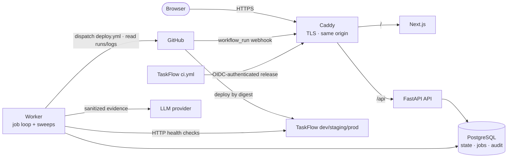
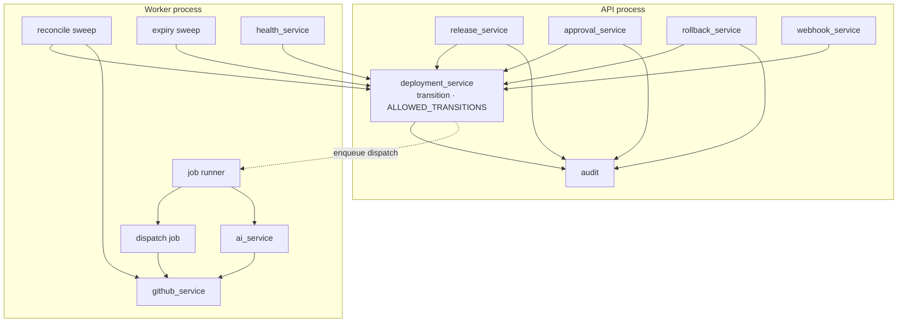
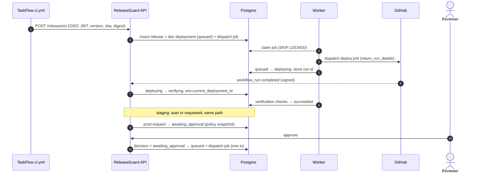
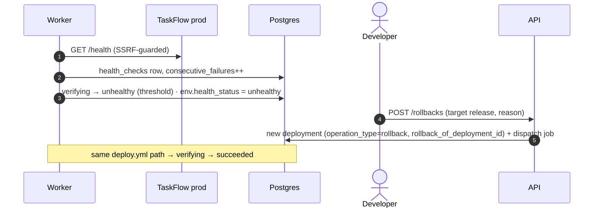

# ReleaseGuard: Architecture Review and Redesign

| Item | Value |
|---|---|
| Date | 2026-11-23 (Sprint 0, before any code) |
| Scope | Spec PDF, [DEVELOPMENT_LIFECYCLE.md](DEVELOPMENT_LIFECYCLE.md), [PROJECT_PLAN.md](PROJECT_PLAN.md), `CLAUDE.md`, `.claude/rules/*` |
| Method | `system-design` framework (requirements → high-level → deep dive → scale → trade-offs), `architecture` skill for option analysis |
| Outcome | The design changes below are **accepted** and already applied to the guide, the plan, the rules and ADRs [0001](adr/0001-modular-monolith.md)–[0007](adr/0007-server-side-sessions-and-csrf.md) |

This report keeps the reasoning. The **source of truth** is still the lifecycle guide; where this report and the guide differ, the guide wins.

---

## 1. Verdict

The core idea holds up: a narrow **release-control layer** on top of GitHub Actions, not another CI engine. The original design had the right instincts (digest identity, a single owner of the state machine, an approval transaction, AI kept read-only). It also had **three correctness gaps** that would have shown up as production bugs, **four redundant mechanisms** that would have cost a solo developer days, and one **sprint-ordering contradiction**.

| Dimension | Before | After | Main change |
|---|:-:|:-:|---|
| Core idea and positioning | 5 | 5 | Unchanged |
| Domain model | 3 | 5 | Approvals and rollbacks live on the deployment; no duplicate status |
| State machine | 3 | 5 | No stuck states; every non-terminal state has an owner and an exit |
| Data model and integrity | 3 | 5 | DB-enforced single active deployment, `workspace_id` everywhere, append-only history |
| Concurrency and consistency | 3 | 5 | Partial unique index replaces a lock-plus-check convention |
| GitHub integration | 3 | 4 | OIDC release registration, one deploy workflow, run ID from the dispatch response |
| Security | 4 | 5 | CSRF and SSRF closed, smaller GitHub App scope |
| Reliability and operability | 3 | 4 | Reconcile and expiry sweeps, retention, one job mechanism |
| AI boundary | 5 | 5 | Unchanged (jobs table wording only) |
| Scope vs 12-week solo schedule | 3 | 4 | Fewer tables, workflows and libraries; worker moved to the sprint that needs it |

Scores: 1 = broken, 3 = workable with known gaps, 5 = sound for v1.

---

## 2. Requirements and constraints

**Functional (from the spec).** Know what runs in each environment; block production until policy is met; keep a durable history; detect unhealthy apps after deploy; roll back to a known-good artifact; explain failures with AI without giving AI any authority.

**Non-functional.**

| Concern | Target | Why |
|---|---|---|
| Correctness | No unauthorized or concurrent production deploy, ever | ReleaseGuard has authority over production |
| Auditability | Every decision and transition kept, never rewritten | This is the product |
| Availability | Single VPS; a ReleaseGuard outage delays deploys but never corrupts state | Small-team tool, portfolio demo |
| Latency | UI < 300 ms p95; status visible within ~5 s of a webhook | Humans watching a deploy |
| Scale | ~5 apps × 3 envs, ~50 deployments/day, health check every 30 s | Small teams |

**Constraints.** One full-stack developer, 12 weeks, Next.js + FastAPI + Postgres + Docker Compose + GitHub Actions (fixed by the spec), no extra infrastructure (no Redis, no broker, no Kubernetes).

**Load estimate.** 15 environments × 2,880 checks/day ≈ 43k `health_checks` rows/day (≈ 16M/year without retention, ≈ 600k with 14-day retention). Deployments: about 20k rows/year. Jobs: a few thousand a day, deleted after 7 days. All of this fits comfortably in one Postgres instance; the only table that needs a retention policy is `health_checks`.

---

## 3. The core idea, judged

**Strong.** Separating *deciding* (ReleaseGuard) from *executing* (GitHub Actions) keeps the blast radius small: the backend never holds deploy credentials for the target and never runs shell commands. Digest identity makes "what is running" a fact rather than a guess. Treating rollback as a new deployment makes the history honest.

**Risk to the idea.** The value is the *auditable lifecycle*. A design where history can be edited, two tables disagree about whether a request is pending, or a deployment can sit in `Deploying` forever undermines exactly that value. Most of the changes below protect the core idea rather than change it.

**What stays out.** Kubernetes, other CI providers, canary/blue-green, automatic rollback and a policy language remain out of v1. The redesign adds no features; it removes parts and closes gaps.

---

## 4. Core features

| Feature | Who uses it | Depends on | Sprint |
|---|---|---|:-:|
| Auth, workspace, roles | Everyone | — | S1 |
| Applications and environments (with policy) | Admin, Developer | Auth | S1 |
| GitHub App connection | Admin | Applications | S2 |
| Release registration (OIDC from CI, manual fallback) | CI, Developer | GitHub connection | S2 |
| Deployment tracking + state machine | Everyone | Releases, worker, webhooks | S2 |
| Auto-deploy to dev/staging by policy | System | Deployments | S2 |
| Production approval gate | Developer, Reviewer | Deployments, promotion rule | S3 |
| Audit log | Everyone (read) | Every state-changing service | S1 → S3 |
| Health verification + scheduled checks | System | Worker, environments | S4 |
| Manual rollback | Admin, Developer | Deployments, health | S4 |
| AI failure analysis, release notes | Everyone (read) | Worker, failed deployments | S5 |
| Dashboard | Everyone | All of the above | S1 shell → S6 |

---

## 5. Architecture and service relationships

### 5.1 Components

The API **never** calls GitHub or the LLM. It writes rows (state + jobs) in one transaction and returns. The worker does all outbound network I/O. That single rule removes the whole class of "network call inside a DB transaction" bugs.

### 5.2 Backend services

| Service | Called by | Calls | Owns (writes) | Transaction boundary |
|---|---|---|---|---|
| `deployment_service` | every service below | `audit`, jobs enqueue | `deployments.status`, `deployment_events`, `environments.current_deployment_id` | Runs **inside** the caller's transaction |
| `release_service` | `POST /releases`, `POST /releases/ci` | `deployment_service` (auto-deploy) | `releases` | One per request |
| `approval_service` | `POST /deployments`, `POST /deployments/{id}/decisions` | `deployment_service` | `approval_decisions` | One per request: decision + transition + dispatch job |
| `rollback_service` | `POST /rollbacks` | `deployment_service` | new rollback `deployments` row | One per request |
| `webhook_service` | `POST /github/webhooks` | `deployment_service` | `webhook_deliveries` | One per delivery |
| `health_service` | worker sweeps | `deployment_service` (verification) | `health_checks`, `environments.health_*` | One per check |
| `github_service` | worker jobs only | GitHub REST | installation-token cache | **No DB transaction open** during HTTP |
| `ai_service` | worker jobs only | LLM provider | `ai_failure_reports` | Writes the result after the call |
| `audit` | every state-changing service | — | `audit_logs` (append-only) | Caller's transaction |

---

## 6. Critical flows and their failure branches

### 6.1 Release → dev → staging → production

| Failure | Handling | Ends in |
|---|---|---|
| OIDC token invalid or wrong repo/workflow | 401/403, nothing written | — |
| Duplicate release (`application_id`, `version`) | 409 (same digest → 200 idempotent) | — |
| Second deployment to an env that is executing | Partial unique index → 409 | — |
| GitHub dispatch 5xx/timeout | Job retried with backoff | `deploying` or, after `max_attempts`, `failed` (`dispatch_failed`) |
| Webhook lost | Reconcile sweep reads the run by id | `verifying` / `failed` |
| No run ever appears | Reconcile after `DISPATCH_TIMEOUT_SECONDS` | `failed` (`run_not_found`) |
| Duplicate webhook delivery | `webhook_deliveries` unique → 200, no-op | unchanged |
| Out-of-order webhook (`in_progress` after `completed`) | Transition not allowed → ignored and logged | unchanged |
| Approval TTL passes | Expiry sweep | `expired` |
| Environment changed since request | Decision refused as stale (409) | stays `awaiting_approval` until expired or cancelled |
| Reviewer = requester, `block_self_approval` on | 403 | unchanged |

### 6.2 Health and rollback

| Failure | Handling |
|---|---|
| One transient check failure | `consecutive_failures` < threshold → nothing changes |
| Target never succeeded in this env, or has no digest | 422, not eligible |
| Another deployment executing | 409 |
| Rollback workflow fails | Rollback deployment → `failed`; the original stays `unhealthy`; both are kept |
| `health_url` resolves to a private address | Check recorded as `blocked`; config refused at save time |

---

## 7. Findings and decisions

Severity: **C** critical (unsafe or corrupting), **H** high (stuck or wrong state), **M** medium (cost or risk), **L** low.

| # | Sev | Finding (where) | Decision | ADR |
|---|:-:|---|---|:-:|
| 1 | C | The advisory xact lock lives only for the creating transaction; "no concurrent deploy" relied on every path re-checking by hand (guide §8.3 r4, `backend.md`) | Partial unique index on `deployments(environment_id)` for `queued`, `deploying`, `verifying`. The database enforces it; violation → 409 | 0003 |
| 2 | H | No exit from `Approved` if dispatch fails for good; `Deploying` waits forever if the webhook is lost; nothing owns `Expired` (§8.1) | `queued → failed`; reconcile sweep; expiry sweep. Every non-terminal state has an owner and a timeout | 0003, 0004 |
| 3 | M | `Pending` is never observable; `Approved` reads oddly for auto-deployed dev/staging | Drop `pending`; rename `approved` → `queued`; drop `deploying → cancelled` and `verifying → failed` | 0003 |
| 4 | H | `approval_requests.status` and `deployments.status` both say "pending approval" and can disagree (§7.1) | Drop `approval_requests`; decisions reference the deployment; `approval_expires_at`, `policy_snapshot`, `base_deployment_id` on the deployment | 0003 |
| 5 | M | `rollback_events` repeats data already on the deployment (§7.1) | `deployments.rollback_of_deployment_id` + `reason` | 0003 |
| 6 | H | No column says what is running; health state has no home (§4.1, §4.7) | `environments.current_deployment_id` (set on entering `verifying`) + `health_status`, `consecutive_failures`, `last_checked_at`, `next_check_at` | 0003 |
| 7 | M | Three deploy workflows do the same thing; the rarely used rollback path is the one most likely to break mid-incident (§10.2) | One `deploy.yml` for every environment and for rollback; GitHub `production` environment protection via `environment: ${{ inputs.environment }}` | 0005 |
| 8 | H | The "signed callback" for release registration names no secret and binds no identity (§10.1) | GitHub Actions OIDC: verify JWT against GitHub JWKS, check `aud`, `repository_id`, `workflow_ref` | 0006 |
| 9 | M | Outbox + job table + APScheduler = three mechanisms; S2 dispatches staging but the worker is planned for S4 | One `jobs` table (outbox + retries + sweeps); no APScheduler; worker skeleton in S2 | 0004 |
| 10 | H | Child tables lack `workspace_id`; one missed join leaks another workspace's data (§7.1) | `workspace_id` on every tenant table, composite FKs to the parent | 0003 |
| 11 | H | No CSRF defense for cookie sessions; `health_url` is an SSRF path into the VPS; audit rows are mutable (§13) | Same origin via Caddy, `SameSite=Lax`, Origin check; SSRF guard; append-only trigger on `audit_logs` and `deployment_events` | 0007 |
| 12 | L | GitHub App asks for Deployments RW and `workflow_job` events it never uses (plan S0) | Actions RW, Contents R, Metadata R; `workflow_run` only; run ID from `return_run_details` | 0005 |
| 13 | M | `health_checks` grows ~16M rows/year; verification rule underspecified (§4.7) | Verification = N consecutive passes within a timeout; 14-day retention for scheduled checks | 0004 |
| 14 | M | Promotion hard-coded to "staging succeeded"; nobody owns the dev auto-deploy (§4.4) | Environment policy: `auto_deploy_on_release`, `promote_from_environment_id`, approval fields, `rollback_requires_approval` | 0003 |
| 15 | L | Guide §14.2 says merge in 1–3 days (rules: 1–2); §14.6 commands lack `uv run`; `CLAUDE.md` listed four TaskFlow workflows | Fixed | — |

---

## 8. Trade-offs accepted

| Decision | We gain | We give up | Revisit when |
|---|---|---|---|
| Partial unique index, not advisory locks | DB-guaranteed invariant, simpler code | A second request can't *queue* behind a running one; it waits in `awaiting_approval` or gets 409 | Teams ask for deploy queues |
| No `deploying → cancelled` | No race with a half-finished GitHub run | Can't abort from ReleaseGuard (cancel in GitHub; the webhook then fails the deployment) | Real users need abort |
| One `deploy.yml` | One tested path, two workflows instead of four | Per-environment workflow differences must be expressed as inputs/env config | Environments genuinely diverge |
| OIDC registration | No shared secret to rotate; repo identity is proven | Needs JWKS fetching and caching; CI must request `id-token: write` | Non-GitHub CI (out of v1) |
| Jobs table, no APScheduler/Redis | One mechanism, transactional enqueue, no extra infra | Polling latency of ~1–2 s; throughput limited to one Postgres | > ~50 jobs/s or a second worker host |
| Approvals on the deployment | One source of truth | Re-requesting approval means a new deployment (already true for Rejected/Expired) | Never in v1 |

---

## 9. What to revisit as the system grows

- **Job latency:** add `LISTEN/NOTIFY` to wake the worker immediately; move to ARQ/Redis only if job volume really demands it.
- **Health data:** partition `health_checks` by month, or downsample to hourly aggregates.
- **Multi-workspace:** the `workspace_id` columns already exist; add Postgres row-level security as a second layer.
- **Automatic rollback:** start with a *recommendation* job (guide §11.3); never auto-dispatch in v1.
- **Two-person approval:** `min_approvals` already exists in the policy snapshot; it only needs UI.
- **Deploy queues:** replace the 409 with a `queued_behind` relation if teams ask for it.

---

## 10. What changed

| File | Change |
|---|---|
| `docs/DEVELOPMENT_LIFECYCLE.md` | §2, §4.4–4.8, §5 (services), §6.2, §7, §8, §9, §10, §11, §13, §14.2, §14.6, §14.9, §16, §18 rewritten to the new design |
| `docs/PROJECT_PLAN.md` | S0 App scope and ADR list; S1–S6 checklists rebalanced; Gantt; risks; cut list |
| `docs/adr/0001`–`0007` | New |
| `CLAUDE.md`, `README.md` | Architecture and "How it works" |
| `.claude/rules/*` | backend, database, github-actions, security, testing, infra, frontend, ai |
| `.claude/agents/release-safety-reviewer.md` | Invariants follow the new model |

**Sources checked (23 Nov 2026):** [Workflow dispatch API now returns run IDs](https://github.blog/changelog/2026-02-19-workflow-dispatch-api-now-returns-run-ids) · [OIDC token claims](https://docs.github.com/en/actions/reference/security/oidc).
