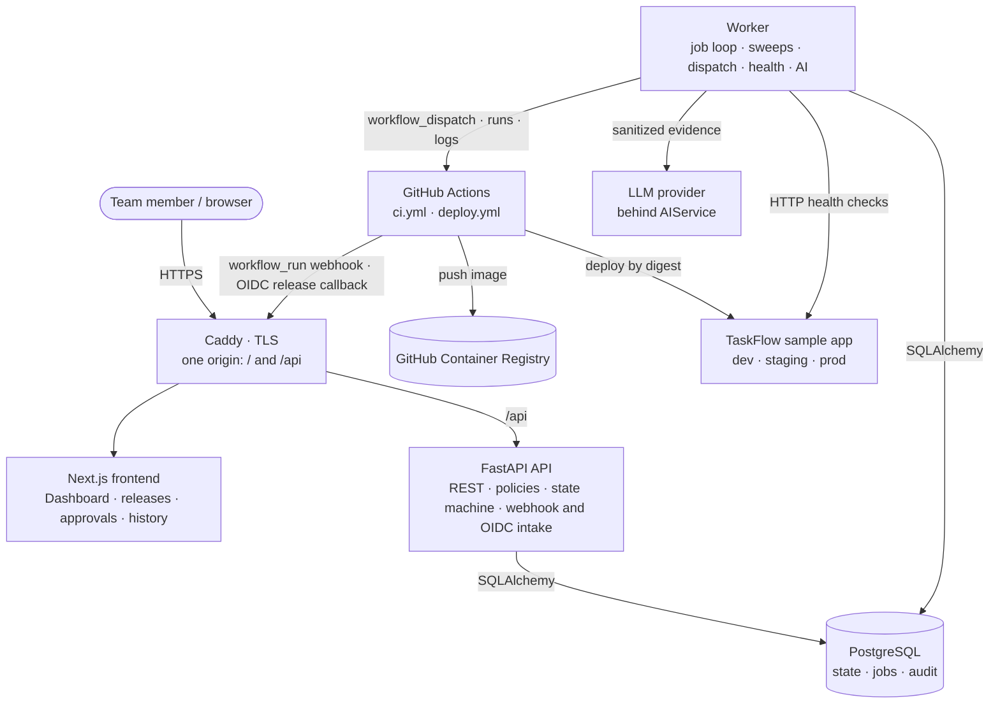
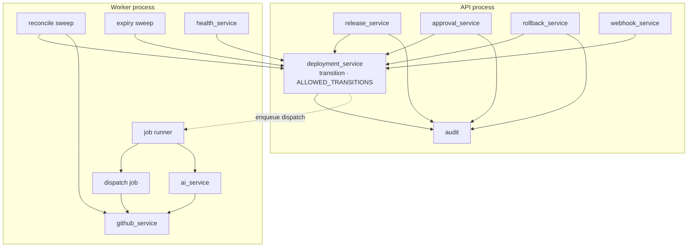
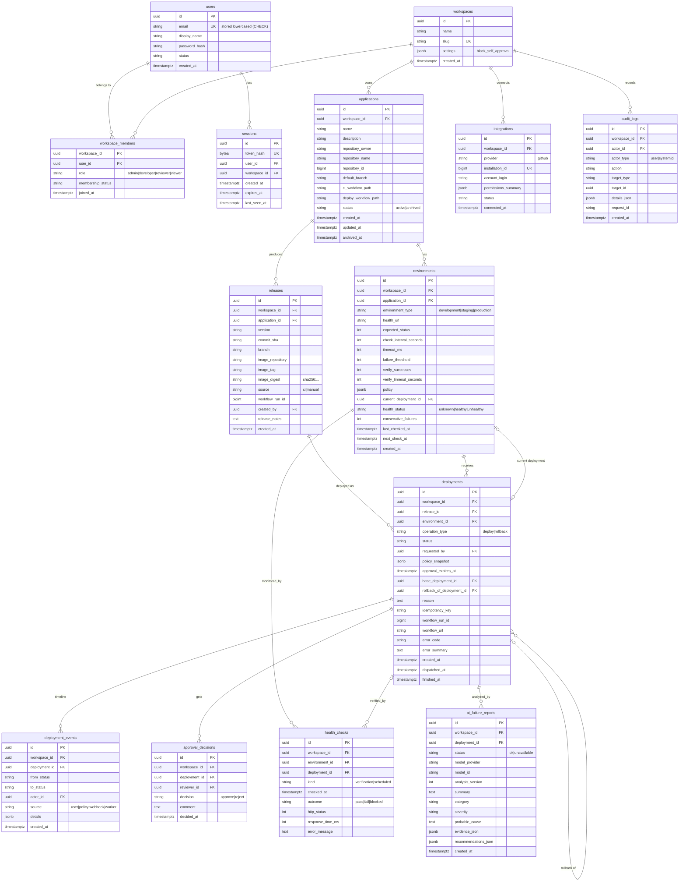
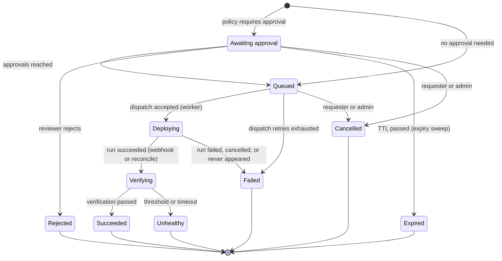
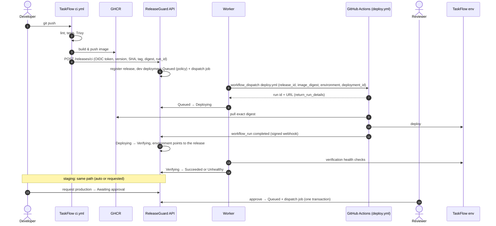
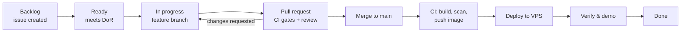
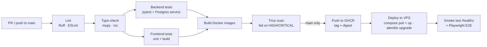
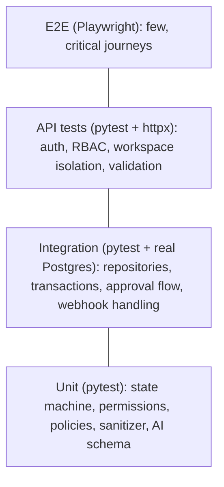

# ReleaseGuard: Development Lifecycle Guide

> **Deployment Approval & Rollback Manager**
> Next.js · FastAPI · PostgreSQL · Docker · GitHub Actions · AI-assisted failure analysis

| Item | Value |
|---|---|
| Source specification | [ReleaseGuard_Project_Specification.pdf](../ReleaseGuard_Project_Specification.pdf) (v1.0, 22 Nov 2026) |
| Execution plan | [PROJECT_PLAN.md](PROJECT_PLAN.md) |
| Audience | Anyone building, reviewing or demoing ReleaseGuard |
| Status | Living document. Update it whenever architecture, process or scope changes |

This guide brings together everything the team needs to understand **what** ReleaseGuard is, **how** it is built, and **how we work** while building it. Sections 1–13 and 15–19 summarize and expand on the specification. Section 14 sets out the engineering process that the spec does not cover. Where this guide recommends something that is not in the spec, the text marks it as *(recommendation)*.

> **Design revision, 23 Nov 2026.** The architecture was reviewed before any code was written ([ARCHITECTURE_REVIEW.md](ARCHITECTURE_REVIEW.md)) and the decisions are recorded in [ADRs 0001–0007](adr/). This guide reflects the revised design. In short: a DB-enforced single active deployment per environment, a state machine without stuck states, approvals and rollbacks stored on the deployment, one Postgres jobs table for all async work, one `deploy.yml` workflow, release registration through GitHub OIDC, and CSRF/SSRF defenses.

---

## Table of contents

1. [Project overview](#1-project-overview)
2. [Core domain concepts](#2-core-domain-concepts)
3. [Users, roles and permissions](#3-users-roles-and-permissions)
4. [Feature catalogue](#4-feature-catalogue)
5. [System architecture](#5-system-architecture)
6. [Technology stack](#6-technology-stack)
7. [Data model](#7-data-model)
8. [Deployment state machine](#8-deployment-state-machine)
9. [REST API surface](#9-rest-api-surface)
10. [GitHub Actions integration](#10-github-actions-integration)
11. [Rollback design](#11-rollback-design)
12. [AI deployment assistant](#12-ai-deployment-assistant)
13. [Security, reliability and auditability](#13-security-reliability-and-auditability)
14. [Development lifecycle process](#14-development-lifecycle-process)
15. [Frontend screens and UI principles](#15-frontend-screens-and-ui-principles)
16. [Roadmap summary](#16-roadmap-summary)
17. [MVP acceptance criteria and demo script](#17-mvp-acceptance-criteria-and-demo-script)
18. [Risks and mitigations](#18-risks-and-mitigations)
19. [References](#19-references)

---

## 1. Project overview

### 1.1 The problem
Small teams often track what is running in production through a mix of separate tools, chat messages and manual notes. They know a pipeline passed. They often **don't** know:

- which exact image is deployed in each environment,
- who approved it,
- whether the application is actually healthy, and
- how to get back to the last known-good release.

### 1.2 What ReleaseGuard is
ReleaseGuard is a **release-control and visibility layer** for small teams. It brings releases, environment versions, production approvals, deployment history, health checks and controlled rollback together in one auditable interface.

> **Positioning: ReleaseGuard is *not* a CI/CD engine.**
> GitHub Actions still builds, tests and deploys. ReleaseGuard **decides** whether a release may proceed, **records** every decision, **triggers** approved workflows, **monitors** the outcome and **coordinates** rollback. The backend never runs deployment shell commands on a user's behalf.

### 1.3 Primary objectives
1. Know exactly which release is running in each environment.
2. Block production deployment until the approval policy is satisfied.
3. Keep a searchable, durable history of deployments and approvals.
4. Detect application health problems after deployment, not only CI/CD job failures.
5. Restore a known-good release through a controlled rollback workflow.
6. Use AI to explain failures **without** giving AI any operational authority.

**Success means** a reviewer can open the platform, find the production version, see how it was approved, inspect the deployment result, and understand how to recover if it becomes unhealthy.

### 1.4 Reference scenario: TaskFlow
The demo uses a small sample application, **TaskFlow**, that publishes Docker images and is promoted through three environments:

| Environment | Running version | Policy |
|---|---|---|
| Development | v1.8.4 | Automatic deployment after successful CI |
| Staging | v1.8.4 | Automatic or manually requested |
| Production | v1.8.2 | Protected; approval required |

**Happy path:**
1. A developer pushes a change to TaskFlow.
2. GitHub Actions runs lint, tests and security checks, then builds and publishes a Docker image.
3. `ci.yml` registers the release with ReleaseGuard (authenticated by a GitHub OIDC token): version, commit SHA, image tag and **immutable digest**. Development deploys automatically.
4. ReleaseGuard dispatches `deploy.yml` to staging (automatically or on request) and tracks the run.
5. A developer requests production deployment. ReleaseGuard checks the policy (staging succeeded) and the deployment waits in *Awaiting approval*.
6. An authorized reviewer approves or rejects it. The decision and comment are recorded.
7. After approval, the deployment is *Queued* and the worker dispatches `deploy.yml` for production.
8. The workflow deploys the approved image. Once it finishes, the environment points to the new version and ReleaseGuard verifies it with HTTP health checks.
9. If verification passes, the deployment is **Succeeded**. If it fails, the deployment is marked **Unhealthy** and a manual rollback can start.

---

## 2. Core domain concepts

> **Release ≠ Deployment.**
> A **release** is an immutable version of the application. A **deployment** is one *attempt* to install a release into one environment. Deploying v1.8.5 to staging on Monday and to production on Tuesday creates **two deployment records** that point to **one release**.

### Glossary

| Term | Meaning |
|---|---|
| **Release** | An immutable version of an application, identified by its source revision and build artifact. |
| **Deployment** | An attempt to install a release into a specific environment. |
| **Environment** | A named deployment target: development, staging or production. |
| **Artifact** | The packaged output of a build, here a Docker image. |
| **Image digest** | A content-addressed identifier (`sha256:…`) for one specific container image. This is the authoritative artifact identity. |
| **Workflow dispatch** | A GitHub API event that starts a workflow manually with defined inputs. |
| **Webhook** | An HTTP event that GitHub sends to notify ReleaseGuard about activity. |
| **Health check** | An HTTP request that checks whether the deployed app responds as expected. |
| **Verification** | The health checks run right after a deploy; they decide Succeeded or Unhealthy. |
| **Environment policy** | Per-environment rules: auto-deploy, approval, promotion source, rollback approval. |
| **Active deployment** | A deployment in Queued, Deploying or Verifying. At most **one** per environment. |
| **Job** | A row in the `jobs` table that the worker runs (dispatch, health check, AI, sweeps). |
| **Rollback** | A **new** deployment that restores a previously published artifact. |
| **RBAC** | Role-based access control: permissions are assigned by workspace role. |
| **Audit log** | A durable record of significant user and system actions. |
| **Workspace** | The tenancy boundary. All data is scoped to a workspace. |

---

## 3. Users, roles and permissions

Version 1 has **one workspace with multiple members**. The workspace boundary makes authorization explicit and leaves a clean path to multi-team support later.

### 3.1 Permission matrix

| Capability | Admin | Developer | Reviewer | Viewer |
|---|:-:|:-:|:-:|:-:|
| View dashboard, environments, releases, deployments, audit log | ✅ | ✅ | ✅ | ✅ |
| Manage workspace, members and roles | ✅ | | | |
| Connect and disconnect the GitHub integration | ✅ | | | |
| Create, edit and archive applications | ✅ | ✅ (permitted apps) | | |
| Configure environments, health checks and approval policy | ✅ | | | |
| Register releases (manually or via CI callback) | ✅ | ✅ | | |
| Request staging or production deployment | ✅ | ✅ | | |
| Approve or reject production requests | ✅ | | ✅ | |
| Initiate rollback | ✅ | ✅ (if permitted) | | |
| Request AI analysis | ✅ | ✅ | ✅ | ✅ (read-only data they can already see) |

### 3.2 Authorization rules
- **Enforce permissions in the backend** (FastAPI dependencies and the service layer). Hiding a button in the frontend is **not** authorization.
- Every query is **scoped to the current workspace**. The API must never return another workspace's data.
- A reviewer must hold the Reviewer or Admin role in the target workspace.
- **Self-approval** of production deployments can be blocked by a workspace policy setting.
- Every important action is recorded with **actor, timestamp, target object, action and result**.

---

## 4. Feature catalogue

Each module is listed with its MVP status and the sprint that delivers it (see [PROJECT_PLAN.md](PROJECT_PLAN.md)).

| # | Module | MVP? | Sprint |
|---|---|:-:|:-:|
| 4.1 | Dashboard and overview | ✅ | S1 shell → S6 metrics |
| 4.2 | Application management | ✅ | S1 |
| 4.3 | Release and version management | ✅ | S2 |
| 4.4 | Environment management | ✅ | S1 (CRUD), S4 (health config) |
| 4.5 | Production approval system | ✅ | S3 |
| 4.6 | Deployment history and details | ✅ | S2 |
| 4.7 | Health monitoring | ✅ | S4 |
| 4.8 | Controlled rollback (manual) | ✅ | S4 |
| 4.9 | AI deployment assistant | ✅ (basic) | S5 |

### 4.1 Dashboard and overview
Answers three questions: *What is deployed? What needs attention? What happened recently?*
- Summary cards: registered applications, successful deployments, failed deployments, pending approvals, unhealthy environments.
- Environment overview: application × environment, with current version and health status.
- Timeline of recent deployment activity (status, version, initiator, environment).
- Pending approvals panel with a direct link to each request.
- Failed deployments panel linking to logs, the workflow run and the AI analysis.
- Deployment success rate over a selectable date range, labeled as an operational metric.

### 4.2 Application management
- Create, edit, archive and view applications. **GitHub repositories only in v1.**
- Stored fields: name, description, repository owner and name, repository URL, default branch, workflow names.
- Repository connection through a **GitHub App installation**.
- Each app gets development, staging and production environments.
- Health-check URL and expected-response policy per environment.

> Keep the integration narrow: no GitLab, Bitbucket or other CI providers in v1. One complete GitHub integration is worth more than several partial ones.

### 4.3 Release and version management
A release records exactly what was built and what should be deployed:
- version (SemVer or Git tag), commit SHA, branch
- Docker image repository, tag and **digest**
- source (`ci` through GitHub OIDC, or `manual`), build timestamp and the actor who started it
- GitHub workflow run ID and URL, plus commit and PR links where available
- release notes or a generated commit summary
- links to every deployment of this release

**The image digest is the authoritative artifact ID** ([ADR-0002](adr/0002-deploy-by-image-digest.md)). Tags are labels and can change. Every deployment is by digest.

**Registration** comes from TaskFlow's `ci.yml` with a GitHub Actions **OIDC** token ([ADR-0006](adr/0006-release-registration-via-oidc.md)). The backend verifies the token and binds it to the application's repository and CI workflow. Manual registration is an Admin/Developer fallback.

### 4.4 Environment management
| Environment | Default policy | Purpose |
|---|---|---|
| Development | `auto_deploy_on_release` | Early integration and developer feedback |
| Staging | Auto or on request; `promote_from` = development | Validate the release in a production-like environment |
| Production | `requires_approval`; `promote_from` = staging | Protected environment used by real users |

Capabilities: show the **current release** (`environments.current_deployment_id`) and the environment's **health**, compare versions across environments (to make promotion gaps visible), show per-environment history, configure health-check URL, interval, timeout, failure threshold and verification rule, and edit the environment policy:

| Policy field | Meaning |
|---|---|
| `auto_deploy_on_release` | Create and dispatch a deployment as soon as a release is registered |
| `requires_approval`, `min_approvals` | Reviewer gate and how many approvals are needed (default 1) |
| `approval_ttl_hours`, `require_comment` | Request expiry and whether decisions need a comment |
| `promote_from_environment_id` | The release must have a **Succeeded** deployment there first |
| `rollback_requires_approval` | Whether rollbacks go through the gate too (default off: incidents need speed) |

**At most one deployment per environment can be executing** (Queued, Deploying or Verifying). The database enforces it ([ADR-0003](adr/0003-deployment-aggregate.md)).

### 4.5 Production approval system *(core differentiator)*
- Request a deployment of a specific release to an environment whose policy requires approval.
- Check preconditions: the release has a digest, it has a **Succeeded** deployment in the `promote_from` environment, and the requester has the role.
- Freeze the policy on the deployment (`policy_snapshot`), so later policy edits don't change open requests.
- Show pending requests with requester, release, commit, digest, promotion evidence, environment and request time.
- Reviewers approve or reject, with an optional or required comment. Record identity, decision, comment and timestamp.
- Block unauthorized approval, a second decision by the same reviewer, and **stale or expired** requests. *Stale* means the environment's current deployment changed after the request was made.
- Optional: block self-approval (workspace setting) and require `min_approvals` reviewers.

**Flow:** request v1.8.5 → preconditions → *Awaiting approval* → the reviewer decides → **approved:** record the decision, move to *Queued* and enqueue the dispatch job **in one transaction**; the worker dispatches · **rejected:** no dispatch, the decision stays in the history.

### 4.6 Deployment history and details
Every attempt gets a durable record, whether it succeeds, fails or is cancelled, and even when a rollback follows.
- Search and filter by application, environment, version, status, actor and date range.
- Show duration, initiator, approver, commit, image digest and workflow run.
- Chronological timeline of state-change events.
- Links to GitHub Actions run logs and commits.
- A normalized error summary and selected log excerpts (sanitized).
- **Rollbacks are separate records. Never rewrite the original failure.**

### 4.7 Health monitoring
A green CI job does not prove the application is healthy. ReleaseGuard runs a **small, predictable set of HTTP checks** after each deployment and on a schedule.
- Per-environment endpoint (for example `/health`), expected status code, timeout, interval and consecutive-failure threshold.
- **Verification** (right after a deploy): `verify_successes` consecutive passes (default 3) within `verify_timeout_seconds` (default 300) → **Succeeded**; `failure_threshold` consecutive failures, or the timeout → **Unhealthy**.
- **Scheduled checks** (always): update `environments.health_status`. The environment turns **unhealthy** only after `failure_threshold` consecutive failures, so one transient failure changes nothing.
- Each check records timestamp, kind (`verification` or `scheduled`), outcome, HTTP code and response time, and links to the environment's current deployment.
- **SSRF guard:** only `http`/`https`, no redirects, and the resolved address must not be private, loopback or link-local (unless `HEALTH_CHECK_ALLOW_PRIVATE=true` in local dev). The URL is checked when saved and again before each request.
- **Retention:** scheduled checks are kept for 14 days; verification checks are kept forever.
- The UI shows current status and recent check history.

> v1 uses HTTP endpoint checks only. No tracing, log aggregation or metrics storage. Prometheus and Grafana are optional extensions.

### 4.8 Controlled rollback
Rollback **restores a known-good artifact**. It is a new deployment (`operation_type = rollback`) linked to the deployment it replaces, and it runs through the **same `deploy.yml` path** as every other deployment. The failed deployment is never deleted or changed. v1 supports **manual rollback only**. See [section 11](#11-rollback-design).

### 4.9 AI deployment assistant
AI reduces the time needed to understand a failure. It is **not** a general chatbot and **not** an operator.

| Capability | Input | Output |
|---|---|---|
| Failure explanation | Failed job or stage, sanitized logs, exit code, deployment metadata | Summary, probable cause, evidence, suggestions |
| Deployment summary | Events, statuses, durations, health results | A readable account of what happened |
| Release notes | Commit messages, PR descriptions | A readable change summary |
| Historical failure analysis | Failure records the user is authorized to see | Similar past failures and recurring patterns |

Example questions: *"What caused the last production deployment failure?"*, *"Have we seen this error before?"*, *"Which deployments failed in the last seven days?"*, *"What changed between v1.8.2 and v1.8.5?"* See [section 12](#12-ai-deployment-assistant).

---

## 5. System architecture

### 5.1 Style: modular monolith
The system has one Next.js app, one FastAPI backend, one PostgreSQL database and one small background worker ([ADR-0001](adr/0001-modular-monolith.md)).
- Business rules live in one backend codebase and can be tested together.
- The data is relational and transactional, which suits approvals and state changes.
- **The API never makes outbound network calls.** It writes state and jobs in one transaction and returns. The worker does all GitHub, health-check and AI I/O. No transaction is ever held open across a network call.
- The system can be split later if a real scaling or ownership need appears.

### 5.2 Component diagram



### 5.3 Component responsibilities

| Component | Responsibility |
|---|---|
| **Caddy** | TLS, and one origin for the browser: `/` → frontend, `/api` → backend (no CORS in production). |
| **Next.js frontend** | Dashboard, application configuration, release views, approvals, deployment details and rollback flows. |
| **FastAPI API** | REST API, validation, sessions, authorization, policies, state transitions, webhook and OIDC intake. Writes jobs; never calls out. |
| **PostgreSQL** | Source of truth: users, workspaces, applications, environments, releases, deployments, decisions, health checks, **jobs** and the append-only audit trail. |
| **SQLAlchemy + Alembic** | ORM mapping, queries and versioned schema migrations. |
| **Worker** | Claims jobs (`FOR UPDATE SKIP LOCKED`): workflow dispatch, verification and scheduled health checks, AI analysis; runs the periodic sweeps (approval expiry, run reconciliation, retention). |
| **GitHub Actions** | `ci.yml`: build, test, scan, publish, register the release. `deploy.yml`: deploy one digest to one environment. |
| **Container registry (GHCR)** | Versioned Docker artifacts. Deploy by digest. |
| **AI provider** | Structured failure explanations and release summaries, reached only through the isolated `AIService`. |

### 5.4 Backend services and how they relate



| Service | Called by | Calls | Owns (writes) | Transaction |
|---|---|---|---|---|
| `deployment_service` | all services below | `audit`, job enqueue | `deployments.status`, `deployment_events`, `environments.current_deployment_id` | Inside the caller's transaction |
| `release_service` | `POST /releases`, `POST /releases/ci` | `deployment_service` (auto-deploy) | `releases` | One per request |
| `approval_service` | `POST /deployments`, `POST /deployments/{id}/decisions` | `deployment_service` | `approval_decisions` | Decision + transition + dispatch job together |
| `rollback_service` | `POST /rollbacks` | `deployment_service` | the new rollback deployment | One per request |
| `webhook_service` | `POST /github/webhooks` | `deployment_service` | `webhook_deliveries` | One per delivery |
| `health_service` | worker | `deployment_service` (verification outcome) | `health_checks`, `environments.health_*` | One per check, after the HTTP call |
| `github_service` | worker jobs only | GitHub REST | installation-token cache | **No transaction open** during HTTP |
| `ai_service` | worker jobs only | LLM provider, `github_service` (logs) | `ai_failure_reports` | Writes after the call |
| `audit` | every state-changing service | none | `audit_logs` (append-only) | Caller's transaction |

### 5.5 Layering rules (backend)
```text
HTTP route  →  service  →  repository / query function  →  database
  (thin)      (business      (data access only)
              rules, state
              transitions,
              permissions)
```
- **Routes are thin:** parse and validate input with Pydantic, call a service, return a response schema.
- **Services own the rules:** permission checks, state transitions, transactions and integration calls.
- **Repositories own data access:** no business logic.
- Only `deployment_service` changes deployment status (see [section 8](#8-deployment-state-machine)).
- Routes and services in the API process never call GitHub, the LLM or health URLs. They enqueue a job.

### 5.6 Repository layout

```text
releaseguard/
├── frontend/                 # Next.js (App Router, TypeScript)
│   ├── app/
│   │   ├── login/
│   │   ├── dashboard/
│   │   ├── applications/[appId]/
│   │   ├── deployments/[deploymentId]/
│   │   ├── approvals/
│   │   ├── environments/
│   │   └── settings/
│   ├── components/           # dashboard/, deployments/, approvals/, applications/, ui/
│   ├── hooks/
│   ├── services/             # API client calls
│   ├── types/                # shared domain types
│   └── lib/
├── backend/                  # FastAPI
│   ├── app/
│   │   ├── main.py
│   │   ├── core/             # config.py, security.py, permissions.py
│   │   ├── api/v1/           # applications, environments, releases, deployments,
│   │   │                     # approvals, rollbacks, health, github (routers)
│   │   ├── models/           # SQLAlchemy models
│   │   ├── schemas/          # Pydantic request/response models (incl. job payloads, policy)
│   │   ├── services/         # deployment, release, approval, rollback, webhook,
│   │   │                     # health, github, ai, audit
│   │   ├── repositories/
│   │   └── worker/           # job runner, job handlers, sweeps
│   ├── migrations/           # Alembic
│   ├── tests/
│   ├── Dockerfile
│   ├── pyproject.toml        # dependencies (uv)
│   └── uv.lock
├── worker/                   # worker entrypoint / Dockerfile (shares backend code)
├── infra/
│   ├── docker-compose.yml
│   ├── reverse-proxy/
│   └── scripts/              # backup, restore, deploy
├── .github/workflows/        # CI/CD for ReleaseGuard itself
├── docs/                     # this guide, project plan, ADRs, diagrams
└── README.md
```

The TaskFlow sample app lives in a **separate repository**, [hamdounisabri1/taskflow](https://github.com/hamdounisabri1/taskflow), with two workflows, `ci.yml` and `deploy.yml` (see [section 10](#10-github-actions-integration)).

---

## 6. Technology stack

### 6.1 Core stack (from the specification)

| Layer | Technology | Why it fits | Docs |
|---|---|---|---|
| Frontend | **Next.js + TypeScript** (App Router) | Component UI, file-system routing, strong typing | [nextjs.org/docs/app](https://nextjs.org/docs/app) |
| UI system | **Tailwind CSS + shadcn/ui** | Consistent dashboard components, quick to assemble | [ui.shadcn.com](https://ui.shadcn.com) |
| Backend | **Python + FastAPI** | Typed request and response APIs, OpenAPI docs, modular routers | [fastapi.tiangolo.com](https://fastapi.tiangolo.com/tutorial/bigger-applications/) |
| Validation | **Pydantic** | Validates API payloads **and** structured AI responses | [docs.pydantic.dev](https://docs.pydantic.dev/latest/) |
| ORM | **SQLAlchemy 2.0** | Relational persistence, explicit database access | [docs.sqlalchemy.org](https://docs.sqlalchemy.org/en/20/) |
| Migrations | **Alembic** | Versioned schema changes | [alembic.sqlalchemy.org](https://alembic.sqlalchemy.org/en/latest/) |
| Database | **PostgreSQL** | Transactions, constraints, partial unique indexes, `SKIP LOCKED` | [postgresql.org/docs](https://www.postgresql.org/docs/) |
| CI/CD | **GitHub Actions** | Repo-native workflows, dispatch API, workflow events | [docs.github.com/actions](https://docs.github.com/en/actions) |
| Containers | **Docker + Docker Compose** | Repeatable local and server deployment | [docs.docker.com](https://docs.docker.com/) |
| Registry | **GitHub Container Registry** | Versioned images, digest references | [docs.github.com/packages](https://docs.github.com/en/packages) |
| AI | **LLM API behind `AIService`** | Provider abstraction, structured failure analysis | n/a |
| Testing | **Pytest + Playwright** | Backend unit and integration tests; browser E2E tests | [pytest](https://docs.pytest.org/) · [playwright](https://playwright.dev/docs/intro) |
| Quality | **Ruff + ESLint** | Python and TypeScript linting | n/a |
| Security scanning | **Trivy** | Container and dependency vulnerability scanning | [trivy.dev](https://trivy.dev/latest/) |
| Optional monitoring | Prometheus + Grafana | Operational metrics for ReleaseGuard itself | n/a |

### 6.2 Supporting libraries *(recommendation)*

| Concern | Choice | Notes |
|---|---|---|
| HTTP client (GitHub API, health checks) | `httpx` | Async, timeouts, no redirects for health checks |
| Retries and backoff | `tenacity` (in-process calls) + `jobs.run_after` backoff (across attempts) | Bounded retries with exponential backoff |
| GitHub App auth | `PyJWT` + `cryptography` | Sign the App JWT, exchange it for short-lived installation tokens |
| CI release auth | `PyJWT` `PyJWKClient` | Verify GitHub Actions OIDC tokens against GitHub's JWKS ([ADR-0006](adr/0006-release-registration-via-oidc.md)) |
| Password hashing | `argon2-cffi` (or `pwdlib`) | argon2id; never store plaintext |
| Sessions | Server-side sessions in Postgres + `HttpOnly`/`Secure`/`SameSite=Lax` cookie + Origin check | Same origin through Caddy ([ADR-0007](adr/0007-server-side-sessions-and-csrf.md)) |
| Worker | Plain async loop over a Postgres `jobs` table (`SELECT … FOR UPDATE SKIP LOCKED`) + interval sweeps | One mechanism for outbox, retries and schedules; no APScheduler or Redis ([ADR-0004](adr/0004-postgres-jobs-table.md)) |
| Config | `pydantic-settings` | Typed settings from environment variables |
| Type checking | `mypy` (backend), `tsc --noEmit` (frontend) | Run as CI gates |
| Frontend data fetching | TanStack Query | Caching, polling for in-progress deployments |
| Forms | React Hook Form + Zod | Typed client-side validation (the backend still validates) |
| API types | `openapi-typescript` | Generate frontend types from FastAPI's OpenAPI schema |
| Logging | `structlog` (JSON) | Correlation IDs per request, deployment and workflow run |

### 6.3 Deliberately excluded from v1
- **Kubernetes.** Docker Compose is enough. The product problem is release control, not cluster management.
- Multiple CI/CD providers and cloud platforms.
- Canary, blue-green and progressive delivery.
- Automatic remediation and autonomous rollback.
- Complex multi-tenancy and a policy language.
- Distributed tracing and a centralized logging platform.

---

## 7. Data model

PostgreSQL is the **source of truth**. Releases, deployment attempts, approval decisions, health observations and audit entries are **separate records**. The deployment is the aggregate: its approval state, rollback link and policy snapshot live on it, so nothing has to be kept in sync ([ADR-0003](adr/0003-deployment-aggregate.md)).

### 7.1 Entity-relationship diagram



Two infrastructure tables sit outside the diagram:

| Table | Columns | Notes |
|---|---|---|
| `webhook_deliveries` | `delivery_id` PK, `event`, `received_at`, `processed_at`, `outcome` | Idempotent webhook intake |
| `jobs` | `id`, `workspace_id` (nullable for global sweeps), `kind`, `payload` jsonb, `status` (`pending/running/done/dead`), `run_after`, `attempts`, `max_attempts`, `locked_until`, `last_error`, `dedupe_key` UK, `created_at`, `updated_at` | Outbox, retry queue and scheduler in one ([ADR-0004](adr/0004-postgres-jobs-table.md)) |

### 7.2 Key relationships
- One workspace owns many applications and has many members. **Every tenant table carries `workspace_id`**, and child tables reference their parent with a composite FK (for example `(application_id, workspace_id)` → `applications (id, workspace_id)`), so no row can point across workspaces.
- One application has three environments (unique `(application_id, environment_type)`) and produces many releases.
- One release can be deployed many times, to different environments.
- Each deployment references **exactly one** release and **one** environment. A rollback deployment also references the deployment it replaces (`rollback_of_deployment_id`).
- A deployment that needs approval has zero or more `approval_decisions`, at most one per reviewer.
- `environments.current_deployment_id` is the deployment whose artifact is live: it is set when a deployment **enters Verifying**. (It and `deployments.environment_id` form a cycle; create the FK after both tables, nullable.)
- A health check belongs to an environment and, when one exists, to the environment's current deployment at check time.
- Audit logs identify the workspace, the actor (user, system or CI) and enough context to explain the action later.

### 7.3 Integrity, indexing and conventions
- Foreign keys on every relationship; never cascade-delete deployment, decision, event or audit history.
- **CHECK constraints** on every status, decision, role, kind and `operation_type` value (mirrored in Python enums), and on `image_digest ~ '^sha256:[0-9a-f]{64}$'`.
- **Unique constraints:** `workspaces.slug`, `(workspace_id, repository_id)` on active applications (partial index; archiving frees the repository), `(application_id, environment_type)` on environments, `(application_id, version)` on releases, `(deployment_id, reviewer_id)` on decisions, `webhook_deliveries.delivery_id`, `jobs.dedupe_key`, `(workspace_id, idempotency_key)` on deployments (where not null).
- **Single active deployment per environment:** `CREATE UNIQUE INDEX deployments_one_active_per_env ON deployments (environment_id) WHERE status IN ('queued','deploying','verifying')`. A unique violation maps to **409**.
- **Indexes:** `deployments (environment_id, created_at DESC)`, `deployments (workspace_id, status, created_at DESC)` (also serves the approvals inbox), `deployments (release_id)`, `health_checks (environment_id, checked_at DESC)`, `jobs (run_after) WHERE status = 'pending'`, `environments (next_check_at)`, `audit_logs (workspace_id, target_type, target_id, created_at DESC)`.
- **Append-only history:** a trigger rejects `UPDATE` and `DELETE` on `audit_logs` and `deployment_events`.
- **Transactions** wrap "decision + transition + dispatch job" and every other state change with the jobs it implies.
- **All timestamps are stored in UTC** (`timestamptz`) and rendered in the user's local timezone.
- **Idempotency:** webhook deliveries by `delivery_id`; deployment requests by `Idempotency-Key`; jobs by `dedupe_key`; CI release registration by `(application_id, version)` (same digest → 200, different digest → 409).
- **Retention:** scheduled `health_checks` older than 14 days and `done` jobs older than 7 days are deleted by the worker. Nothing else is deleted.

> **Auditability principle:** never update a failed deployment to "successful" when a rollback happens. Keep the failure as history, create a **new** rollback deployment, and link the two. Records describe what actually happened.

---

## 8. Deployment state machine

Deployment status is a **state machine**, not a free-text field that any endpoint can overwrite. A **single backend service** (`deployment_service`) validates every transition. Every non-terminal state has an owner that moves it on, and a timeout, so nothing gets stuck ([ADR-0003](adr/0003-deployment-aggregate.md)).

### 8.1 State diagram



### 8.2 States

| State | Meaning | Owner that moves it on | Typical next state |
|---|---|---|---|
| **Awaiting approval** | The policy requires reviewers | Reviewers; expiry sweep | Queued, Rejected, Expired, Cancelled |
| **Queued** | Authorized (by reviewers or by policy); dispatch job pending | Dispatch job | Deploying, Failed, Cancelled |
| **Deploying** | Dispatched; the GitHub run is in progress | `workflow_run` webhook; reconcile sweep | Verifying, Failed |
| **Verifying** | The run succeeded; the artifact is live and being checked | Verification job | Succeeded, Unhealthy |
| **Succeeded** | Deployment and verification passed | — | *Terminal* |
| **Rejected** | A reviewer rejected it | — | *Terminal*; a new request can be made |
| **Failed** | Dispatch, the run, or run discovery failed (`error_code`: `dispatch_failed`, `run_failed`, `run_cancelled`, `run_not_found`) | — | *Terminal*; retry as a **new** deployment |
| **Unhealthy** | Live, but verification failed | — | *Terminal*; a rollback can be created |
| **Cancelled / Expired** | Withdrawn before dispatch, or the approval TTL passed | — | *Terminal* |

Queued, Deploying and Verifying are **active**: at most one per environment.

### 8.3 Transition rules
1. A deployment is created in **Awaiting approval** or **Queued**, decided by the environment policy in the creating transaction. There is no observable "pending" state.
2. A deployment whose policy requires approval **cannot** reach Queued until `min_approvals` approve decisions are recorded by authorized reviewers on the **current, unexpired, non-stale** request.
3. The service **rejects invalid transitions** (409), even when a client calls the API directly. Terminal states never change.
4. **No concurrent deployments to one environment:** the partial unique index on active statuses makes the database refuse a second one (409). Several requests can wait in Awaiting approval; whichever is approved first executes, and approving another while one is active returns 409.
5. GitHub webhook deliveries are processed **idempotently**, and an event that implies a backwards or invalid move (for example `in_progress` after `completed`) is ignored and logged.
6. Cancelling is possible only before dispatch (Awaiting approval, Queued). To stop a running deploy, cancel the run in GitHub; the webhook then moves the deployment to Failed (`run_cancelled`).
7. A retry creates a **new** deployment. It never erases the failed attempt.
8. Entering **Verifying** sets `environments.current_deployment_id`, because the new artifact is live from that moment.

Implement transitions as one table, `ALLOWED_TRANSITIONS: dict[Status, frozenset[Status]]`, plus one function, `transition(deployment, to_status, actor, source, details)`. It checks the table, sets timestamps, writes a `deployment_events` row and an audit entry, enqueues the follow-up job (dispatch for Queued, verification for Verifying, AI analysis for Failed/Unhealthy when AI is enabled), and runs inside the caller's transaction. Unit-test **every** allowed transition and every forbidden pair.

---

## 9. REST API surface

*(Recommendation, derived from the spec's `api/v1` router modules.)* All routes are prefixed with `/api/v1`, need an authenticated session unless noted, and are scoped to the caller's workspace. FastAPI generates the OpenAPI docs at `/docs`.

| Area | Method & path | Purpose | Min. role |
|---|---|---|---|
| Auth | `POST /auth/login` · `POST /auth/logout` · `GET /auth/me` | Session management | public / any |
| Workspace | `GET /workspace` · `PATCH /workspace/settings` · `GET/POST/PATCH/DELETE /workspace/members[/{id}]` | Workspace, `block_self_approval`, members | Viewer / Admin |
| Dashboard | `GET /dashboard/summary?from=&to=` | Summary cards, environment matrix, recent activity | Viewer |
| Applications | `GET/POST /applications` · `GET/PATCH /applications/{id}` · `POST /applications/{id}/archive` | Application CRUD | Viewer / Developer |
| Environments | `GET /applications/{id}/environments` · `GET/PATCH /environments/{id}` | Health config and environment **policy** | Viewer / Admin |
| Releases | `GET /applications/{id}/releases` · `GET /releases/{id}` · `POST /releases` | List, view, manual registration (fallback) | Viewer / Developer |
| | `POST /releases/ci` | CI registration with a **GitHub OIDC bearer token**; no session | CI (OIDC) |
| Deployments | `GET /deployments?app=&env=&status=&actor=&from=&to=` · `GET /deployments/{id}` · `GET /deployments/{id}/events` | History, details, timeline | Viewer |
| | `POST /deployments` (`Idempotency-Key` header) · `POST /deployments/{id}/cancel` | Request a deployment (created Awaiting approval or Queued); cancel before dispatch | Developer |
| Approvals | `GET /approvals?status=pending` | Inbox: deployments in Awaiting approval, with release and promotion evidence | Viewer |
| | `POST /deployments/{id}/decisions` | Approve or reject with comment | Reviewer |
| Rollbacks | `GET /environments/{id}/rollback-candidates` · `POST /rollbacks` | Eligible releases; start a rollback (target release, reason) | Developer |
| Health | `GET /environments/{id}/health` · `GET /environments/{id}/health-checks` · `POST /environments/{id}/health/check-now` | Current status, history, enqueue an immediate check | Viewer / Admin |
| GitHub | `POST /github/webhooks` (HMAC-verified, no session) · `GET /integrations` · `POST /integrations/github/callback` · `DELETE /integrations/{id}` | Webhook intake; App install and uninstall | system / Admin |
| AI | `POST /deployments/{id}/ai-analysis` · `GET /deployments/{id}/ai-analysis` · `POST /releases/{id}/release-notes` | Enqueue or view AI analysis and release notes | Viewer / Developer |
| Audit | `GET /audit-logs?target_type=&target_id=&actor=` | Audit trail | Viewer |
| Ops | `GET /healthz` · `GET /readyz` | Liveness and readiness of ReleaseGuard itself | public |

**Conventions:** JSON everywhere; cursor or page pagination on lists; errors use the shape `{ "error": { "code", "message", "details" } }` (`ErrorResponse` in OpenAPI). `code` is stable and machine-readable: `validation_error` (422; `details.errors` lists `loc`, `msg` and `type`, never the submitted input), `csrf_origin_mismatch` (403), `internal_error` (500; no exception text), plain-status codes such as `not_found` or `method_not_allowed`, and domain codes such as `environment_busy`. Status codes: `401` missing or invalid session, signature or OIDC token; `403` role failure, self-approval, or a foreign `Origin` on a state-changing request; `404` for resources in other workspaces (never confirm they exist); `409` invalid transition, an environment that already has an active deployment, a stale request, or a duplicate decision; `422` validation and ineligible targets. Endpoints that trigger GitHub, health or AI work return `202` with the deployment or job reference; the work happens in the worker.

---

## 10. GitHub Actions integration

GitHub Actions **executes** CI/CD. ReleaseGuard **triggers** one controlled workflow and **receives** events to sync status, through a **GitHub App** with minimum permissions. All outbound GitHub calls run in the worker.

### 10.1 End-to-end flow



### 10.2 Workflow files (in the TaskFlow repository)

| File | Trigger | Responsibility |
|---|---|---|
| `ci.yml` | push / PR | Lint, tests, Trivy, build and publish the image, capture the digest; on the default branch or a tag, register the release with an OIDC token (`permissions: id-token: write`) |
| `deploy.yml` | `workflow_dispatch` **only** | Deploy one digest to one environment. Used for every environment **and** for rollback ([ADR-0005](adr/0005-single-deploy-workflow.md)) |

`deploy.yml` sets `run-name: deploy-${{ inputs.deployment_id }}` and `environment: ${{ inputs.environment }}` on its job, so GitHub environment protection rules and environment-scoped secrets apply to production. Its steps: validate the digest format → pull `ghcr.io/<owner>/taskflow@<digest>` → check that the pulled digest matches → deploy to the environment's Compose project.

### 10.3 Dispatch inputs, correlation and callbacks
- **Inputs:** exactly `release_id`, `image_digest`, `environment` (`development|staging|production`), `deployment_id`. **Never** accept arbitrary shell commands, refs or targets from the API or the AI.
- **Dispatch** is a job. The worker calls the dispatch API with `return_run_details: true` and stores the returned run id and URL, then moves the deployment to Deploying. Transient errors retry with backoff; after `max_attempts` the deployment becomes Failed (`dispatch_failed`). *(Check the response field names against the live API when implementing; the feature shipped in Feb 2026.)*
- **Status** arrives through signed `workflow_run` webhooks. Each event is accepted only if its repository id, workflow path and `run-name` (`deploy-<deployment_id>`) match the deployment; otherwise it is logged and ignored.
- **Reconcile sweep** (worker, every 60 s): a deployment in Deploying with no update for 5 minutes has its run read from the API. If the run concluded, apply the result. If no run exists after `DISPATCH_TIMEOUT_SECONDS`, mark it Failed (`run_not_found`). This covers lost webhooks and tunnel outages.
- **Release registration:** `POST /releases/ci` verifies the OIDC JWT against GitHub's JWKS (`iss`, `aud` = `GITHUB_OIDC_AUDIENCE`, `exp`) and binds it to the application: `repository_id` equals the stored repository id, `workflow_ref` is the configured CI workflow on the default branch or a tag, and `sha` equals the body's commit SHA ([ADR-0006](adr/0006-release-registration-via-oidc.md)).

### 10.4 GitHub App
- **Permissions:** Actions read/write (dispatch, runs, logs), Contents read, Metadata read. Nothing else.
- **Webhook events:** `workflow_run` only.
- Short-lived installation tokens, cached and refreshed before expiry, used only in the worker.
- A separate development App (webhooks through a smee.io or cloudflared tunnel) and a production App. Registration steps, verification and key rotation: [GITHUB_APP_SETUP.md](GITHUB_APP_SETUP.md).

### 10.5 Defense in depth
Configure **GitHub environment protection rules** on the `production` environment (required reviewers where the plan allows, and a deployment-branch rule). ReleaseGuard still enforces its own policy, so the product logic never depends on GitHub plan features.

> **Separation of duties:** ReleaseGuard decides whether a release may proceed. GitHub Actions performs the build and deployment. The backend never runs deployment shell commands.

---

## 11. Rollback design

A rollback is a **controlled redeployment of a previously published artifact**. Do not rebuild old source during an incident. Restore the exact, previously tested **image digest**, through the same `deploy.yml` path every deployment uses.

### 11.1 Manual rollback sequence
1. The user opens an unhealthy deployment or environment page.
2. ReleaseGuard lists **eligible** targets: releases that have a **Succeeded** deployment in this environment, have a digest, and are not the environment's current release.
3. The user picks a target and enters a **reason**; the dialog shows current vs. target version and digest.
4. The backend checks permissions, eligibility and the environment policy.
5. A **new** deployment is created with `operation_type = rollback`, the target release and `rollback_of_deployment_id` = the environment's current deployment. If `rollback_requires_approval` is on, it starts in Awaiting approval; otherwise in Queued with a dispatch job. If another deployment is active in the environment, the database refuses it (409).
6. The worker dispatches `deploy.yml` with the target **image digest**.
7. ReleaseGuard tracks completion and runs verification.
8. The rollback deployment ends Succeeded or Unhealthy. The original keeps its status, and both are linked.

| Example | Value |
|---|---|
| Current production | v1.8.5, **Unhealthy** |
| Previous stable | v1.8.2, previously Succeeded in production |
| Operation | Deploy the immutable artifact for v1.8.2 |
| Result | New rollback deployment record, followed by verification |

### 11.2 Safeguards
- Only releases with a **published artifact** that previously **succeeded in this environment** can be selected.
- Current and target versions are both clearly shown **before** confirmation.
- Targets that break the environment policy are blocked.
- The single-active-deployment index applies to rollbacks too.
- Explicit confirmation is required and the reason is recorded.
- Health is verified after the rollback workflow completes.
- The original failed deployment is kept and **linked** to the rollback.

### 11.3 Later: automatic rollback
Add it only after manual rollback is proven. A conservative first rule: create a rollback **recommendation** when consecutive health checks fail right after a deployment. An authorized user still confirms the action.

---

## 12. AI deployment assistant

All AI calls go through a dedicated **`AIService`**, and they run only as **worker jobs** (`kind = ai_analysis` / `ai_release_notes`). When a deployment becomes Failed or Unhealthy and AI is enabled, `transition()` enqueues an analysis job; users can also request one. **Deployments never depend on the AI provider.** A deployment succeeds or fails normally even if AI is down.

### 12.1 Service methods

| Method | Purpose |
|---|---|
| `analyze_deployment_failure()` | Analyze sanitized failure evidence and return a structured explanation |
| `summarize_pipeline_logs()` | Summarize selected logs from a workflow run |
| `generate_release_notes()` | Turn commit and PR metadata into readable release notes |
| `compare_deployment_failures()` | Find similarities among historical failures the user may see |

### 12.2 Request and response

```jsonc
// request (built by the backend from sanitized evidence)
{
  "application": "TaskFlow",
  "version": "v1.8.5",
  "environment": "production",
  "failed_stage": "health_check",
  "logs": [
    "Container started",
    "Application initialization failed",
    "Health endpoint returned HTTP 503"
  ]
}
```

```jsonc
// structured response, validated against a Pydantic model before storage/display
{
  "summary": "Application failed during startup verification.",
  "category": "application_startup",
  "probable_cause": "Application initialization failure.",
  "recommendations": [
    "Inspect application startup logs.",
    "Check required environment variables.",
    "Verify database connectivity."
  ],
  "severity": "high"
}
```

Store the provider and model identifier, creation timestamp, related deployment and **analysis version** alongside each result so it can be audited.

### 12.3 Safety and data handling
- **Remove** secrets, tokens, passwords, private keys and sensitive user data before sending anything to an external provider.
- **Limit** log size and send relevant excerpts only.
- Treat logs and commit messages as **untrusted input**, because they may contain prompt-injection text.
- Model output **never** chooses tools, commands, repositories or deployment targets.
- Label probable causes as **AI-generated hypotheses**, not confirmed diagnoses.
- Apply the same workspace and application authorization **before** retrieving historical data.
- If the output fails validation or the provider times out, show "analysis unavailable" with a retry option. Never block a deployment flow.

> **AI boundary:** AI explains and recommends. It never approves releases, runs commands or starts rollbacks.

---

## 13. Security, reliability and auditability

ReleaseGuard has authority over production release decisions, so security is part of the architecture from the start.

### 13.1 Authentication and authorization
- Server-side sessions in Postgres: the cookie holds a random id, the table stores its hash; idle timeout 12 h, absolute 7 days, rotated on login ([ADR-0007](adr/0007-server-side-sessions-and-csrf.md)). Passwords hashed with argon2id.
- **CSRF:** one origin through Caddy, `SameSite=Lax` cookie, and an Origin check on every unsafe method (403 on mismatch). The webhook and OIDC endpoints are exempt because they don't use cookies.
- Check workspace membership on **every** operation, and run RBAC checks in the **service layer**.
- Use short-lived, least-privilege GitHub credentials (installation tokens).

### 13.2 GitHub, webhook and CI security
- Use a **GitHub App** rather than a broad personal access token: Actions RW, Contents R, Metadata R; `workflow_run` events only.
- Keep private keys, installation tokens and webhook secrets **on the backend and worker only**.
- Validate webhook signatures with **HMAC-SHA256** (`X-Hub-Signature-256`) and a **constant-time comparison**, before parsing the body.
- Reject duplicate deliveries using `X-GitHub-Delivery` IDs.
- Authenticate CI release registration with **GitHub OIDC** and bind the token's `repository_id`, `workflow_ref` and `sha` to the application. No shared secret.
- Rotate and revoke credentials when an integration is disconnected.

### 13.3 Deployment safety
- No arbitrary deployment commands from users or from AI output.
- Deploy **immutable digests** only.
- Keep environment-specific secrets out of source code and frontend bundles.
- **One active deployment per environment**, enforced by a partial unique index.
- Check that each workflow run matches the expected repository, workflow and `run-name`.
- Record request, decision, dispatch, start, finish, failure and rollback events.

### 13.4 Health-check SSRF guard
Health URLs are fetched from inside the VPS, so a bad URL could reach Postgres or metadata endpoints. Allow only `http`/`https`, resolve the host and refuse private, loopback, link-local and multicast addresses (unless `HEALTH_CHECK_ALLOW_PRIVATE=true` for local dev), don't follow redirects, cap the response size, and re-check the resolved address on every request (DNS can change).

### 13.5 Reliability and operational controls
- Bounded retries with **exponential backoff** for transient GitHub API failures (jobs table).
- **Idempotent** webhook, CI and deployment-request handlers.
- Database **transactions** around each state change and the jobs it implies.
- Every non-terminal deployment state has an owner and a timeout (expiry and reconcile sweeps).
- Background jobs are retryable and visible in the `jobs` table; dead jobs are surfaced on the dashboard.
- **Append-only** `audit_logs` and `deployment_events` (trigger).
- PostgreSQL backups, with **regular restore tests**.
- **Correlation IDs** in logs for requests, deployments, jobs and GitHub workflow runs.

---

## 14. Development lifecycle process

This section defines **how we build** ReleaseGuard. It goes beyond the specification and applies whether the team is one person or several.

### 14.1 Lifecycle overview



The team works in **vertical slices**. Each sprint ends with something working that can be demoed, not a pile of models or screens. See [PROJECT_PLAN.md](PROJECT_PLAN.md).

### 14.2 Branching, commits and versioning
- **Trunk-based development.** `main` is always deployable and protected (PR plus green CI required). Both repos use the ruleset `protect-main` (PR required, rebase-merge only, no force-push or deletion, no bypass), applied by [`infra/github/setup-repo.sh`](../infra/README.md#github-repository-settings). Required status checks are added in Sprint 1, once CI exists.
- Short-lived branches: `feat/<scope>-<short-desc>`, `fix/…`, `chore/…`, `docs/…`, `test/…`. Merge the same day.
- **Conventional Commits:** `feat(api): block self-approval when policy enabled`. Scopes: `api`, `web`, `worker`, `db`, `github`, `ai`, `infra`, `docs`.
- **Rebase-merge** PRs so `main` keeps every commit (linear history, no merge commits). Each commit is a Conventional Commit with the Jira key that builds and passes on its own; fixups are folded in with `--autosquash` before review.
- **SemVer tags** for ReleaseGuard releases (`v0.1.0` at the end of Sprint 1, … `v1.0.0` at MVP). Generate the changelog from the commits.
- Record significant technical decisions as **ADRs** in `docs/adr/NNNN-title.md` (context, decision, alternatives, consequences) with `/new-adr`. Accepted so far: [0001](adr/0001-modular-monolith.md) modular monolith · [0002](adr/0002-deploy-by-image-digest.md) deploy by digest · [0003](adr/0003-deployment-aggregate.md) deployment aggregate · [0004](adr/0004-postgres-jobs-table.md) jobs table · [0005](adr/0005-single-deploy-workflow.md) one deploy workflow · [0006](adr/0006-release-registration-via-oidc.md) OIDC release registration · [0007](adr/0007-server-side-sessions-and-csrf.md) sessions and CSRF.

### 14.3 Definition of Ready (DoR)
An issue is **Ready** when it has:
- a user-facing goal ("As a Reviewer I can…") or a clear technical objective,
- acceptance criteria, including **failure paths**,
- the affected areas (`api`, `web`, `db`, …) and any migration needs,
- no unresolved dependencies,
- a size small enough to finish in **≤ 2 h** (re-planned 25 Nov 2026; estimates are in `PROJECT_PLAN.md`).

### 14.4 Definition of Done (DoD)
A change is **Done** when:
- [ ] acceptance criteria are met, including permission-denied and failure paths
- [ ] permissions are enforced in the backend and workspace scoping is verified
- [ ] unit and integration tests are added or updated, and CI is green (lint, types, tests, Trivy)
- [ ] the Alembic migration is included, reversible and tested on a fresh database
- [ ] the UI covers empty, loading, error and permission-denied states (where relevant)
- [ ] important actions write audit log entries
- [ ] docs, OpenAPI descriptions and `.env.example` are updated if behavior or config changed
- [ ] the change is deployed and checked on the VPS (from Sprint 6 onward)

### 14.5 Pull request checklist
Use this as the PR template (`.github/pull_request_template.md`):
```markdown
## What & why
## How to test
## Checklist
- [ ] Tests cover happy path + failure path
- [ ] Backend permission check + workspace scoping
- [ ] No secrets / tokens in code, logs or frontend bundle
- [ ] Migration reversible (if any)
- [ ] Audit events recorded (if state-changing)
- [ ] Screenshots (if UI)
```
For a solo developer, **self-review the diff the next day** before merging, and keep CI gates mandatory.

### 14.6 Local development environment
**Prerequisites:** Docker Desktop, Node.js LTS + pnpm, Python 3.12+ with `uv` (or pip/venv), Git, and the GitHub CLI.

```bash
cp .env.example .env                 # fill in local values
docker compose -f infra/docker-compose.yml up -d db   # Postgres only
cd backend && uv sync && uv run alembic upgrade head && uv run python -m app.scripts.seed
uv run uvicorn app.main:app --reload        # http://localhost:8000/docs
uv run python -m app.worker                 # worker (second terminal)
cd ../frontend && pnpm install && pnpm dev   # http://localhost:3000
# or everything at once:
docker compose -f infra/docker-compose.yml up --build
```

**Seed data:** one workspace, four users (one per role), the TaskFlow application with three environments, and some example releases and deployments, so every screen has content.

**Testing GitHub webhooks locally:** a **smee.io** channel forwards the **separate development GitHub App**'s deliveries to `http://127.0.0.1:8000/api/v1/github/webhooks` (`npx -y smee-client@5.0.0 --url <channel> --target …`); cloudflared is the byte-exact fallback. Start, stop, verify and Redeliver steps: [GITHUB_APP_SETUP.md § Run the webhook tunnel](GITHUB_APP_SETUP.md#run-the-webhook-tunnel). Until the real endpoint exists, `infra/scripts/webhook_echo.py` stands in for it.

**Key environment variables (`.env.example`):**

| Variable | Used by | Notes |
|---|---|---|
| `DATABASE_URL` | backend, worker | `postgresql+psycopg://…`. Required. Tests use `TEST_DATABASE_URL` (a separate database, rebuilt from the migrations each run) |
| `SEED_PASSWORD` | seed script | Password of the seeded local users (default `releaseguard-dev`). The seed refuses `ENV=production` |
| `GITHUB_APP_ID`, `GITHUB_APP_PRIVATE_KEY_PATH`, `GITHUB_WEBHOOK_SECRET` | backend, worker | **Backend only.** Never `NEXT_PUBLIC_*`. The key is a `.pem` file outside the repo (mounted read-only in containers); the variable holds its path. Setup: [GITHUB_APP_SETUP.md](GITHUB_APP_SETUP.md) |
| `GITHUB_OIDC_AUDIENCE` | backend | Expected `aud` of CI OIDC tokens (for example `releaseguard`); not secret |
| `SITE_ORIGIN` | backend | The public origin (`https://<host>`) for the CSRF Origin check |
| `DISPATCH_TIMEOUT_SECONDS` | worker | How long a deployment may wait for its GitHub run before `run_not_found` (default 600) |
| `HEALTH_CHECK_ALLOW_PRIVATE` | worker | `true` only in local dev, to allow health URLs on private addresses (default `false`) |
| `AI_PROVIDER`, `AI_API_KEY`, `AI_MODEL` | worker | AI can be disabled by leaving the key empty |
| `NEXT_PUBLIC_API_BASE_URL` | frontend | The only public variable (`/api/v1` behind Caddy) |
| `CORS_ORIGINS`, `LOG_LEVEL`, `ENV` | backend | `CORS_ORIGINS` is used only when `ENV=local` (frontend and API on different ports) |

### 14.7 Environments for ReleaseGuard itself

| Environment | Where | Purpose |
|---|---|---|
| **Local** | Developer machine, Docker Compose | Day-to-day development |
| **CI** | GitHub Actions runners, ephemeral Postgres service | Automated tests and builds |
| **Demo / production** | Single VPS, Docker Compose, Caddy or Nginx with TLS | Public portfolio demo |

**Secrets:** local `.env` files (git-ignored), **GitHub Actions encrypted secrets** for CI, and an environment file on the VPS readable only by the deploy user (`chmod 600`). Never commit secrets. Run `gitleaks` in CI *(recommendation)*.

### 14.8 CI/CD pipeline for ReleaseGuard



Workflows in `releaseguard/.github/workflows/`: `ci.yml` (all PRs), `release.yml` (main or tags: build, scan, push, deploy), and `nightly.yml` (full E2E plus a backup restore test, *recommendation*).

### 14.9 Testing strategy



| Layer | Scope | Tool | Target |
|---|---|---|---|
| Unit | Services, permission rules, state transitions, policy evaluation, SSRF guard, log sanitizer, AI response schema | pytest | **100% of state-machine transitions and permission rules**; ≥ 80% of the services package |
| Integration | Repositories, constraints (single active deployment, append-only triggers), approval → job → dispatch, job runner and sweeps, webhook handling, OIDC verification (local JWKS), GitHub mocked with `respx` | pytest + Postgres container | All service-level flows |
| API | Authentication, authorization, validation, **workspace isolation**, CSRF Origin check | pytest + `httpx.AsyncClient` | Every router has allowed, denied and cross-workspace tests |
| E2E | Request → approve → status update → rollback UI | Playwright | The demo script runs green |
| Failure-path | GitHub dispatch timeout and retries exhausted, run never appears, lost webhook (reconcile), duplicate and out-of-order webhooks, invalid OIDC token or claim mismatch, rejected/expired/stale approval, concurrent deployment 409, unhealthy endpoint, SSRF-blocked URL, rollback failure, AI unavailable | pytest (+ Playwright) | Each has at least one test |
| Frontend unit | Status badges, formatters, hooks | Vitest + Testing Library *(recommendation)* | Key components |

**Test data:** factories (`factory_boy` or plain builders); each test runs in a transaction that is rolled back. **Never** call the real GitHub or AI APIs in CI. Use mocks and recorded fixtures.

### 14.10 Quality gates

| Gate | Tool | Blocks merge? |
|---|---|:-:|
| Python lint and format | `ruff check`, `ruff format --check` | ✅ |
| Python types | `mypy app` | ✅ |
| TS lint and types | `eslint`, `tsc --noEmit` | ✅ |
| Tests | pytest, Vitest, Playwright (main) | ✅ |
| Container and dependency vulnerabilities | Trivy (`--severity HIGH,CRITICAL --exit-code 1`) | ✅ |
| Secret scanning | gitleaks / GitHub secret scanning | ✅ |
| Migration check | `alembic upgrade head` on an empty database + `alembic check` | ✅ |

Use `pre-commit` hooks for Ruff, ESLint, Prettier and gitleaks to catch problems before they reach CI.

### 14.11 Logging and observability
- Structured **JSON logs** (`structlog`) with `request_id`, `workspace_id`, `user_id`, `deployment_id` and `workflow_run_id` where relevant.
- A middleware generates or propagates an `X-Request-ID` header.
- `GET /healthz` (liveness) and `GET /readyz` (database reachable) for ReleaseGuard itself.
- The worker logs each job's start, finish, retry and failure.
- Optional extension: a Prometheus `/metrics` endpoint and a Grafana dashboard.

### 14.12 Operations runbooks
**Backup and restore:**
- Run `pg_dump` nightly (cron on the VPS) to a compressed file, keep 7 daily and 4 weekly copies, and copy them off-host.
- **Test the restore** monthly (and in `nightly.yml` if possible): restore into a scratch container, run `alembic current` and a row-count sanity check.

**Deploying ReleaseGuard:**
```bash
docker compose pull && docker compose run --rm backend alembic upgrade head && docker compose up -d
curl -fsS https://<host>/api/v1/healthz
```

**Rolling back ReleaseGuard itself:** pin the previous image digests in `.env` (`BACKEND_IMAGE=ghcr.io/…@sha256:…`) and run `docker compose up -d`. Migrations must stay **backward-compatible for one release** (expand, then contract) so that code rollback is safe.

**Incident in a managed app (TaskFlow):** open the deployment → read the AI analysis and evidence → choose a rollback target → confirm with a reason → verify health → write a short post-incident note.

### 14.13 Documentation standards
- `README.md`: overview, architecture diagram, features, local setup, demo credentials (non-production only).
- `docs/`: this guide, the project plan, ADRs, the ER diagram and the API guide (link to `/docs` OpenAPI).
- Each module carries a docstring explaining its responsibility. Comments explain **why**, not what.
- `CLAUDE.md` (short project instructions) and `.claude/rules/*.md` (path-scoped coding rules) carry the conventions in this guide for Claude Code. Update them in the same change as any new rule, tool or convention. See [AI_TOOLING.md](AI_TOOLING.md).

---

## 15. Frontend screens and UI principles

| Screen | Main content and actions |
|---|---|
| **Login** | Sign-in, session state, error handling, workspace selection if needed |
| **Dashboard** | App summary, environment status, recent deployments, pending approvals, failures needing attention |
| **Applications list** | Search, filter, create, edit, archive, open details |
| **Application details** | Repo metadata, environments, current versions, releases, deployment history |
| **Environment details** | Current release, health status, check history, deployment history, policy config |
| **Release details** | Version, commit, image digest, build result, release notes, deployment targets |
| **Deployment details** | State timeline, initiator, approver, workflow URL, logs and errors, health checks, rollback action |
| **Approvals inbox** | Pending production requests, release evidence, approve and reject, reviewer comments |
| **AI analysis** | Failure summary, probable cause, evidence excerpts, suggested next steps |
| **Settings** | Members, roles, GitHub integration, environment policy, notification preferences |

### UI principles
- Show **environment and version** next to every deployment status. Avoid lists that show status alone.
- Keep **deployment status** visually separate from **application health**. A deployment can finish while the app is unhealthy.
- Use **confirmation dialogs** for production deploys and rollbacks.
- Show **approver identity and timestamp** wherever an approval is relevant.
- Make failed workflow links and error summaries **easy to find**.
- Give every major screen **empty, loading, error and permission-denied** states.
- Use one consistent status vocabulary and color mapping across the app (for example Succeeded = green, Unhealthy = amber, Failed = red, Awaiting approval = blue).

---

## 16. Roadmap summary

Six vertical slices. Each one ends in a working demo. Full detail: [PROJECT_PLAN.md](PROJECT_PLAN.md).

| Phase | Days (compressed 25 Nov 2026) | Scope | Definition of done |
|---|---|---|---|
| 1. Foundation | 26–27 Nov | Next.js, FastAPI, Postgres, migrations, auth, workspace roles, app and env CRUD | A user can sign in, create an app and configure its environments |
| 2. Releases and tracking | 28 Nov | OIDC release registration, `deploy.yml`, worker + jobs table, dispatch, webhooks, reconcile, state machine, history pages | A real CI run creates a release, and its dev and staging deployments are tracked live |
| 3. Approval engine | 29 Nov | Environment policy, decisions, expiry and stale rules, production gate, audit UI | A production deployment cannot proceed without the required approval |
| 4. Health and rollback | 30 Nov | Verification and scheduled HTTP checks, SSRF guard, env health, manual rollback | A failed or unhealthy release can be replaced by an earlier known-good artifact |
| 5. AI assistant | 1 Dec | Sanitized log analysis, structured summaries, release notes, saved reports | A failed deployment shows a useful AI explanation without controlling operations |
| 6. DevOps delivery | 2 Dec | Dockerization, CI for ReleaseGuard, test automation, Trivy, VPS deploy, backups, monitoring | The platform is deployed and the end-to-end demo is repeatable |

---

## 17. MVP acceptance criteria and demo script

### 17.1 Acceptance criteria
A polished dashboard **without** a real CI/CD connection does **not** meet the project goal.

| Area | Criterion |
|---|---|
| Application setup | An admin can connect a GitHub repository and configure three environments. |
| Release registration | A successful CI workflow creates a release record with commit SHA and image digest. |
| Staging | A release can be deployed to staging through GitHub Actions, and its status appears in ReleaseGuard. |
| Production gate | A developer cannot trigger production deployment until the required approval is recorded. |
| Auditability | The system records who requested, approved, rejected and executed each deployment. |
| Health | The system records HTTP health checks and marks the environment unhealthy after the failure threshold. |
| Rollback | An authorized user can select an earlier successful artifact and trigger a new rollback deployment. |
| AI | A failure detail page shows a structured explanation based on sanitized failure evidence. |
| Security | Workspace data is isolated, role checks run in the backend, and webhook signatures are validated. |
| Delivery | ReleaseGuard runs through Docker Compose on a reachable environment, with a documented setup and backup procedure. |

### 17.2 Demo script (≈ 10 minutes)
Prepare **both** a good build and a deliberately failing health-check build in advance.
1. Open the dashboard and show TaskFlow's dev, staging and production versions.
2. Open a newly registered release: commit SHA, image digest, GitHub Actions run.
3. Show the completed staging deployment and its passing health check.
4. As a **developer**, request a production deployment.
5. Switch to a **reviewer** and approve. Show the decision in the audit history.
6. Show GitHub Actions receiving the production dispatch and deploying the image.
7. Show the deployment detail view: workflow URL, timestamps, health result.
8. Trigger the prepared **unhealthy** release and watch the environment turn unhealthy.
9. Open the AI analysis: summary and recommendations.
10. Run a **manual rollback** to the previous stable digest and confirm health is restored.
11. Finish on the **immutable history**: the original failed deployment and the separate rollback deployment.

> **Narrative:** the value is not "I connected Docker to a dashboard". The value is an **auditable release lifecycle**: artifact identity, environment promotion, human approval, deployment execution, post-deployment verification and recovery.

### 17.3 Portfolio evidence to publish
- A README with an architecture diagram, feature list, local setup and demo credentials (non-production).
- Screenshots or a short walkthrough video: approvals, failed deployment, AI analysis, rollback.
- The sample TaskFlow repository with documented workflows.
- API documentation and a database relationship diagram.
- A test report and security scan output, with secrets removed.

### 17.4 CV-ready project description
Use this **only after** the matching features are actually implemented. Remove any bullet the working project does not yet demonstrate.

> **ReleaseGuard: Deployment Approval & Rollback Management Platform**
> *Next.js · FastAPI · Python · PostgreSQL · Docker · GitHub Actions · AI*
> - Developed a full-stack deployment management platform to track application releases across development, staging and production environments.
> - Implemented a role-based approval engine to control production deployments, with deployment history and audit logging.
> - Integrated GitHub Actions for CI/CD execution, Docker image management and deployment status synchronization.
> - Developed health-check monitoring and controlled rollback workflows to recover from unsuccessful deployments.
> - Integrated an AI-powered assistant to analyze pipeline failures, summarize deployment logs and generate troubleshooting recommendations.
> - Containerized the application with Docker and implemented automated testing and security scanning pipelines.

---

## 18. Risks and mitigations

| Risk | Why it matters | Mitigation |
|---|---|---|
| GitHub integration complexity | Dispatch, webhook delivery and permissions can each fail independently | One repo and **one** deploy workflow; run id from the dispatch response; idempotent webhooks; job retries; reconcile sweep |
| Incorrect deployment status | Callbacks can arrive twice, out of order, or not at all | Validate transitions; match run id and `run-name`; ignore duplicates; reconcile stuck deployments from the API |
| Unsafe production action | A permission bug could allow an unauthorized deployment | Backend RBAC, frozen approval policy, audit logs, DB-enforced single active deployment |
| Forged release registration | Anyone who can call the API could register a malicious digest | GitHub OIDC bound to repository id, workflow and SHA; promotion rules before production |
| SSRF through health URLs | The worker runs inside the VPS network | SSRF guard: scheme allowlist, private-address block, no redirects |
| Mutable image tag | A tag could later point to a different artifact | Store and deploy the **digest** |
| False health signal | One request can fail because of a transient network issue | Timeout, threshold and consecutive-failure policy; keep deployment status separate from env health |
| AI hallucination or sensitive log exposure | Wrong causes; logs may contain secrets | Sanitize and minimize logs; validate structured output; label hypotheses; AI is read-only |
| Scope expansion | Kubernetes, multi-cloud and advanced strategies delay the core | Finish the end-to-end Docker + GitHub Actions MVP first; follow the cut list in the plan |
| Solo bandwidth *(added)* | One person covers frontend, backend, DevOps and AI | Vertical slices, ~15% buffer per sprint, ordered cut list, demo at the end of each sprint |

---

## 19. References

| Reference | URL |
|---|---|
| Next.js App Router | https://nextjs.org/docs/app |
| FastAPI: Bigger Applications / APIRouter | https://fastapi.tiangolo.com/tutorial/bigger-applications/ |
| GitHub REST: Create a workflow dispatch event | https://docs.github.com/en/rest/actions/workflows#create-a-workflow-dispatch-event |
| GitHub Actions: Managing environments | https://docs.github.com/en/actions/how-tos/deploy/configure-and-manage-deployments/manage-environments |
| GitHub: Validating webhook deliveries | https://docs.github.com/en/webhooks/using-webhooks/validating-webhook-deliveries |
| GitHub Apps: About creating GitHub Apps | https://docs.github.com/en/apps/creating-github-apps/about-creating-github-apps |
| Docker | https://docs.docker.com/ |
| PostgreSQL | https://www.postgresql.org/docs/ |
| SQLAlchemy 2.0 | https://docs.sqlalchemy.org/en/20/ |
| Alembic | https://alembic.sqlalchemy.org/en/latest/ |
| Pydantic | https://docs.pydantic.dev/latest/ |
| Pytest | https://docs.pytest.org/ |
| Playwright | https://playwright.dev/docs/intro |
| Trivy | https://trivy.dev/latest/ |

> API behavior, plan limitations and product capabilities change over time. Check the current documentation before relying on a specific GitHub feature.

---

**Final build recommendation:** build ReleaseGuard around **one convincing end-to-end path**: register a release → deploy to staging → request and approve production → dispatch a GitHub Actions workflow → verify health → roll back to an earlier immutable artifact. Once that path is reliable, add the AI assistant and polish the dashboard.
