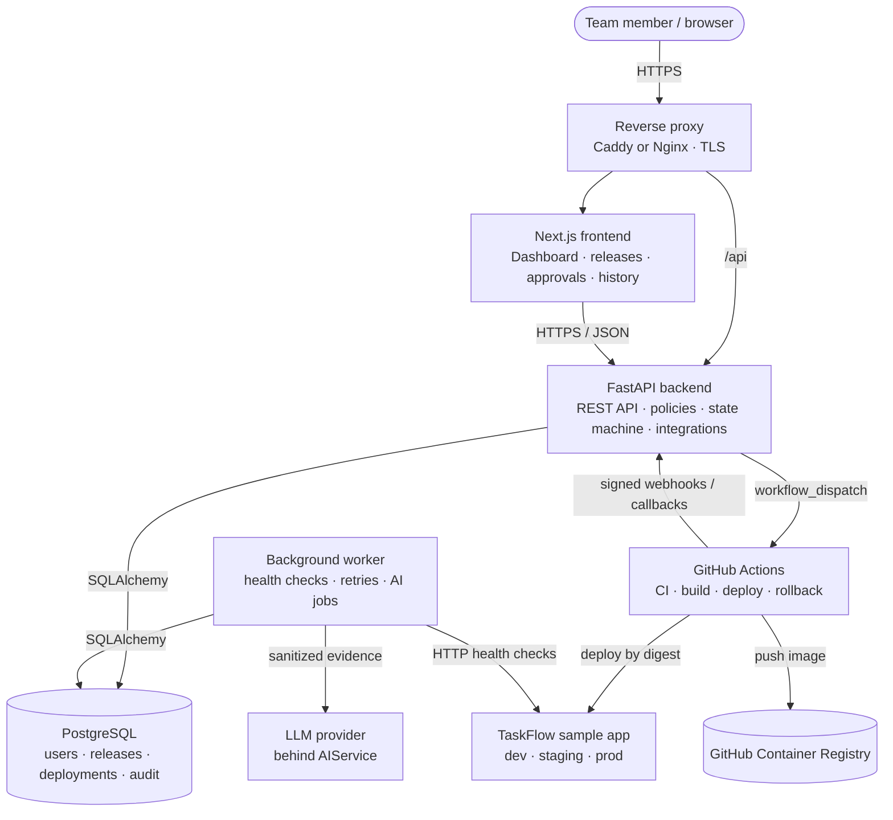
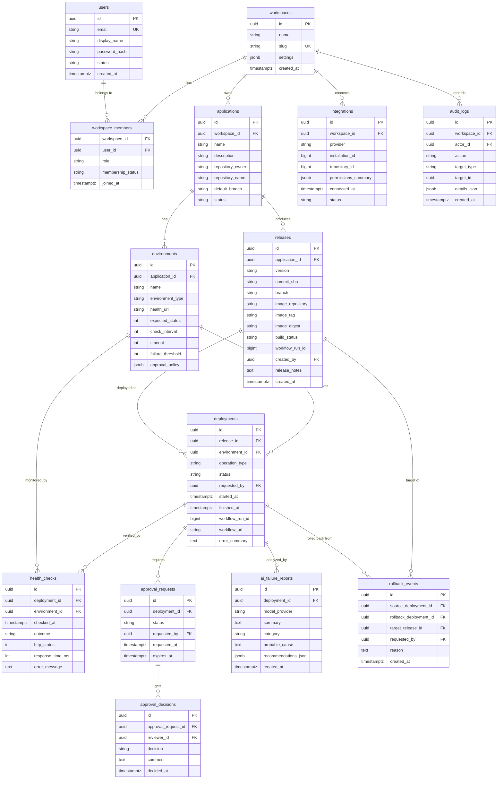
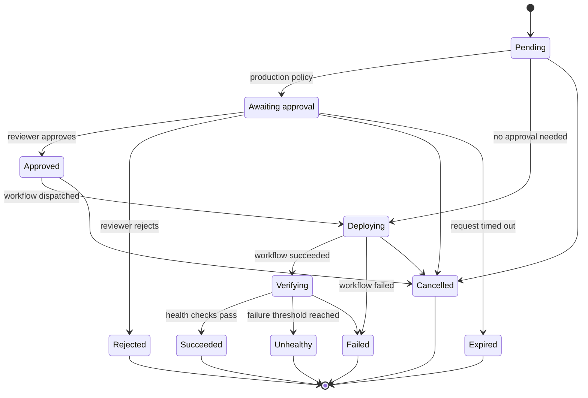
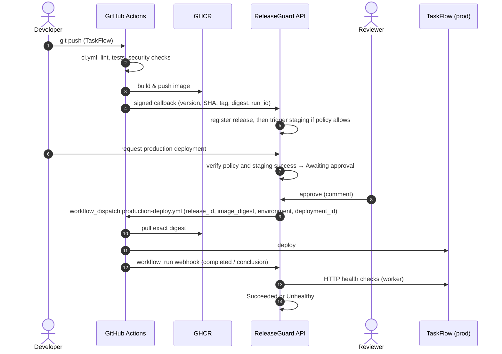
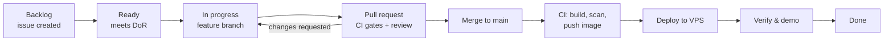
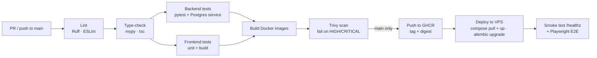
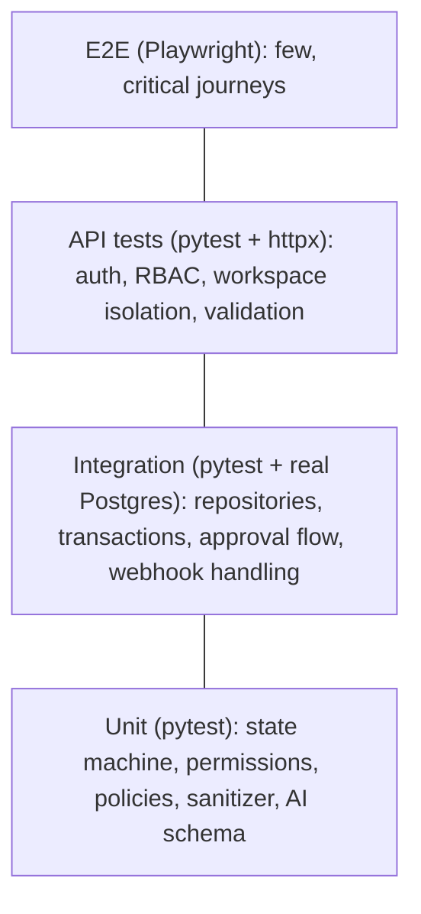

# ReleaseGuard: Development Lifecycle Guide

> **Deployment Approval & Rollback Manager**
> Next.js · FastAPI · PostgreSQL · Docker · GitHub Actions · AI-assisted failure analysis

| Item | Value |
|---|---|
| Source specification | [ReleaseGuard_Project_Specification.pdf](../ReleaseGuard_Project_Specification.pdf) (v1.0, 22 Nov 2026) |
| Execution plan | [PROJECT_PLAN.md](PROJECT_PLAN.md) |
| Audience | Anyone building, reviewing or demoing ReleaseGuard |
| Status | Living document. Update it whenever architecture, process or scope changes |

This guide brings together everything the team needs to understand **what** ReleaseGuard is, **how** it is built, and **how we work** while building it. Sections 1–13 and 15–19 summarize and expand on the specification. Section 14 sets out the engineering process that the spec does not cover. Where this guide recommends something that is not in the spec, the text marks it as *(recommendation)*.

---

## Table of contents

1. [Project overview](#1-project-overview)
2. [Core domain concepts](#2-core-domain-concepts)
3. [Users, roles and permissions](#3-users-roles-and-permissions)
4. [Feature catalogue](#4-feature-catalogue)
5. [System architecture](#5-system-architecture)
6. [Technology stack](#6-technology-stack)
7. [Data model](#7-data-model)
8. [Deployment state machine](#8-deployment-state-machine)
9. [REST API surface](#9-rest-api-surface)
10. [GitHub Actions integration](#10-github-actions-integration)
11. [Rollback design](#11-rollback-design)
12. [AI deployment assistant](#12-ai-deployment-assistant)
13. [Security, reliability and auditability](#13-security-reliability-and-auditability)
14. [Development lifecycle process](#14-development-lifecycle-process)
15. [Frontend screens and UI principles](#15-frontend-screens-and-ui-principles)
16. [Roadmap summary](#16-roadmap-summary)
17. [MVP acceptance criteria and demo script](#17-mvp-acceptance-criteria-and-demo-script)
18. [Risks and mitigations](#18-risks-and-mitigations)
19. [References](#19-references)

---

## 1. Project overview

### 1.1 The problem
Small teams often track what is running in production through a mix of separate tools, chat messages and manual notes. They know a pipeline passed. They often **don't** know:

- which exact image is deployed in each environment,
- who approved it,
- whether the application is actually healthy, and
- how to get back to the last known-good release.

### 1.2 What ReleaseGuard is
ReleaseGuard is a **release-control and visibility layer** for small teams. It brings releases, environment versions, production approvals, deployment history, health checks and controlled rollback together in one auditable interface.

> **Positioning: ReleaseGuard is *not* a CI/CD engine.**
> GitHub Actions still builds, tests and deploys. ReleaseGuard **decides** whether a release may proceed, **records** every decision, **triggers** approved workflows, **monitors** the outcome and **coordinates** rollback. The backend never runs deployment shell commands on a user's behalf.

### 1.3 Primary objectives
1. Know exactly which release is running in each environment.
2. Block production deployment until the approval policy is satisfied.
3. Keep a searchable, durable history of deployments and approvals.
4. Detect application health problems after deployment, not only CI/CD job failures.
5. Restore a known-good release through a controlled rollback workflow.
6. Use AI to explain failures **without** giving AI any operational authority.

**Success means** a reviewer can open the platform, find the production version, see how it was approved, inspect the deployment result, and understand how to recover if it becomes unhealthy.

### 1.4 Reference scenario: TaskFlow
The demo uses a small sample application, **TaskFlow**, that publishes Docker images and is promoted through three environments:

| Environment | Running version | Policy |
|---|---|---|
| Development | v1.8.4 | Automatic deployment after successful CI |
| Staging | v1.8.4 | Automatic or manually requested |
| Production | v1.8.2 | Protected; approval required |

**Happy path:**
1. A developer pushes a change to TaskFlow.
2. GitHub Actions runs lint, tests and security checks, then builds and publishes a Docker image.
3. ReleaseGuard registers the release: version, commit SHA, image tag and **immutable digest**.
4. A workflow deploys the release to staging and reports back.
5. A developer requests production deployment. ReleaseGuard checks the policy and opens an approval request.
6. An authorized reviewer approves or rejects it. The decision and comment are recorded.
7. After approval, ReleaseGuard dispatches the production workflow.
8. The workflow deploys the approved image. ReleaseGuard tracks the run and performs HTTP health checks.
9. If the deployment passes, the environment points to the new version. If it fails verification, the deployment is marked **Unhealthy** and a manual rollback can start.

---

## 2. Core domain concepts

> **Release ≠ Deployment.**
> A **release** is an immutable version of the application. A **deployment** is one *attempt* to install a release into one environment. Deploying v1.8.5 to staging on Monday and to production on Tuesday creates **two deployment records** that point to **one release**.

### Glossary

| Term | Meaning |
|---|---|
| **Release** | An immutable version of an application, identified by its source revision and build artifact. |
| **Deployment** | An attempt to install a release into a specific environment. |
| **Environment** | A named deployment target: development, staging or production. |
| **Artifact** | The packaged output of a build, here a Docker image. |
| **Image digest** | A content-addressed identifier (`sha256:…`) for one specific container image. This is the authoritative artifact identity. |
| **Workflow dispatch** | A GitHub API event that starts a workflow manually with defined inputs. |
| **Webhook** | An HTTP event that GitHub sends to notify ReleaseGuard about activity. |
| **Health check** | An HTTP request that checks whether the deployed app responds as expected. |
| **Rollback** | A **new** deployment that restores a previously published artifact. |
| **RBAC** | Role-based access control: permissions are assigned by workspace role. |
| **Audit log** | A durable record of significant user and system actions. |
| **Workspace** | The tenancy boundary. All data is scoped to a workspace. |

---

## 3. Users, roles and permissions

Version 1 has **one workspace with multiple members**. The workspace boundary makes authorization explicit and leaves a clean path to multi-team support later.

### 3.1 Permission matrix

| Capability | Admin | Developer | Reviewer | Viewer |
|---|:-:|:-:|:-:|:-:|
| View dashboard, environments, releases, deployments, audit log | ✅ | ✅ | ✅ | ✅ |
| Manage workspace, members and roles | ✅ | | | |
| Connect and disconnect the GitHub integration | ✅ | | | |
| Create, edit and archive applications | ✅ | ✅ (permitted apps) | | |
| Configure environments, health checks and approval policy | ✅ | | | |
| Register releases (manually or via CI callback) | ✅ | ✅ | | |
| Request staging or production deployment | ✅ | ✅ | | |
| Approve or reject production requests | ✅ | | ✅ | |
| Initiate rollback | ✅ | ✅ (if permitted) | | |
| Request AI analysis | ✅ | ✅ | ✅ | ✅ (read-only data they can already see) |

### 3.2 Authorization rules
- **Enforce permissions in the backend** (FastAPI dependencies and the service layer). Hiding a button in the frontend is **not** authorization.
- Every query is **scoped to the current workspace**. The API must never return another workspace's data.
- A reviewer must hold the Reviewer or Admin role in the target workspace.
- **Self-approval** of production deployments can be blocked by a workspace policy setting.
- Every important action is recorded with **actor, timestamp, target object, action and result**.

---

## 4. Feature catalogue

Each module is listed with its MVP status and the sprint that delivers it (see [PROJECT_PLAN.md](PROJECT_PLAN.md)).

| # | Module | MVP? | Sprint |
|---|---|:-:|:-:|
| 4.1 | Dashboard and overview | ✅ | S1 shell → S6 metrics |
| 4.2 | Application management | ✅ | S1 |
| 4.3 | Release and version management | ✅ | S2 |
| 4.4 | Environment management | ✅ | S1 (CRUD), S4 (health config) |
| 4.5 | Production approval system | ✅ | S3 |
| 4.6 | Deployment history and details | ✅ | S2 |
| 4.7 | Health monitoring | ✅ | S4 |
| 4.8 | Controlled rollback (manual) | ✅ | S4 |
| 4.9 | AI deployment assistant | ✅ (basic) | S5 |

### 4.1 Dashboard and overview
Answers three questions: *What is deployed? What needs attention? What happened recently?*
- Summary cards: registered applications, successful deployments, failed deployments, pending approvals, unhealthy environments.
- Environment overview: application × environment, with current version and health status.
- Timeline of recent deployment activity (status, version, initiator, environment).
- Pending approvals panel with a direct link to each request.
- Failed deployments panel linking to logs, the workflow run and the AI analysis.
- Deployment success rate over a selectable date range, labeled as an operational metric.

### 4.2 Application management
- Create, edit, archive and view applications. **GitHub repositories only in v1.**
- Stored fields: name, description, repository owner and name, repository URL, default branch, workflow names.
- Repository connection through a **GitHub App installation**.
- Each app gets development, staging and production environments.
- Health-check URL and expected-response policy per environment.

> Keep the integration narrow: no GitLab, Bitbucket or other CI providers in v1. One complete GitHub integration is worth more than several partial ones.

### 4.3 Release and version management
A release records exactly what was built and what should be deployed:
- version (SemVer or Git tag), commit SHA, branch
- Docker image repository, tag and **digest**
- build status, build timestamp and the actor who started it
- GitHub workflow run ID and URL, plus commit and PR links where available
- release notes or a generated commit summary
- links to every deployment of this release

**The image digest is the authoritative artifact ID.** Tags are labels and can change. Deploy by digest, or enforce an immutable-tag policy.

### 4.4 Environment management
| Environment | Default behavior | Purpose |
|---|---|---|
| Development | Automatic | Early integration and developer feedback |
| Staging | Automatic or manual | Validate the release in a production-like environment |
| Production | Approval required | Protected environment used by real users |

Capabilities: show the current release and its status, compare versions across environments (to make promotion gaps visible), show per-environment history, configure health-check URL, interval, timeout and failure threshold, configure approval requirements and allowed roles, and **prevent conflicting production operations** on the same application.

### 4.5 Production approval system *(core differentiator)*
- Create a production deployment request for a specific release and environment.
- Check preconditions (for example, a successful staging deployment and an acceptable release status).
- Show pending requests with requester, release, commit, environment and request time.
- Reviewers approve or reject, with an optional or required comment.
- Record the reviewer's identity, decision, comment and timestamp.
- Block unauthorized approval, duplicate approval and approval of **stale or expired** requests.
- Optional: block self-approval and set a minimum reviewer count.

**Flow:** request v1.8.5 → verify the release exists and staging succeeded → *Awaiting approval* → the reviewer inspects it and decides → **approved:** record the decision and dispatch the production workflow in one transaction · **rejected:** no dispatch, and the decision is kept in the audit history.

### 4.6 Deployment history and details
Every attempt gets a durable record, whether it succeeds, fails or is cancelled, and even when a rollback follows.
- Search and filter by application, environment, version, status, actor and date range.
- Show duration, initiator, approver, commit, image digest and workflow run.
- Chronological timeline of state-change events.
- Links to GitHub Actions run logs and commits.
- A normalized error summary and selected log excerpts (sanitized).
- **Rollbacks are separate records. Never rewrite the original failure.**

### 4.7 Health monitoring
A green CI job does not prove the application is healthy. ReleaseGuard runs a **small, predictable set of HTTP checks** after each deployment and on a schedule.
- Per-environment endpoint (for example `/health`), expected status code, timeout, interval and consecutive-failure threshold.
- Each check records timestamp, outcome, HTTP code and response time.
- The environment is marked **unhealthy** once the threshold is reached.
- Failures are linked to the deployment that most recently changed the environment.
- The UI shows current status and recent check history.

> v1 uses HTTP endpoint checks only. No tracing, log aggregation or metrics storage. Prometheus and Grafana are optional extensions.

### 4.8 Controlled rollback
Rollback **restores a known-good artifact**. It is a new deployment operation. The failed deployment is never deleted or changed. v1 supports **manual rollback only**. See [section 11](#11-rollback-design).

### 4.9 AI deployment assistant
AI reduces the time needed to understand a failure. It is **not** a general chatbot and **not** an operator.

| Capability | Input | Output |
|---|---|---|
| Failure explanation | Failed job or stage, sanitized logs, exit code, deployment metadata | Summary, probable cause, evidence, suggestions |
| Deployment summary | Events, statuses, durations, health results | A readable account of what happened |
| Release notes | Commit messages, PR descriptions | A readable change summary |
| Historical failure analysis | Failure records the user is authorized to see | Similar past failures and recurring patterns |

Example questions: *"What caused the last production deployment failure?"*, *"Have we seen this error before?"*, *"Which deployments failed in the last seven days?"*, *"What changed between v1.8.2 and v1.8.5?"* See [section 12](#12-ai-deployment-assistant).

---

## 5. System architecture

### 5.1 Style: modular monolith
The system has one Next.js app, one FastAPI backend, one PostgreSQL database and one small background worker.
- Business rules live in one backend codebase and can be tested together.
- The data is relational and transactional, which suits approvals and state changes.
- Monitoring and AI jobs run in a separate worker process, with no service mesh.
- The system can be split later if a real scaling or ownership need appears.

### 5.2 Component diagram



### 5.3 Component responsibilities

| Component | Responsibility |
|---|---|
| **Next.js frontend** | Dashboard, application configuration, release views, approvals, deployment details and rollback flows. |
| **FastAPI backend** | REST API, validation, authorization, business policies, release and deployment state transitions, integrations. |
| **PostgreSQL** | Durable records for users, workspaces, applications, environments, releases, deployments, approvals and audit events. |
| **SQLAlchemy + Alembic** | ORM mapping, queries and versioned schema migrations. |
| **Background worker** | Scheduled health checks, retryable tasks and asynchronous AI analysis. |
| **GitHub Actions** | Build, test, scan, publish the image, deploy, and report the workflow outcome. |
| **Container registry (GHCR)** | Versioned Docker artifacts. Deploy by digest. |
| **AI provider** | Structured failure explanations and release summaries, reached only through the isolated `AIService`. |

### 5.4 Layering rules (backend)
```text
HTTP route  →  service  →  repository / query function  →  database
  (thin)      (business      (data access only)
              rules, state
              transitions,
              permissions)
```
- **Routes are thin:** parse and validate input with Pydantic, call a service, return a response schema.
- **Services own the rules:** permission checks, state transitions, transactions and integration calls.
- **Repositories own data access:** no business logic.
- Only `deployment_service` changes deployment status (see [section 8](#8-deployment-state-machine)).

### 5.5 Repository layout

```text
releaseguard/
├── frontend/                 # Next.js (App Router, TypeScript)
│   ├── app/
│   │   ├── login/
│   │   ├── dashboard/
│   │   ├── applications/[appId]/
│   │   ├── deployments/[deploymentId]/
│   │   ├── approvals/
│   │   ├── environments/
│   │   └── settings/
│   ├── components/           # dashboard/, deployments/, approvals/, applications/, ui/
│   ├── hooks/
│   ├── services/             # API client calls
│   ├── types/                # shared domain types
│   └── lib/
├── backend/                  # FastAPI
│   ├── app/
│   │   ├── main.py
│   │   ├── core/             # config.py, security.py, permissions.py
│   │   ├── api/v1/           # applications, environments, releases, deployments,
│   │   │                     # approvals, rollbacks, health, github (routers)
│   │   ├── models/           # SQLAlchemy models
│   │   ├── schemas/          # Pydantic request/response models
│   │   ├── services/         # deployment, approval, rollback, health, github, ai
│   │   ├── repositories/
│   │   └── worker/
│   ├── migrations/           # Alembic
│   ├── tests/
│   ├── Dockerfile
│   ├── pyproject.toml        # dependencies (uv)
│   └── uv.lock
├── worker/                   # worker entrypoint / Dockerfile (shares backend code)
├── infra/
│   ├── docker-compose.yml
│   ├── reverse-proxy/
│   └── scripts/              # backup, restore, deploy
├── .github/workflows/        # CI/CD for ReleaseGuard itself
├── docs/                     # this guide, project plan, ADRs, diagrams
└── README.md
```

The TaskFlow sample app lives in a **separate repository** with its own `ci.yml`, `staging-deploy.yml`, `production-deploy.yml` and `rollback.yml` (see [section 10](#10-github-actions-integration)).

---

## 6. Technology stack

### 6.1 Core stack (from the specification)

| Layer | Technology | Why it fits | Docs |
|---|---|---|---|
| Frontend | **Next.js + TypeScript** (App Router) | Component UI, file-system routing, strong typing | [nextjs.org/docs/app](https://nextjs.org/docs/app) |
| UI system | **Tailwind CSS + shadcn/ui** | Consistent dashboard components, quick to assemble | [ui.shadcn.com](https://ui.shadcn.com) |
| Backend | **Python + FastAPI** | Typed request and response APIs, OpenAPI docs, modular routers | [fastapi.tiangolo.com](https://fastapi.tiangolo.com/tutorial/bigger-applications/) |
| Validation | **Pydantic** | Validates API payloads **and** structured AI responses | [docs.pydantic.dev](https://docs.pydantic.dev/latest/) |
| ORM | **SQLAlchemy 2.0** | Relational persistence, explicit database access | [docs.sqlalchemy.org](https://docs.sqlalchemy.org/en/20/) |
| Migrations | **Alembic** | Versioned schema changes | [alembic.sqlalchemy.org](https://alembic.sqlalchemy.org/en/latest/) |
| Database | **PostgreSQL** | Transactions, constraints, relationships, advisory locks | [postgresql.org/docs](https://www.postgresql.org/docs/) |
| CI/CD | **GitHub Actions** | Repo-native workflows, dispatch API, workflow events | [docs.github.com/actions](https://docs.github.com/en/actions) |
| Containers | **Docker + Docker Compose** | Repeatable local and server deployment | [docs.docker.com](https://docs.docker.com/) |
| Registry | **GitHub Container Registry** | Versioned images, digest references | [docs.github.com/packages](https://docs.github.com/en/packages) |
| AI | **LLM API behind `AIService`** | Provider abstraction, structured failure analysis | n/a |
| Testing | **Pytest + Playwright** | Backend unit and integration tests; browser E2E tests | [pytest](https://docs.pytest.org/) · [playwright](https://playwright.dev/docs/intro) |
| Quality | **Ruff + ESLint** | Python and TypeScript linting | n/a |
| Security scanning | **Trivy** | Container and dependency vulnerability scanning | [trivy.dev](https://trivy.dev/latest/) |
| Optional monitoring | Prometheus + Grafana | Operational metrics for ReleaseGuard itself | n/a |

### 6.2 Supporting libraries *(recommendation)*

| Concern | Choice | Notes |
|---|---|---|
| HTTP client (GitHub API, health checks) | `httpx` | Async, timeouts, works with retry wrappers |
| Retries and backoff | `tenacity` | Bounded retries with exponential backoff for GitHub API calls |
| GitHub App auth | `PyJWT` + `cryptography` | Sign the App JWT, exchange it for short-lived installation tokens |
| Password hashing | `argon2-cffi` (or `pwdlib`) | Modern password hashing; never store plaintext |
| Sessions | Server-side sessions in Postgres + `HttpOnly`/`Secure`/`SameSite` cookie | Simpler and safer than storing JWTs in the browser |
| Worker scheduling | `APScheduler` + Postgres job table (`SELECT … FOR UPDATE SKIP LOCKED`) | No extra infrastructure. ARQ/Redis is a later option if needed |
| Config | `pydantic-settings` | Typed settings from environment variables |
| Type checking | `mypy` (backend), `tsc --noEmit` (frontend) | Run as CI gates |
| Frontend data fetching | TanStack Query | Caching, polling for in-progress deployments |
| Forms | React Hook Form + Zod | Typed client-side validation (the backend still validates) |
| API types | `openapi-typescript` | Generate frontend types from FastAPI's OpenAPI schema |
| Logging | `structlog` (JSON) | Correlation IDs per request, deployment and workflow run |

### 6.3 Deliberately excluded from v1
- **Kubernetes.** Docker Compose is enough. The product problem is release control, not cluster management.
- Multiple CI/CD providers and cloud platforms.
- Canary, blue-green and progressive delivery.
- Automatic remediation and autonomous rollback.
- Complex multi-tenancy and a policy language.
- Distributed tracing and a centralized logging platform.

---

## 7. Data model

PostgreSQL is the **source of truth**. The central modeling rule is to keep releases, deployment attempts, approval decisions and health observations as **separate records**.

### 7.1 Entity-relationship diagram



*(Recommendation)* Add a `webhook_deliveries` table (`delivery_id` UK, `event`, `received_at`, `processed_at`) for idempotent webhook handling, and a `deployment_events` table (`deployment_id`, `from_status`, `to_status`, `actor`, `source`, `created_at`) to drive the deployment timeline.

### 7.2 Key relationships
- One workspace owns many applications and has many members.
- One application has multiple environments and produces multiple releases.
- One release can be deployed many times, including to different environments.
- Each deployment references **exactly one** release and **one** environment.
- A deployment can have one or more approval requests. Each request can have one or more decisions if the policy needs several reviewers.
- A deployment can have many health-check observations.
- A rollback event references the deployment rolled back **from**, the **new** rollback deployment and the **target** release.
- Audit logs identify the workspace and actor and keep enough context to explain the action later.

### 7.3 Integrity, indexing and conventions
- Foreign keys on all important relationships. **CHECK constraints** on status and decision values.
- Unique constraints: workspace `slug`, application and repository identity, `(application_id, version)` on releases.
- Indexes:
  - `deployments (environment_id, created_at)`, `deployments (status, created_at)`, `deployments (release_id)`
  - `approval_requests (status, requested_at)` and workspace access paths
- **Transactions** wrap "approve a request + create the authorized dispatch operation".
- **All timestamps are stored in UTC** (`timestamptz`) and rendered in the user's local timezone.
- **Idempotency keys** for webhook processing and deployment-request creation.

> **Auditability principle:** never update a failed deployment to "successful" when a rollback happens. Keep the failure as history, create a **new** rollback deployment, and link the two. Records describe what actually happened.

---

## 8. Deployment state machine

Deployment status is a **state machine**, not a free-text field that any endpoint can overwrite. A **single backend service** (`deployment_service`) validates every transition.

### 8.1 State diagram



### 8.2 States

| State | Meaning | Typical next state |
|---|---|---|
| **Pending** | Request created, not yet dispatched | Awaiting approval, Deploying, Cancelled |
| **Awaiting approval** | Production policy requires a reviewer | Approved, Rejected, Cancelled, Expired |
| **Approved** | Approval policy satisfied | Deploying, Cancelled |
| **Deploying** | The GitHub Actions workflow is running | Verifying, Failed, Cancelled |
| **Verifying** | The workflow finished; app health is being checked | Succeeded, Unhealthy, Failed |
| **Succeeded** | Deployment and verification passed | *Terminal* |
| **Rejected** | Approval denied | *Terminal*; a new request can be created |
| **Failed** | The build or deploy operation failed | *Terminal*; retry as a **new** deployment |
| **Unhealthy** | Deployed, but the post-deploy health policy failed | *Terminal*; a rollback can be created |
| **Cancelled / Expired** | Cancelled, or the approval expired | *Terminal* |

### 8.3 Transition rules
1. A production deployment **cannot** enter *Deploying* until its required approvals are recorded.
2. An approval decision must come from an **authorized reviewer** and apply to the **current, unexpired** request.
3. The service **rejects invalid transitions**, even when a client calls the API directly.
4. **No concurrent production deployments** to the same application and environment. Use a Postgres advisory lock (`pg_advisory_xact_lock(hash(environment_id))`) or a well-defined job concurrency key.
5. GitHub webhook deliveries are processed **idempotently**, so repeated callbacks never cause duplicate transitions.
6. A retry creates a **new attempt** (or an explicitly modeled retry record). It never erases the failed attempt.

*(Recommendation)* Implement transitions as one table, `ALLOWED_TRANSITIONS: dict[Status, set[Status]]`, plus one function, `transition(deployment, to_status, actor, source)`. That function checks the table, writes a `deployment_events` row and an audit log entry, and runs inside the caller's transaction. Unit-test **every** allowed transition and a representative set of forbidden ones.

---

## 9. REST API surface

*(Recommendation, derived from the spec's `api/v1` router modules.)* All routes are prefixed with `/api/v1`, need an authenticated session unless noted, and are scoped to the caller's workspace. FastAPI generates the OpenAPI docs at `/docs`.

| Area | Method & path | Purpose | Min. role |
|---|---|---|---|
| Auth | `POST /auth/login` · `POST /auth/logout` · `GET /auth/me` | Session management | public / any |
| Workspace | `GET /workspace` · `GET/POST/PATCH/DELETE /workspace/members[/{id}]` | Workspace and member management | Viewer / Admin |
| Dashboard | `GET /dashboard/summary?from=&to=` | Summary cards, environment matrix, recent activity | Viewer |
| Applications | `GET/POST /applications` · `GET/PATCH /applications/{id}` · `POST /applications/{id}/archive` | Application CRUD | Viewer / Developer |
| Environments | `GET /applications/{id}/environments` · `GET/PATCH /environments/{id}` | Environment config, health and approval policy | Viewer / Admin |
| Releases | `GET /applications/{id}/releases` · `GET /releases/{id}` · `POST /releases` | List, view, register (CI callback or manual) | Viewer / Developer |
| Deployments | `GET /deployments?app=&env=&status=&actor=&from=&to=` · `GET /deployments/{id}` · `GET /deployments/{id}/events` | History, details, timeline | Viewer |
| | `POST /deployments` (`Idempotency-Key` header) · `POST /deployments/{id}/cancel` | Request a deployment; cancel | Developer |
| Approvals | `GET /approvals?status=pending` · `GET /approvals/{id}` · `POST /approvals/{id}/decisions` | Inbox; approve or reject with comment | Viewer / Reviewer |
| Rollbacks | `GET /environments/{id}/rollback-candidates` · `POST /rollbacks` | List eligible releases; start a rollback | Developer |
| Health | `GET /environments/{id}/health` · `GET /environments/{id}/health-checks` · `POST /environments/{id}/health/check-now` | Current status, history, on-demand check | Viewer / Admin |
| GitHub | `POST /github/webhooks` (HMAC-verified, no session) · `GET /integrations` · `POST /integrations/github/callback` · `DELETE /integrations/{id}` | Webhook intake; App install and uninstall | system / Admin |
| AI | `POST /deployments/{id}/ai-analysis` · `GET /deployments/{id}/ai-analysis` · `POST /releases/{id}/release-notes` | Request or view AI analysis and release notes | Viewer / Developer |
| Audit | `GET /audit-logs?target_type=&target_id=&actor=` | Audit trail | Viewer |
| Ops | `GET /healthz` · `GET /readyz` | Liveness and readiness of ReleaseGuard itself | public |

**Conventions:** JSON everywhere; cursor or page pagination on lists; errors use the shape `{ "error": { "code", "message", "details" } }`; return `403` for permission failures, `404` for resources in other workspaces (to avoid leaking that they exist), `409` for invalid state transitions or lock conflicts, and `422` for validation errors.

---

## 10. GitHub Actions integration

GitHub Actions **executes** CI/CD. ReleaseGuard **triggers** controlled workflows and **receives** events to sync status, through a **GitHub App** with minimum permissions.

### 10.1 End-to-end flow



### 10.2 Workflow files (in the TaskFlow repository)

| File | Trigger | Responsibility |
|---|---|---|
| `ci.yml` | push / PR | Lint, tests, security checks, build and publish image, report release to ReleaseGuard |
| `staging-deploy.yml` | `workflow_dispatch` (or after CI) | Deploy a release to staging |
| `production-deploy.yml` | `workflow_dispatch` **only** | Deploy **only** an approved release |
| `rollback.yml` | `workflow_dispatch` | Redeploy a selected, previously published image digest |

These can be combined during early prototyping. Keep them separate once the approval and rollback paths exist, because separate files are easier to reason about.

### 10.3 Dispatch inputs and callback contract
- **Inputs:** `release_id`, `image_digest`, `environment`, `deployment_id`. **Never** accept arbitrary shell commands from the API or the AI.
- The workflow **checks** that the artifact it deploys matches the approved release.
- The backend stores the GitHub `workflow_run_id` and URL.
- Status arrives through **signed webhooks** (`workflow_run`, `workflow_job`) or an authenticated callback endpoint. Both are protected by signature validation, authorization and idempotency.
- *(Recommendation)* Correlate dispatches to runs by passing `deployment_id` as an input and setting `run-name: deploy-${{ inputs.deployment_id }}` in the workflow, then matching on that name in the `workflow_run` event.

### 10.4 Defense in depth
Where the GitHub plan allows, configure **GitHub environment protection rules and required reviewers** on the `production` environment as a second layer. ReleaseGuard still enforces its own policy, so the product logic never depends on GitHub plan features.

> **Separation of duties:** ReleaseGuard decides whether a release may proceed. GitHub Actions performs the build and deployment. The backend never runs deployment shell commands.

---

## 11. Rollback design

A rollback is a **controlled redeployment of a previously published artifact**. Do not rebuild old source during an incident. Restore the exact, previously tested **image digest**.

### 11.1 Manual rollback sequence
1. The user opens an unhealthy deployment or environment page.
2. ReleaseGuard lists **eligible** earlier successful releases for that application and environment.
3. The user picks a target and enters a **reason**.
4. The backend checks permissions, target eligibility, environment policy and **concurrency**.
5. If the policy requires approval for rollback, an approval request is created. Otherwise the flow continues.
6. A **new** deployment record is created with `operation_type = rollback` and the target release.
7. The `rollback.yml` workflow is dispatched with the target **image digest**.
8. ReleaseGuard tracks completion and runs post-rollback health checks.
9. The rollback deployment is marked Succeeded or Unhealthy, and the full event chain is kept.

| Example | Value |
|---|---|
| Current production | v1.8.5, **Unhealthy** |
| Previous stable | v1.8.2, previously healthy |
| Operation | Deploy the immutable artifact for v1.8.2 |
| Result | New rollback deployment record, followed by health checks |

### 11.2 Safeguards
- Only known releases with a **published artifact** can be selected.
- Current and target versions are both clearly shown **before** confirmation.
- Targets that break the environment policy are blocked.
- A per-environment deployment lock or concurrency key applies.
- Explicit confirmation is required and the reason is recorded.
- Health is verified after the rollback workflow completes.
- The original failed deployment is kept and **linked** to the rollback.

### 11.3 Later: automatic rollback
Add it only after manual rollback is proven. A conservative first rule: create a rollback **recommendation** when consecutive health checks fail right after a deployment. An authorized user still confirms the action.

---

## 12. AI deployment assistant

All AI calls go through a dedicated **`AIService`**. **Deployments never depend on the AI provider.** A deployment succeeds or fails normally even if AI is down.

### 12.1 Service methods

| Method | Purpose |
|---|---|
| `analyze_deployment_failure()` | Analyze sanitized failure evidence and return a structured explanation |
| `summarize_pipeline_logs()` | Summarize selected logs from a workflow run |
| `generate_release_notes()` | Turn commit and PR metadata into readable release notes |
| `compare_deployment_failures()` | Find similarities among historical failures the user may see |

### 12.2 Request and response

```jsonc
// request (built by the backend from sanitized evidence)
{
  "application": "TaskFlow",
  "version": "v1.8.5",
  "environment": "production",
  "failed_stage": "health_check",
  "logs": [
    "Container started",
    "Application initialization failed",
    "Health endpoint returned HTTP 503"
  ]
}
```

```jsonc
// structured response, validated against a Pydantic model before storage/display
{
  "summary": "Application failed during startup verification.",
  "category": "application_startup",
  "probable_cause": "Application initialization failure.",
  "recommendations": [
    "Inspect application startup logs.",
    "Check required environment variables.",
    "Verify database connectivity."
  ],
  "severity": "high"
}
```

Store the provider and model identifier, creation timestamp, related deployment and **analysis version** alongside each result so it can be audited.

### 12.3 Safety and data handling
- **Remove** secrets, tokens, passwords, private keys and sensitive user data before sending anything to an external provider.
- **Limit** log size and send relevant excerpts only.
- Treat logs and commit messages as **untrusted input**, because they may contain prompt-injection text.
- Model output **never** chooses tools, commands, repositories or deployment targets.
- Label probable causes as **AI-generated hypotheses**, not confirmed diagnoses.
- Apply the same workspace and application authorization **before** retrieving historical data.
- If the output fails validation or the provider times out, show "analysis unavailable" with a retry option. Never block a deployment flow.

> **AI boundary:** AI explains and recommends. It never approves releases, runs commands or starts rollbacks.

---

## 13. Security, reliability and auditability

ReleaseGuard has authority over production release decisions, so security is part of the architecture from the start.

### 13.1 Authentication and authorization
- Secure server-side sessions (or a carefully built token model). Hash passwords with a modern algorithm (argon2).
- Check workspace membership on **every** operation, and run RBAC checks in the **service layer**.
- Use short-lived, least-privilege GitHub credentials (installation tokens).

### 13.2 GitHub and webhook security
- Use a **GitHub App** rather than a broad personal access token.
- Request only the repository and Actions permissions the selected workflows need.
- Keep private keys, installation tokens and webhook secrets **on the backend only**.
- Validate webhook signatures with **HMAC-SHA256** (`X-Hub-Signature-256`) and a **constant-time comparison**.
- Reject duplicate deliveries using `X-GitHub-Delivery` IDs or idempotency records.
- Rotate and revoke credentials when an integration is disconnected.

### 13.3 Deployment safety
- No arbitrary deployment commands from users or from AI output.
- Deploy **immutable digests**, or enforce immutable tags.
- Keep environment-specific secrets out of source code and frontend bundles.
- Restrict production deployment concurrency.
- Check that each workflow run matches the requested release and environment.
- Record approval, dispatch, start, finish, failure and rollback events.

### 13.4 Reliability and operational controls
- Bounded retries with **exponential backoff** for transient GitHub API failures.
- **Idempotent** webhook and callback handlers.
- Database **transactions** around approval decisions and the state changes that go with them.
- Background jobs that are retryable and observable.
- PostgreSQL backups, with **regular restore tests**.
- **Correlation IDs** in logs for requests, deployments and GitHub workflow runs.

---

## 14. Development lifecycle process

This section defines **how we build** ReleaseGuard. It goes beyond the specification and applies whether the team is one person or several.

### 14.1 Lifecycle overview



The team works in **vertical slices**. Each sprint ends with something working that can be demoed, not a pile of models or screens. See [PROJECT_PLAN.md](PROJECT_PLAN.md).

### 14.2 Branching, commits and versioning
- **Trunk-based development.** `main` is always deployable and protected (PR plus green CI required).
- Short-lived branches: `feat/<scope>-<short-desc>`, `fix/…`, `chore/…`, `docs/…`, `test/…`. Merge within 1–3 days.
- **Conventional Commits:** `feat(api): block self-approval when policy enabled`. Scopes: `api`, `web`, `worker`, `db`, `github`, `ai`, `infra`, `docs`.
- **Squash-merge** PRs so `main` has one commit per change.
- **SemVer tags** for ReleaseGuard releases (`v0.1.0` at the end of Sprint 1, … `v1.0.0` at MVP). Generate the changelog from the commits.
- Record significant technical decisions as **ADRs** in `docs/adr/NNNN-title.md` (context, decision, consequences). Suggested first ADRs: modular monolith; server-side sessions; worker on a Postgres job table; deploy by digest.

### 14.3 Definition of Ready (DoR)
An issue is **Ready** when it has:
- a user-facing goal ("As a Reviewer I can…") or a clear technical objective,
- acceptance criteria, including **failure paths**,
- the affected areas (`api`, `web`, `db`, …) and any migration needs,
- no unresolved dependencies,
- a size small enough to finish in **≤ 2 days**.

### 14.4 Definition of Done (DoD)
A change is **Done** when:
- [ ] acceptance criteria are met, including permission-denied and failure paths
- [ ] permissions are enforced in the backend and workspace scoping is verified
- [ ] unit and integration tests are added or updated, and CI is green (lint, types, tests, Trivy)
- [ ] the Alembic migration is included, reversible and tested on a fresh database
- [ ] the UI covers empty, loading, error and permission-denied states (where relevant)
- [ ] important actions write audit log entries
- [ ] docs, OpenAPI descriptions and `.env.example` are updated if behavior or config changed
- [ ] the change is deployed and checked on the VPS (from Sprint 6 onward)

### 14.5 Pull request checklist
Use this as the PR template (`.github/pull_request_template.md`):
```markdown
## What & why
## How to test
## Checklist
- [ ] Tests cover happy path + failure path
- [ ] Backend permission check + workspace scoping
- [ ] No secrets / tokens in code, logs or frontend bundle
- [ ] Migration reversible (if any)
- [ ] Audit events recorded (if state-changing)
- [ ] Screenshots (if UI)
```
For a solo developer, **self-review the diff the next day** before merging, and keep CI gates mandatory.

### 14.6 Local development environment
**Prerequisites:** Docker Desktop, Node.js LTS + pnpm, Python 3.12+ with `uv` (or pip/venv), Git, and the GitHub CLI.

```bash
cp .env.example .env                 # fill in local values
docker compose -f infra/docker-compose.yml up -d db   # Postgres only
cd backend && uv sync && alembic upgrade head && python -m app.scripts.seed
uvicorn app.main:app --reload        # http://localhost:8000/docs
cd ../frontend && pnpm install && pnpm dev   # http://localhost:3000
# or everything at once:
docker compose -f infra/docker-compose.yml up --build
```

**Seed data:** one workspace, four users (one per role), the TaskFlow application with three environments, and some example releases and deployments, so every screen has content.

**Testing GitHub webhooks locally:** use a tunnel (`smee.io`, `ngrok` or `cloudflared`) pointing at `/api/v1/github/webhooks`, with a **separate development GitHub App**.

**Key environment variables (`.env.example`):**

| Variable | Used by | Notes |
|---|---|---|
| `DATABASE_URL` | backend, worker | `postgresql+psycopg://…` |
| `SESSION_SECRET` | backend | Random 32+ bytes |
| `GITHUB_APP_ID`, `GITHUB_APP_PRIVATE_KEY`, `GITHUB_WEBHOOK_SECRET` | backend, worker | **Backend only.** Never `NEXT_PUBLIC_*` |
| `AI_PROVIDER`, `AI_API_KEY`, `AI_MODEL` | worker | AI can be disabled by leaving the key empty |
| `NEXT_PUBLIC_API_BASE_URL` | frontend | The only public variable |
| `CORS_ORIGINS`, `LOG_LEVEL`, `ENV` | backend | |

### 14.7 Environments for ReleaseGuard itself

| Environment | Where | Purpose |
|---|---|---|
| **Local** | Developer machine, Docker Compose | Day-to-day development |
| **CI** | GitHub Actions runners, ephemeral Postgres service | Automated tests and builds |
| **Demo / production** | Single VPS, Docker Compose, Caddy or Nginx with TLS | Public portfolio demo |

**Secrets:** local `.env` files (git-ignored), **GitHub Actions encrypted secrets** for CI, and an environment file on the VPS readable only by the deploy user (`chmod 600`). Never commit secrets. Run `gitleaks` in CI *(recommendation)*.

### 14.8 CI/CD pipeline for ReleaseGuard



Workflows in `releaseguard/.github/workflows/`: `ci.yml` (all PRs), `release.yml` (main or tags: build, scan, push, deploy), and `nightly.yml` (full E2E plus a backup restore test, *recommendation*).

### 14.9 Testing strategy



| Layer | Scope | Tool | Target |
|---|---|---|---|
| Unit | Services, permission rules, state transitions, log sanitizer, AI response schema | pytest | **100% of state-machine transitions and permission rules**; ≥ 80% of the services package |
| Integration | Repositories, transactions, approval → dispatch, GitHub callback handling (GitHub API mocked with `respx`) | pytest + Postgres container | All service-level flows |
| API | Authentication, authorization, validation, **workspace isolation** | pytest + `httpx.AsyncClient` | Every router has allowed, denied and cross-workspace tests |
| E2E | Request → approve → status update → rollback UI | Playwright | The demo script runs green |
| Failure-path | GitHub API timeout, duplicate webhook, rejected approval, unhealthy endpoint, rollback failure, AI unavailable | pytest (+ Playwright) | Each has at least one test |
| Frontend unit | Status badges, formatters, hooks | Vitest + Testing Library *(recommendation)* | Key components |

**Test data:** factories (`factory_boy` or plain builders); each test runs in a transaction that is rolled back. **Never** call the real GitHub or AI APIs in CI. Use mocks and recorded fixtures.

### 14.10 Quality gates

| Gate | Tool | Blocks merge? |
|---|---|:-:|
| Python lint and format | `ruff check`, `ruff format --check` | ✅ |
| Python types | `mypy app` | ✅ |
| TS lint and types | `eslint`, `tsc --noEmit` | ✅ |
| Tests | pytest, Vitest, Playwright (main) | ✅ |
| Container and dependency vulnerabilities | Trivy (`--severity HIGH,CRITICAL --exit-code 1`) | ✅ |
| Secret scanning | gitleaks / GitHub secret scanning | ✅ |
| Migration check | `alembic upgrade head` on an empty database + `alembic check` | ✅ |

Use `pre-commit` hooks for Ruff, ESLint, Prettier and gitleaks to catch problems before they reach CI.

### 14.11 Logging and observability
- Structured **JSON logs** (`structlog`) with `request_id`, `workspace_id`, `user_id`, `deployment_id` and `workflow_run_id` where relevant.
- A middleware generates or propagates an `X-Request-ID` header.
- `GET /healthz` (liveness) and `GET /readyz` (database reachable) for ReleaseGuard itself.
- The worker logs each job's start, finish, retry and failure.
- Optional extension: a Prometheus `/metrics` endpoint and a Grafana dashboard.

### 14.12 Operations runbooks
**Backup and restore:**
- Run `pg_dump` nightly (cron on the VPS) to a compressed file, keep 7 daily and 4 weekly copies, and copy them off-host.
- **Test the restore** monthly (and in `nightly.yml` if possible): restore into a scratch container, run `alembic current` and a row-count sanity check.

**Deploying ReleaseGuard:**
```bash
docker compose pull && docker compose run --rm backend alembic upgrade head && docker compose up -d
curl -fsS https://<host>/api/v1/healthz
```

**Rolling back ReleaseGuard itself:** pin the previous image digests in `.env` (`BACKEND_IMAGE=ghcr.io/…@sha256:…`) and run `docker compose up -d`. Migrations must stay **backward-compatible for one release** (expand, then contract) so that code rollback is safe.

**Incident in a managed app (TaskFlow):** open the deployment → read the AI analysis and evidence → choose a rollback target → confirm with a reason → verify health → write a short post-incident note.

### 14.13 Documentation standards
- `README.md`: overview, architecture diagram, features, local setup, demo credentials (non-production only).
- `docs/`: this guide, the project plan, ADRs, the ER diagram and the API guide (link to `/docs` OpenAPI).
- Each module carries a docstring explaining its responsibility. Comments explain **why**, not what.
- `CLAUDE.md` (short project instructions) and `.claude/rules/*.md` (path-scoped coding rules) carry the conventions in this guide for Claude Code. Update them in the same change as any new rule, tool or convention. See [AI_TOOLING.md](AI_TOOLING.md).

---

## 15. Frontend screens and UI principles

| Screen | Main content and actions |
|---|---|
| **Login** | Sign-in, session state, error handling, workspace selection if needed |
| **Dashboard** | App summary, environment status, recent deployments, pending approvals, failures needing attention |
| **Applications list** | Search, filter, create, edit, archive, open details |
| **Application details** | Repo metadata, environments, current versions, releases, deployment history |
| **Environment details** | Current release, health status, check history, deployment history, policy config |
| **Release details** | Version, commit, image digest, build result, release notes, deployment targets |
| **Deployment details** | State timeline, initiator, approver, workflow URL, logs and errors, health checks, rollback action |
| **Approvals inbox** | Pending production requests, release evidence, approve and reject, reviewer comments |
| **AI analysis** | Failure summary, probable cause, evidence excerpts, suggested next steps |
| **Settings** | Members, roles, GitHub integration, environment policy, notification preferences |

### UI principles
- Show **environment and version** next to every deployment status. Avoid lists that show status alone.
- Keep **deployment status** visually separate from **application health**. A deployment can finish while the app is unhealthy.
- Use **confirmation dialogs** for production deploys and rollbacks.
- Show **approver identity and timestamp** wherever an approval is relevant.
- Make failed workflow links and error summaries **easy to find**.
- Give every major screen **empty, loading, error and permission-denied** states.
- Use one consistent status vocabulary and color mapping across the app (for example Succeeded = green, Unhealthy = amber, Failed = red, Awaiting approval = blue).

---

## 16. Roadmap summary

Six vertical slices. Each one ends in a working demo. Full detail: [PROJECT_PLAN.md](PROJECT_PLAN.md).

| Phase | Weeks | Scope | Definition of done |
|---|---|---|---|
| 1. Foundation | 1–2 | Next.js, FastAPI, Postgres, migrations, auth, workspace roles, app and env CRUD | A user can sign in, create an app and configure its environments |
| 2. Releases and tracking | 3–4 | Release registration, deployment records, state transitions, history pages, GitHub CI integration | A real CI run creates a release, and its staging deployment is visible |
| 3. Approval engine | 5–6 | Reviewer permissions, approval requests and decisions, audit events, production dispatch | A production deployment cannot proceed without the required approval |
| 4. Health and rollback | 7–8 | Scheduled HTTP checks, env health, manual rollback, post-rollback verification | A failed or unhealthy release can be replaced by an earlier known-good artifact |
| 5. AI assistant | 9–10 | Sanitized log analysis, structured summaries, release notes, saved reports | A failed deployment shows a useful AI explanation without controlling operations |
| 6. DevOps delivery | 11–12 | Dockerization, CI for ReleaseGuard, test automation, Trivy, VPS deploy, backups, monitoring | The platform is deployed and the end-to-end demo is repeatable |

---

## 17. MVP acceptance criteria and demo script

### 17.1 Acceptance criteria
A polished dashboard **without** a real CI/CD connection does **not** meet the project goal.

| Area | Criterion |
|---|---|
| Application setup | An admin can connect a GitHub repository and configure three environments. |
| Release registration | A successful CI workflow creates a release record with commit SHA and image digest. |
| Staging | A release can be deployed to staging through GitHub Actions, and its status appears in ReleaseGuard. |
| Production gate | A developer cannot trigger production deployment until the required approval is recorded. |
| Auditability | The system records who requested, approved, rejected and executed each deployment. |
| Health | The system records HTTP health checks and marks the environment unhealthy after the failure threshold. |
| Rollback | An authorized user can select an earlier successful artifact and trigger a new rollback deployment. |
| AI | A failure detail page shows a structured explanation based on sanitized failure evidence. |
| Security | Workspace data is isolated, role checks run in the backend, and webhook signatures are validated. |
| Delivery | ReleaseGuard runs through Docker Compose on a reachable environment, with a documented setup and backup procedure. |

### 17.2 Demo script (≈ 10 minutes)
Prepare **both** a good build and a deliberately failing health-check build in advance.
1. Open the dashboard and show TaskFlow's dev, staging and production versions.
2. Open a newly registered release: commit SHA, image digest, GitHub Actions run.
3. Show the completed staging deployment and its passing health check.
4. As a **developer**, request a production deployment.
5. Switch to a **reviewer** and approve. Show the decision in the audit history.
6. Show GitHub Actions receiving the production dispatch and deploying the image.
7. Show the deployment detail view: workflow URL, timestamps, health result.
8. Trigger the prepared **unhealthy** release and watch the environment turn unhealthy.
9. Open the AI analysis: summary and recommendations.
10. Run a **manual rollback** to the previous stable digest and confirm health is restored.
11. Finish on the **immutable history**: the original failed deployment and the separate rollback deployment.

> **Narrative:** the value is not "I connected Docker to a dashboard". The value is an **auditable release lifecycle**: artifact identity, environment promotion, human approval, deployment execution, post-deployment verification and recovery.

### 17.3 Portfolio evidence to publish
- A README with an architecture diagram, feature list, local setup and demo credentials (non-production).
- Screenshots or a short walkthrough video: approvals, failed deployment, AI analysis, rollback.
- The sample TaskFlow repository with documented workflows.
- API documentation and a database relationship diagram.
- A test report and security scan output, with secrets removed.

### 17.4 CV-ready project description
Use this **only after** the matching features are actually implemented. Remove any bullet the working project does not yet demonstrate.

> **ReleaseGuard: Deployment Approval & Rollback Management Platform**
> *Next.js · FastAPI · Python · PostgreSQL · Docker · GitHub Actions · AI*
> - Developed a full-stack deployment management platform to track application releases across development, staging and production environments.
> - Implemented a role-based approval engine to control production deployments, with deployment history and audit logging.
> - Integrated GitHub Actions for CI/CD execution, Docker image management and deployment status synchronization.
> - Developed health-check monitoring and controlled rollback workflows to recover from unsuccessful deployments.
> - Integrated an AI-powered assistant to analyze pipeline failures, summarize deployment logs and generate troubleshooting recommendations.
> - Containerized the application with Docker and implemented automated testing and security scanning pipelines.

---

## 18. Risks and mitigations

| Risk | Why it matters | Mitigation |
|---|---|---|
| GitHub integration complexity | Dispatch, webhook delivery and permissions can each fail independently | Start with one repo and one workflow path; store run IDs; idempotent callbacks; retries |
| Incorrect deployment status | Callbacks can arrive twice or out of order | Validate transitions; use event timestamps and run IDs; ignore duplicate deliveries |
| Unsafe production action | A permission bug could allow an unauthorized deployment | Backend RBAC, approval policy, audit logs, environment concurrency locks |
| Mutable image tag | A tag could later point to a different artifact | Store and deploy the **digest** |
| False health signal | One request can fail because of a transient network issue | Timeout, threshold and consecutive-failure policy; keep deployment status separate from env health |
| AI hallucination or sensitive log exposure | Wrong causes; logs may contain secrets | Sanitize and minimize logs; validate structured output; label hypotheses; AI is read-only |
| Scope expansion | Kubernetes, multi-cloud and advanced strategies delay the core | Finish the end-to-end Docker + GitHub Actions MVP first; follow the cut list in the plan |
| Solo bandwidth *(added)* | One person covers frontend, backend, DevOps and AI | Vertical slices, ~15% buffer per sprint, ordered cut list, demo at the end of each sprint |

---

## 19. References

| Reference | URL |
|---|---|
| Next.js App Router | https://nextjs.org/docs/app |
| FastAPI: Bigger Applications / APIRouter | https://fastapi.tiangolo.com/tutorial/bigger-applications/ |
| GitHub REST: Create a workflow dispatch event | https://docs.github.com/en/rest/actions/workflows#create-a-workflow-dispatch-event |
| GitHub Actions: Managing environments | https://docs.github.com/en/actions/how-tos/deploy/configure-and-manage-deployments/manage-environments |
| GitHub: Validating webhook deliveries | https://docs.github.com/en/webhooks/using-webhooks/validating-webhook-deliveries |
| GitHub Apps: About creating GitHub Apps | https://docs.github.com/en/apps/creating-github-apps/about-creating-github-apps |
| Docker | https://docs.docker.com/ |
| PostgreSQL | https://www.postgresql.org/docs/ |
| SQLAlchemy 2.0 | https://docs.sqlalchemy.org/en/20/ |
| Alembic | https://alembic.sqlalchemy.org/en/latest/ |
| Pydantic | https://docs.pydantic.dev/latest/ |
| Pytest | https://docs.pytest.org/ |
| Playwright | https://playwright.dev/docs/intro |
| Trivy | https://trivy.dev/latest/ |

> API behavior, plan limitations and product capabilities change over time. Check the current documentation before relying on a specific GitHub feature.

---

**Final build recommendation:** build ReleaseGuard around **one convincing end-to-end path**: register a release → deploy to staging → request and approve production → dispatch a GitHub Actions workflow → verify health → roll back to an earlier immutable artifact. Once that path is reliable, add the AI assistant and polish the dashboard.
