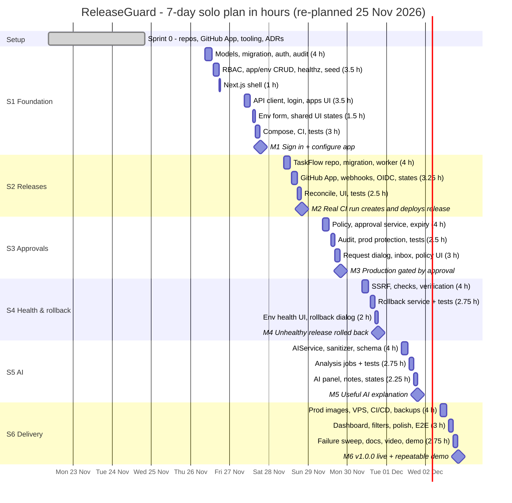

# ReleaseGuard: Project Plan

| Item | Value |
|---|---|
| Team | 1 full-stack developer (owns frontend, backend, DevOps and AI) |
| Duration | 7 working days, Thu 26 Nov – Wed 2 Dec 2026 (weekend included), 6 sprints: Sprint 1 is 2 days, Sprints 2–6 are 1 day each (re-planned in hours on 25 Nov 2026; was 12 weeks) |
| Working hours | 09:00–20:00 every day, break 13:00–14:00 = **10 focused hours a day, 70 h in total** |
| Planned work | **63.25 h** of Tasks (each ≤ 2 h, estimated next to its checkbox) + 1.5 h of sprint closes = 64.75 h, leaving **≈ 5 h buffer** ([timetable](#daily-timetable)) |
| Planned start | Sun 22 Nov 2026, Sprint 0 (closed Tue 24 Nov) |
| Target finish | **Wed 2 Dec 2026, 20:00**, MVP `v1.0.0` + live demo (was Fri 19 Feb 2027; see the note under §3) |
| Spec | [ReleaseGuard_Project_Specification.pdf](../ReleaseGuard_Project_Specification.pdf) |
| Team reference | [DEVELOPMENT_LIFECYCLE.md](DEVELOPMENT_LIFECYCLE.md) (architecture, stack, data model, process) |

---

## 1. Goal

Deliver **one convincing end-to-end release path** for the TaskFlow sample app:

```text
register release → deploy to staging → request production → reviewer approves
→ dispatch GitHub Actions → verify health → (unhealthy) → manual rollback to prior digest
```

Everything must be **real**: real GitHub Actions runs, real GHCR images, real HTTP health checks. Each sprint ends with a working slice that can be demoed. The project is "done" when every [MVP acceptance criterion](#7-mvp-acceptance-checklist) is met and the [demo script](DEVELOPMENT_LIFECYCLE.md#172-demo-script--10-minutes) runs end to end on the deployed instance.

---

## 2. Scope

### In v1
- One workspace with multiple users and 4 roles (Admin, Developer, Reviewer, Viewer)
- GitHub repository integration only, through a GitHub App
- Development, staging and production environments
- Docker target apps and GHCR image references (by **digest**)
- Release registration and deployment history
- Production approval and rejection, plus an audit log
- HTTP health checks and environment health status
- Manual rollback to an earlier successful artifact
- AI failure summaries and basic release notes
- Docker Compose deployment of ReleaseGuard to one VPS

### Not in v1
Kubernetes · multiple CI/CD or cloud providers · canary and blue-green · automatic rollback · enterprise multi-tenancy and a policy language · distributed tracing and centralized logging.

### Later extensions (backlog only)
Kubernetes target · canary and blue-green · email and chat notifications · release windows and change freezes · two-person approval and staging soak-time rules · Prometheus and Grafana · automatic rollback recommendations.

---

## 3. Timeline



> **Schedule change (24 Nov 2026, superseded by the 25 Nov re-plan below):** Sprint 0 ran over and was extended to Wed 25 Nov. Sprints 1–6 were planned in Jira up front the same day (Epics SCRUM-12…17, Tasks SCRUM-18…109, board sprints with these dates). Structural changes from the checklist: the `health_checks` migration is part of SCRUM-68, "never change the original failed deployment" is part of SCRUM-71, "status vs. health visually distinct" is part of SCRUM-74, and `compare_deployment_failures` is its own `p2` Task (SCRUM-85).

> **Re-plan in hours (25 Nov 2026):** the whole project must finish within 7 days, so the MVP moved from Fri 19 Feb 2027 to **Wed 2 Dec 2026**. All scope is kept (Epics SCRUM-12…17, Tasks SCRUM-18…109). The day-based sizing (≤ 2 days per Task, about 60 working days) was replaced by **hour estimates (≤ 2 h per Task, 63.25 h in total)** against **10 focused hours a day, 7 days a week** (70 h). The estimates assume Claude Code writes the code and tests and the developer reviews, tests by hand and merges, with related Tasks completed **in bulk** (one PR per time block, about 3 PRs a day, per `git-workflow.md`). Sprint dates in Jira already match (board sprints 5–10). There are no holidays in the window. The [cut list](#6-buffer-risks-and-cut-list) is back to its normal role: it applies when a day overruns its buffer.

### Daily timetable

Every day runs 09:00–13:00 and 14:00–20:00. Each sprint ends with a 15-minute close (self-demo, `v0.N.0` tag, retro draft). **Buffer rolls forward:** when a sprint's last Task is Done early, the next sprint starts at once (`jira-workflow.md` §7), so unused time on Thu–Fri covers the zero-buffer Saturday.

| Day | Sprint | Time blocks → Tasks | Planned | Buffer |
|---|---|---|---|---|
| Wed 25 Nov | S1 (head start) | SCRUM-26 Next.js shell, if time allows (frees 1 h on Thu) | 1 h | — |
| Thu 26 Nov | S1 Foundation | 09:00–13:00 SCRUM-19, 20, 22 · 14:00–17:30 SCRUM-21, 23, 24, 25 · 17:30–18:30 SCRUM-26 | 8.5 h | 1.5 h |
| Fri 27 Nov | S1 Foundation | 09:00–12:30 SCRUM-27, 28, 30 · 14:00–15:30 SCRUM-31, 29 · 15:30–18:30 SCRUM-32, 33, 34 · 18:30 close → `v0.1.0` | 8 h + 15 min | 1.75 h |
| Sat 28 Nov | S2 Releases | 09:00–13:00 SCRUM-35, 40, 38, 39, 36, 41, 52, 43 · 14:00–17:15 SCRUM-44, 45, 37, 42, 46 · 17:15–19:45 SCRUM-47, 48, 49, 50, 51, 53 · 19:45 close → `v0.2.0` | 9.75 h + 15 min | 0 |
| Sun 29 Nov | S3 Approvals | 09:00–13:00 SCRUM-54, 55, 56, 57 · 14:00–16:30 SCRUM-58, 59, 64, 65, 66 · 16:30–19:30 SCRUM-60, 61, 62, 63 · 19:30 close → `v0.3.0` | 9.5 h + 15 min | 15 min |
| Mon 30 Nov | S4 Health & rollback | 09:00–13:00 SCRUM-67, 68, 69, 70, 72, 73 · 14:00–16:45 SCRUM-71, 77 · 16:45–18:45 SCRUM-74, 75, 76 · 18:45 close → `v0.4.0` | 8.75 h + 15 min | 1 h |
| Tue 1 Dec | S5 AI | 09:00–13:00 SCRUM-78, 79, 80, 81, 82, 83, 87 · 14:00–16:45 SCRUM-84, 86, 91, 92 · 16:45–19:00 SCRUM-88, 89, 90, 85 (stretch, last) · 19:00 close → `v0.5.0` | 9 h + 15 min | 45 min |
| Wed 2 Dec | S6 Delivery | 09:00–13:00 SCRUM-93, 94, 96, 95, 97, 105 · 14:00–17:00 SCRUM-99, 100, 101, 102, 103 · 17:00–19:45 SCRUM-104, 106, 107, 109, 108 · 19:45 close → **`v1.0.0`** | 9.75 h + 15 min | 0 |
| **Total** | | SCRUM-98 (Prometheus/Grafana, 30 min) is done only if buffer is left (cut list #2) | **64.75 h of 70 h** | **≈ 5.25 h** |

> **Design revision (23 Nov 2026):** the checklists below follow the reviewed architecture ([ARCHITECTURE_REVIEW.md](ARCHITECTURE_REVIEW.md), ADRs 0001–0007). The main changes: the worker and jobs table move to **S2** (staging dispatch needs them), TaskFlow has **one `deploy.yml`** (S4 needs no rollback workflow), approvals live on the deployment (no `approval_requests` or `rollback_events` tables), and releases register through **GitHub OIDC**.

---

## 4. Sprint breakdown

Each Task carries its estimate in hours next to its key, *(1 h)*; each sprint heading shows its working hours and planned load against capacity (10 h a day; see the [timetable](#daily-timetable)). Every sprint ends with a tagged release (`v0.N.0`), a 10-minute self-demo recording or notes, and a short retro note in `docs/retros/`.

### Sprint 0: Setup (Sun 22 – Tue 24 Nov 2026, extended; closed Tue 24 Nov) · Epic SCRUM-5 ✓
- [x] SCRUM-6 Create the `releaseguard` repo (monorepo layout per [section 5.6 of the guide](DEVELOPMENT_LIFECYCLE.md#56-repository-layout)) and a separate `taskflow` repo
- [x] SCRUM-7 Protect `main` (ruleset `protect-main`, [infra/README.md](../infra/README.md#github-repository-settings)), add PR template, labels, and the Jira `SCRUM` board with the Sprint 0 Epic (the Epics, Tasks and board sprints for Sprints 1–6 are then created up front in one pass; see [§5](#5-work-tracking))
- [x] SCRUM-8 Register a **development GitHub App** (Actions: read/write, Contents: read, Metadata: read; webhook event `workflow_run` only). Steps: [GITHUB_APP_SETUP.md](GITHUB_APP_SETUP.md)
- [x] SCRUM-9 Set up a webhook tunnel (smee.io or cloudflared). *smee.io chosen; runbook in [GITHUB_APP_SETUP.md](GITHUB_APP_SETUP.md#run-the-webhook-tunnel).*
- [x] SCRUM-10 `pre-commit` with Ruff, ESLint, Prettier and gitleaks; `.editorconfig`; `.env.example`
- [x] SCRUM-11 Write ADR-0001 (modular monolith) and ADR-0002 (deploy by digest). *Drafted 23 Nov in [docs/adr/](adr/) together with ADRs 0003–0007 from the architecture review; final review 24 Nov.*

---

### Sprint 1: Foundation (Thu 26 – Fri 27 Nov 2026, 09:00–20:00 · 18 h planned of 20 h) → `v0.1.0` · Epic SCRUM-12
**Goal:** a user can sign in, create an application and configure its three environments.

**Backend**
- [x] SCRUM-18 FastAPI app skeleton: `core/config.py` (pydantic-settings), `core/security.py`, `core/permissions.py`, the `api/v1` router layout, a standard error shape, and the **Origin-check CSRF middleware** ([ADR-0007](adr/0007-server-side-sessions-and-csrf.md))
- [x] SCRUM-19 *(2 h)* SQLAlchemy 2.0 models and the first Alembic migration: `users`, `workspaces`, `workspace_members`, `sessions`, `applications`, `environments` (health fields + `policy` JSONB + health state), `audit_logs` with the **append-only trigger**; `workspace_id` and composite FKs on every tenant table
- [x] SCRUM-20 *(1.5 h)* Auth: argon2id, server-side sessions (hashed id, idle and absolute timeout, rotate on login), `HttpOnly`/`Secure`/`SameSite=Lax` cookie, login, logout and `me`
- [x] SCRUM-21 *(1 h)* RBAC dependency: `require_role(Role.ADMIN, …)` plus workspace scoping on every query
- [x] SCRUM-22 *(30 min)* Audit log helper, `record_audit(actor, action, target, details)`, used by every state-changing service
- [x] SCRUM-23 *(1.5 h)* Application CRUD and archive; environment CRUD (auto-create dev, staging and prod with default policies: dev auto-deploy, staging promote from dev, prod requires approval and promotes from staging)
- [x] SCRUM-24 *(30 min)* `/healthz` and `/readyz`; request-ID middleware; structlog JSON logging
- [x] SCRUM-25 *(30 min)* Seed script (1 workspace, 4 users, TaskFlow app)
- [ ] SCRUM-110 *(1.5 h)* Login throttling (found in SCRUM-20): `login_attempts` table, 5 failures per (email, IP) and 30 per IP in 15 min → 429 `too_many_attempts` + `Retry-After`; unknown emails throttled the same; `X-Forwarded-For` trusted only from Caddy

**Frontend**
- [x] SCRUM-26 *(1 h)* Next.js App Router + TypeScript + Tailwind + shadcn/ui; layout with sidebar and top bar
- [ ] SCRUM-27 *(1 h)* API client in `services/`, types generated from OpenAPI (`openapi-typescript`), TanStack Query
- [ ] SCRUM-28 *(1 h)* Login page; auth guard; dashboard placeholder
- [ ] SCRUM-30 *(1.5 h)* Applications list (search, create, archive) and application details with environments tab
- [ ] SCRUM-31 *(1 h)* Environment settings form (health URL, expected status, interval, timeout, threshold, verification rule)
- [ ] SCRUM-29 *(30 min)* Shared empty, loading, error and permission-denied components

**DevOps**
- [ ] SCRUM-32 *(30 min)* `infra/docker-compose.yml` for local development (db, backend, frontend)
- [ ] SCRUM-33 *(1 h)* `ci.yml`: Ruff, mypy, pytest (Postgres service), ESLint, `tsc`, `next build`, Alembic check

**Tests**
- [ ] SCRUM-34 *(1.5 h)* Unit tests for permission rules; API tests for login, RBAC (allowed and denied), **cross-workspace isolation**, a state-changing request with a foreign `Origin` (403), and an `UPDATE` on `audit_logs` being refused

**Definition of done:** a user signs in, creates TaskFlow and configures its three environments. A Viewer cannot edit. Another workspace's data cannot be reached. CI is green.

---

### Sprint 2: Releases and tracking (Sat 28 Nov 2026, 09:00–20:00 · 9.75 h planned of 10 h) → `v0.2.0` · Epic SCRUM-13
**Goal:** a real CI run in the TaskFlow repo registers a release, ReleaseGuard deploys it to dev automatically and to staging on request, and both deployments are tracked live.

**TaskFlow (sample app repo)**
- [ ] SCRUM-35 *(30 min)* Minimal web app with `/health` (an env flag can force it to return HTTP 503, for the failure demo) and a Dockerfile
- [ ] SCRUM-38 *(45 min)* `ci.yml`: lint, test, Trivy, build, push to GHCR, capture **digest**, register the release with an **OIDC token** (`id-token: write`, audience `GITHUB_OIDC_AUDIENCE`)
- [ ] SCRUM-40 *(30 min)* `deploy.yml` for **every** environment (`workflow_dispatch`; inputs `release_id`, `image_digest`, `environment`, `deployment_id`; `run-name: deploy-${{ inputs.deployment_id }}`; job `environment: ${{ inputs.environment }}`; pull by digest and check it)
- [ ] SCRUM-39 *(30 min)* Deploy target: TaskFlow Compose projects per environment on the VPS (or a free container host) over SSH, pulling by digest

**Backend and worker**
- [ ] SCRUM-36 *(30 min)* Migration: `releases`, `deployments` (incl. the **partial unique index** on active statuses), `deployment_events` (append-only), `integrations`, `webhook_deliveries`, `jobs`
- [ ] SCRUM-41 *(45 min)* Worker: entrypoint and container, job runner (`FOR UPDATE SKIP LOCKED`, backoff, `dead` after `max_attempts`), sweep loop ([ADR-0004](adr/0004-postgres-jobs-table.md))
- [ ] SCRUM-44 *(45 min)* GitHub App service: JWT → installation token (cached), `httpx` + `tenacity`; **dispatch job** with `return_run_details`, storing run id and URL
- [ ] SCRUM-45 *(45 min)* `POST /github/webhooks`: **HMAC-SHA256 validation with constant-time compare** before parsing, delivery-ID idempotency, run matching (repo, workflow, `run-name`)
- [ ] SCRUM-37 *(30 min)* Release registration: `POST /releases/ci` (OIDC verification against JWKS, claim binding to repository id, workflow and SHA) and manual `POST /releases`; unique `(application_id, version)`
- [ ] SCRUM-42 *(45 min)* `deployment_service` with the **state machine** (`ALLOWED_TRANSITIONS`, `transition()` that writes events and audit entries and enqueues follow-up jobs); `current_deployment_id` set on entering Verifying
- [ ] SCRUM-46 *(30 min)* Auto-deploy on release (dev policy) and `POST /deployments` for staging; Verifying → Succeeded is immediate until verification lands in S4
- [ ] SCRUM-47 *(30 min)* Reconcile sweep: read stuck runs from the API; `run_not_found` after `DISPATCH_TIMEOUT_SECONDS`
- [ ] SCRUM-43 *(15 min)* GitHub integration connect and disconnect (installation callback, store `installation_id`)

**Frontend**
- [ ] SCRUM-48 *(30 min)* Releases list and release details (version, SHA, digest, source, workflow link, deployments)
- [ ] SCRUM-49 *(30 min)* Deployment list (recent, per environment) and deployment details with **state timeline**; poll active deployments
- [ ] SCRUM-50 *(15 min)* Settings → GitHub integration page

**Tests**
- [ ] SCRUM-51 *(15 min)* Unit: every allowed transition plus every forbidden pair
- [ ] SCRUM-53 *(30 min)* Integration: webhook with a valid signature, an invalid signature, a duplicate delivery and an out-of-order event; OIDC token valid, expired, wrong audience and wrong repository; dispatch timeout → retried → exhausted → Failed; reconcile → `run_not_found`; a second active deployment refused by the index (409)
- [ ] SCRUM-52 *(15 min)* GitHub API mocked with `respx`, OIDC with a local JWKS; no real GitHub calls in CI

**Definition of done:** a push to TaskFlow registers a release with SHA and digest, dev deploys automatically, requesting staging dispatches `deploy.yml`, and both statuses show up live.

---

### Sprint 3: Approval engine (Sun 29 Nov 2026, 09:00–20:00 · 9.5 h planned of 10 h) → `v0.3.0` · Epic SCRUM-14
**Goal:** a production deployment **cannot** proceed without the required approval.

**Backend**
- [ ] SCRUM-54 *(45 min)* Migration: `approval_decisions` (`UNIQUE (deployment_id, reviewer_id)`); workspace setting `block_self_approval`; environment policy validated by a Pydantic model (`requires_approval`, `min_approvals`, `approval_ttl_hours`, `require_comment`, `promote_from_environment_id`, `rollback_requires_approval`) and editable by Admins
- [ ] SCRUM-55 *(2 h)* `approval_service`:
  - [ ] preconditions: release has a digest, a **Succeeded deployment in the `promote_from` environment**, requester role
  - [ ] request → Awaiting approval with `policy_snapshot`, `approval_expires_at` and `base_deployment_id`
  - [ ] decide: reviewer role, request unexpired and **not stale**, one decision per reviewer, self-approval rule, required comment
  - [ ] **one transaction:** record decision → (if `min_approvals` reached) transition to Queued → insert dispatch job
  - [ ] rejection → Rejected, no dispatch
- [ ] SCRUM-56 *(30 min)* Expiry sweep → Expired
- [ ] SCRUM-57 *(45 min)* `Idempotency-Key` on `POST /deployments`; `POST /deployments/{id}/cancel` (Awaiting approval and Queued only)
- [ ] SCRUM-58 *(30 min)* Audit events: requested, approved, rejected, cancelled, expired, dispatched, finished

**TaskFlow**
- [ ] SCRUM-59 *(15 min)* GitHub `production` environment protection for `deploy.yml` (deployment-branch rule, required reviewers if the plan allows) as a second layer

**Frontend**
- [ ] SCRUM-60 *(45 min)* "Request deployment" with a confirmation dialog for production, showing promotion evidence
- [ ] SCRUM-61 *(1 h)* **Approvals inbox:** pending list, release evidence (commit, digest, promotion result), approve and reject with comment
- [ ] SCRUM-62 *(30 min)* Environment policy form (Admin)
- [ ] SCRUM-63 *(45 min)* Approver identity and time on deployment details; audit log view

**Tests**
- [ ] SCRUM-64 *(30 min)* Developer cannot approve; Reviewer from another workspace gets 404; self-approval blocked when enabled
- [ ] SCRUM-65 *(45 min)* Expired and stale requests refused; a second decision by the same reviewer refused; approving while another deployment is active returns 409; `min_approvals = 2` needs two reviewers
- [ ] SCRUM-66 *(30 min)* Same `Idempotency-Key` returns the same deployment; cancel after dispatch returns 409

**Definition of done:** as a Developer, request production → blocked until a Reviewer approves → the workflow is dispatched and the full audit trail is visible.

---

### Sprint 4: Health and rollback (Mon 30 Nov 2026, 09:00–20:00 · 8.75 h planned of 10 h) → `v0.4.0` · Epic SCRUM-15
**Goal:** a failed or unhealthy release can be replaced by an earlier known-good artifact.

**Worker**
- [ ] SCRUM-67 *(1 h)* **SSRF guard** for health URLs (scheme allowlist, private-address block unless `HEALTH_CHECK_ALLOW_PRIVATE`, no redirects), checked on save and before every request
- [ ] SCRUM-68 *(1 h)* Migration `health_checks` + scheduled checks via `environments.next_check_at`; write `health_checks` rows; update `health_status` and `consecutive_failures`
- [ ] SCRUM-69 *(1 h)* Verification job: `verify_successes` passes within `verify_timeout_seconds` → **Succeeded**; `failure_threshold` consecutive failures or the timeout → **Unhealthy**
- [ ] SCRUM-70 *(30 min)* Retention sweep (scheduled checks 14 days, `done` jobs 7 days)

**Backend**
- [ ] SCRUM-71 *(1.5 h)* `rollback_service`: candidates (releases that **succeeded in this environment**, with a digest, not current), permission, eligibility, `rollback_requires_approval`, new deployment `operation_type=rollback` with `rollback_of_deployment_id` and `reason`, dispatched through the same `deploy.yml`; **never changes the original failed deployment**
- [ ] SCRUM-72 *(15 min)* `POST /environments/{id}/health/check-now` (enqueue)

**TaskFlow**
- [ ] SCRUM-73 *(15 min)* A "bad" release that is ready to go: `/health` returns 503

**Frontend**
- [ ] SCRUM-74 *(1 h)* Environment details: health badge, check history (table or sparkline), current release, **version comparison across environments**; keeps **deployment status** and **environment health** visually distinct
- [ ] SCRUM-75 *(30 min)* Rollback dialog: current vs. target version, reason field, explicit confirmation
- [ ] SCRUM-76 *(30 min)* Deployment details: health checks tab; links between failed and rollback deployments

**Tests**
- [ ] SCRUM-77 *(1.25 h)* Threshold logic (a single transient failure doesn't flip state); verification timeout; SSRF-blocked URL; rollback to an ineligible target rejected; rollback workflow failure; concurrent rollback returns 409; retention keeps verification checks

**Definition of done:** deploy the bad release to production → it ends Unhealthy and the environment turns unhealthy → roll back to the earlier digest → health is restored. History shows both deployments.

---

### Sprint 5: AI assistant (Tue 1 Dec 2026, 09:00–20:00 · 9 h planned of 10 h) → `v0.5.0` · Epic SCRUM-16
**Goal:** a failed deployment shows a useful AI explanation without controlling any operations.

**Backend and worker**
- [ ] SCRUM-78 *(45 min)* `AIService` interface plus one provider adapter (configured through `AI_PROVIDER`, `AI_MODEL`)
- [ ] SCRUM-79 *(1 h)* **Log sanitizer:** redact tokens, keys, passwords, connection strings, emails and private keys; cap the size; pick relevant excerpts (failed step and its surrounding lines)
- [ ] SCRUM-80 *(30 min)* Fetch failed job logs through the GitHub API (installation token, worker only)
- [ ] SCRUM-81 *(30 min)* Prompt that treats logs as **untrusted data** (delimited, with instructions not to follow embedded text)
- [ ] SCRUM-82 *(30 min)* Pydantic schema for the structured response; reject and store "unavailable" on invalid output
- [ ] SCRUM-83 *(30 min)* Migration: `ai_failure_reports` (`status`, `model_provider`, `model_id`, `analysis_version`, evidence)
- [ ] SCRUM-84 *(1 h)* `analyze_deployment_failure`, `summarize_pipeline_logs`, `generate_release_notes`
- [ ] SCRUM-85 *(30 min)* `compare_deployment_failures` (**stretch**, cut list #1)
- [ ] SCRUM-86 *(30 min)* Runs as `ai_analysis` / `ai_release_notes` jobs, auto-enqueued on Failed or Unhealthy; a deployment never waits on AI
- [ ] SCRUM-87 *(15 min)* Authorization: users see analysis only for deployments in their workspace

**Frontend**
- [ ] SCRUM-88 *(1 h)* AI analysis panel on failed or unhealthy deployments: summary, category, severity, probable cause (labeled **"AI-generated hypothesis"**), evidence excerpts, recommendations
- [ ] SCRUM-89 *(15 min)* "Generate release notes" on release details
- [ ] SCRUM-90 *(30 min)* States for unavailable, in progress and retry

**Tests**
- [ ] SCRUM-91 *(45 min)* Sanitizer unit tests (secrets never leave the system); schema validation for good and bad payloads
- [ ] SCRUM-92 *(30 min)* Provider timeout → deployment flow unaffected; prompt-injection fixture text doesn't change the output schema

**Definition of done:** the unhealthy TaskFlow deployment from S4 shows a structured, sensible explanation. With AI disabled, everything else still works.

---

### Sprint 6: DevOps delivery and polish (Wed 2 Dec 2026, 09:00–20:00 · 9.75 h planned of 10 h; SCRUM-98 only from buffer) → `v1.0.0` · Epic SCRUM-17
**Goal:** the platform is deployed and the end-to-end demo can be repeated.

**DevOps**
- [ ] SCRUM-93 *(45 min)* Multi-stage production Dockerfiles (backend, worker, frontend `output: standalone`), non-root users
- [ ] SCRUM-94 *(45 min)* Production `docker-compose.yml`: proxy (Caddy, automatic TLS, `/` → frontend and `/api` → backend on **one origin**), frontend, backend, worker, db (named volume, not exposed publicly)
- [ ] SCRUM-96 *(1 h)* `release.yml`: build → **Trivy (fail on HIGH/CRITICAL)** → push to GHCR → SSH deploy (`compose pull`, `alembic upgrade head`, `up -d`) → smoke test `/healthz`
- [ ] SCRUM-95 *(30 min)* Production GitHub App registration and secrets on the VPS (`chmod 600` env file)
- [ ] SCRUM-97 *(45 min)* `infra/scripts/backup.sh` (nightly `pg_dump`, retention, off-host copy) and `restore.sh`. **Run one restore test.**
- [ ] SCRUM-98 *(30 min)* Optional: Prometheus `/metrics` and a Grafana dashboard

**Product polish**
- [ ] SCRUM-99 *(1 h)* Dashboard: summary cards, env × app matrix, recent activity, pending approvals, failed deployments, dead jobs, success rate over a date range
- [ ] SCRUM-100 *(30 min)* Deployment history filters (app, env, status, actor, date)
- [ ] SCRUM-101 *(30 min)* Consistent status vocabulary and colors; empty, loading, error and permission-denied states everywhere
- [ ] SCRUM-102 *(15 min)* UTC storage and local-time rendering checked

**Quality**
- [ ] SCRUM-103 *(45 min)* Playwright E2E: login → request → approve → status updates → rollback UI
- [ ] SCRUM-104 *(45 min)* Failure-path test sweep (GitHub timeout, lost webhook, duplicate webhook, rejected approval, unhealthy endpoint, rollback failure)
- [ ] SCRUM-105 *(15 min)* Coverage report; Trivy report (secrets removed)

**Documentation and portfolio**
- [ ] SCRUM-106 *(30 min)* README: architecture diagram, features, local setup, demo credentials (non-production)
- [ ] SCRUM-107 *(15 min)* ER diagram, API docs link, TaskFlow workflow docs
- [ ] SCRUM-108 *(45 min)* Screenshots and a 3–5 minute walkthrough video (approvals, failure, AI, rollback)
- [ ] SCRUM-109 *(30 min)* Rehearse the [demo script](DEVELOPMENT_LIFECYCLE.md#172-demo-script--10-minutes) twice on the live instance

**Definition of done:** all [MVP acceptance criteria](#7-mvp-acceptance-checklist) are checked, and the live instance runs the full demo.

---

## 5. Work tracking

### Board
Jira project **`SCRUM`** is the only work tracker (one board sprint plus one Epic per sprint, one Task per checklist item, everything assigned to the owner; see [`.claude/rules/jira-workflow.md`](../.claude/rules/jira-workflow.md)). Board columns: **To Do → In Progress → Done** (no In Review column: a Task stays *In Progress* until its PR is merged). GitHub is used for code, PRs and Actions runs only. A ticket moves to *In Progress* only when it meets the [Definition of Ready](DEVELOPMENT_LIFECYCLE.md#143-definition-of-ready-dor), and to *Done* only when it meets the [Definition of Done](DEVELOPMENT_LIFECYCLE.md#144-definition-of-done-dod).

### How the work flows
1. **All sprints are planned once, up front.** Every sprint's Epic, its Tasks (one per checkbox below) and its board sprint are created in Jira in a single approved pass. Each key is written next to its checkbox.
2. **Sprints run one at a time.** Only the current board sprint is active; the rest wait in the *future* state.
3. **Every day, Claude plans the day.** In the first session of each new date, Claude picks about a day's worth of unblocked Tasks from the active sprint, labels them `today` in Jira (JQL `project = SCRUM AND labels = today`) and rewrites the "Today" block below.
4. **Each Task starts in plan mode.** The developer opens a Task in plan mode; Claude writes the plan, and the Task moves to *In Progress* once the plan is approved.
5. **Git per Task:** one branch and one PR per Task, branched from `main` (never stacked on another Task branch). When the developer asks to complete several Tasks in bulk, they share one branch and one PR that lists every key. Commit after each working step, push at the end of every session (with a draft PR from the first push), and the developer rebase-merges by hand once CI is green and the reviews pass (Claude never merges). Full rhythm in [`git-workflow.md`](../.claude/rules/git-workflow.md#daily-git-rhythm).
6. **Done is automatic.** Claude ticks the Task's checkbox inside its own PR (`main` is protected), then moves the Task to *Done* as soon as it passes `/dod-check` and the PR is merged. When the sprint's last Task is Done, Claude closes the Epic and the board sprint, starts the next sprint, and drafts the retro.

### Today
<!-- Claude rewrites this block in the first session of each day (jira-workflow.md §4). -->
- **Date:** Wed 25 Nov 2026
- **Done today:** SCRUM-18 Backend skeleton (PR #10) · SCRUM-26 Next.js App Router shell (PR #12) · bulk SCRUM-19…25 (PR #14): SCRUM-19 models + first migration · SCRUM-24 health endpoints, request id, JSON logging · SCRUM-22 `record_audit` · SCRUM-20 auth (argon2id, sessions, login/logout/me) · SCRUM-21 RBAC + scoping · SCRUM-23 application + environment CRUD · SCRUM-25 seed script
- **Today's Tasks:** bulk SCRUM-19…25 (Thu's 09:00–17:30 backend blocks, started a day early; one PR). SCRUM-22/23 lines corrected to match Jira (22 = audit helper, 23 = CRUD)
- **Carried over:** none
- **Blocked:** none
- **Next:** SCRUM-110 (login throttling, added from the SCRUM-20 review), then SCRUM-27, 28 (API client, login page; see the [timetable](#daily-timetable))
- **Schedule:** on plan. Re-planned in hours on 25 Nov: 63.25 h of Tasks in 70 h (10 h a day, Thu 26 Nov – Wed 2 Dec), ≈ 5 h buffer. Sprint 1: 9.5 h left of 20 h (SCRUM-26 and the 7.5 h SCRUM-19…25 bulk done a day early, merged in PR #14; SCRUM-110 adds 1.5 h)

### Labels
| Group | Labels |
|---|---|
| Area | `area:api` `area:web` `area:worker` `area:db` `area:github` `area:ai` `area:infra` `area:docs` |
| Type | `type:feature` `type:bug` `type:chore` `type:test` `type:spike` |
| Sprint | `sprint:0` … `sprint:6` |
| Priority | `p0` (MVP-critical) · `p1` (MVP) · `p2` (stretch / cut first) |

### Solo cadence
| When | What | Time |
|---|---|---|
| Once, before Sprint 1 | Up-front planning: review and approve every sprint's Tasks, then Claude creates them in Jira | 1–2 h |
| Daily, 09:00 (first session) | Claude picks today's Tasks (`today` label, about 10 h of estimates, following the [timetable](#daily-timetable)) and updates the "Today" block; you confirm or swap | 5 min |
| Per Task or time block | Start it in plan mode, approve the plan, build; one bulk PR per time block; Claude marks it Done when `/dod-check` passes | its estimate |
| 13:00 and 17:00 each day | Scope check against the timetable: a block more than 30 min over? Use the day's buffer; if none is left, apply the cut list now | 5 min |
| Sprint end (last 15 min of the sprint day) | Claude closes the sprint when its last Task is Done and starts the next at once; you demo to yourself (record it), tag `v0.N.0`, review the retro draft | 15 min |

---

## 6. Buffer, risks and cut list

### Buffer
About **5.25 h** (7.5%) in total: Thu 1.5 h, Fri 1.75 h, Sun 15 min, Mon 1 h, Tue 45 min; Sat and Wed have none (see the [timetable](#daily-timetable)). Buffer rolls forward because the next sprint starts as soon as the current one closes. Leftover time goes to SCRUM-98 (only if everything else is done), tests and docs, **not** to new features.

### Top delivery risks
| Risk | Early signal | Response |
|---|---|---|
| GitHub App and webhook setup takes longer than planned | S2 (Sat 28 Nov) 17:15 with no release registered | Release registration (OIDC) doesn't depend on webhooks; until webhooks work, the reconcile sweep reads run status from the API |
| S2 is the heaviest sprint (worker, GitHub App, OIDC, webhooks, state machine) and has no buffer | S2 (Sat 28 Nov) 17:15 with no run dispatched | Move manual `POST /releases` and the GitHub integration settings page to S3; keep the dispatch → webhook → timeline path |
| Deploy target for TaskFlow is unclear | S2 (Sat 28 Nov) 11:00 | Use the same VPS with separate compose projects per environment (`taskflow-dev/staging/prod`) |
| Hour estimates are too optimistic | A time block runs more than 30 min over, or a sprint is still open at 20:00 | Spend the day's buffer first; then apply the cut list in order; don't compress approval-engine work |
| AI output quality is poor | S5 (Tue 1 Dec) 16:45 | Narrow the input to the failed step's excerpt; add few-shot examples; keep the schema strict |
| VPS and TLS problems | S6 (Wed 2 Dec) 13:00 | Fall back to the provider's default domain; Caddy handles certificates |

### Cut list (apply in this order if the schedule slips)
1. `compare_deployment_failures()`: historical AI comparison
2. Prometheus and Grafana monitoring
3. Dashboard success-rate chart (keep the cards and tables)
4. Minimum-reviewer-count policy (keep single approval and the self-approval rule)
5. AI release notes (keep failure analysis)
6. Rollback approval policy (keep manual rollback with confirmation and reason)
7. Manual release registration (keep OIDC registration from CI)

**Never cut:** real GitHub Actions integration, digest-based deployment, backend RBAC and workspace isolation, the approval gate, the single-active-deployment constraint, health verification, manual rollback, the audit trail, webhook signature validation, OIDC release verification, the reconcile and expiry sweeps, the SSRF guard, backups.

---

## 7. MVP acceptance checklist

- [ ] **Application setup:** an admin can connect a GitHub repository and configure three environments.
- [ ] **Release registration:** a successful CI workflow creates a release record with commit SHA and image digest.
- [ ] **Staging:** a release can be deployed to staging through GitHub Actions, and its status appears in ReleaseGuard.
- [ ] **Production gate:** a developer cannot trigger production deployment until the required approval is recorded.
- [ ] **Auditability:** the system records who requested, approved, rejected and executed each deployment.
- [ ] **Health:** the system records HTTP health checks and marks the environment unhealthy after the failure threshold.
- [ ] **Rollback:** an authorized user can select an earlier successful artifact and trigger a new rollback deployment.
- [ ] **AI:** a failure detail page shows a structured explanation based on sanitized failure evidence.
- [ ] **Security:** workspace data is isolated, role checks run in the backend, and webhook signatures are validated.
- [ ] **Delivery:** ReleaseGuard runs through Docker Compose on a reachable environment, with a documented setup and backup procedure.

| Criterion | Delivered in |
|---|---|
| Application setup | S1 (+ GitHub connect in S2) |
| Release registration, Staging | S2 |
| Production gate, Auditability | S3 |
| Health, Rollback | S4 |
| AI | S5 |
| Security | S1–S3 (verified in S6) |
| Delivery | S6 |
