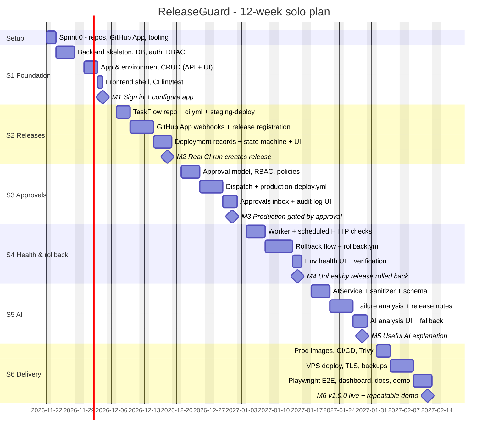

# ReleaseGuard: Project Plan

| Item | Value |
|---|---|
| Team | 1 full-stack developer (owns frontend, backend, DevOps and AI) |
| Duration | 12 weeks = 6 sprints × 2 weeks |
| Planned start | Sun 22 Nov 2026, Sprint 0 (shift all dates if the start changes) |
| Target finish | Fri 12 Feb 2027, MVP `v1.0.0` + live demo |
| Spec | [ReleaseGuard_Project_Specification.pdf](../ReleaseGuard_Project_Specification.pdf) |
| Team reference | [DEVELOPMENT_LIFECYCLE.md](DEVELOPMENT_LIFECYCLE.md) (architecture, stack, data model, process) |

---

## 1. Goal

Deliver **one convincing end-to-end release path** for the TaskFlow sample app:

```text
register release → deploy to staging → request production → reviewer approves
→ dispatch GitHub Actions → verify health → (unhealthy) → manual rollback to prior digest
```

Everything must be **real**: real GitHub Actions runs, real GHCR images, real HTTP health checks. Each sprint ends with a working slice that can be demoed. The project is "done" when every [MVP acceptance criterion](#7-mvp-acceptance-checklist) is met and the [demo script](DEVELOPMENT_LIFECYCLE.md#172-demo-script--10-minutes) runs end to end on the deployed instance.

---

## 2. Scope

### In v1
- One workspace with multiple users and 4 roles (Admin, Developer, Reviewer, Viewer)
- GitHub repository integration only, through a GitHub App
- Development, staging and production environments
- Docker target apps and GHCR image references (by **digest**)
- Release registration and deployment history
- Production approval and rejection, plus an audit log
- HTTP health checks and environment health status
- Manual rollback to an earlier successful artifact
- AI failure summaries and basic release notes
- Docker Compose deployment of ReleaseGuard to one VPS

### Not in v1
Kubernetes · multiple CI/CD or cloud providers · canary and blue-green · automatic rollback · enterprise multi-tenancy and a policy language · distributed tracing and centralized logging.

### Later extensions (backlog only)
Kubernetes target · canary and blue-green · email and chat notifications · release windows and change freezes · two-person approval and staging soak-time rules · Prometheus and Grafana · automatic rollback recommendations.

---

## 3. Timeline



> **Holidays:** Sprint 3 (21 Dec – 1 Jan) covers Christmas and New Year, and its milestone falls on New Year's Day. If you take time off, move every later date by the same amount rather than squeezing scope. Use the [cut list](#6-buffer-risks-and-cut-list) if the end date is fixed.

---

## 4. Sprint breakdown

Each sprint has about **8.5 working days of planned work and 1.5 days of buffer**. Every sprint ends with a tagged release (`v0.N.0`), a 10-minute self-demo recording or notes, and a short retro note in `docs/retros/`.

### Sprint 0: Setup (Sun 22 – Mon 23 Nov 2026)
- [ ] Create the `releaseguard` repo (monorepo layout per [section 5.5 of the guide](DEVELOPMENT_LIFECYCLE.md#55-repository-layout)) and a separate `taskflow` repo
- [ ] Protect `main`, add PR template (draft in `.github/pull_request_template.md`), labels, and the Jira `SCRUM` board with the Sprint 0 Epic (each later sprint's Epic is created when that sprint starts)
- [ ] Register a **development GitHub App** (Actions: read/write, Contents: read, Metadata: read, Deployments: read/write; webhook events `workflow_run` and `workflow_job`)
- [ ] Set up a webhook tunnel (smee.io or cloudflared)
- [ ] `pre-commit` with Ruff, ESLint, Prettier and gitleaks; `.editorconfig`; `.env.example`
- [ ] Write ADR-0001 (modular monolith) and ADR-0002 (deploy by digest)

---

### Sprint 1: Foundation (Tue 24 Nov – Fri 4 Dec) → `v0.1.0`
**Goal:** a user can sign in, create an application and configure its three environments.

**Backend**
- [ ] FastAPI app skeleton: `core/config.py` (pydantic-settings), `core/security.py`, `core/permissions.py`, the `api/v1` router layout, and a standard error shape
- [ ] SQLAlchemy 2.0 models and the first Alembic migration: `users`, `workspaces`, `workspace_members`, `applications`, `environments`, `audit_logs`
- [ ] Auth: argon2 password hashing, server-side sessions in Postgres, `HttpOnly` cookie, login, logout and `me` endpoints
- [ ] RBAC dependency: `require_role(Role.ADMIN, …)` plus workspace scoping on every query
- [ ] Application CRUD and archive; environment CRUD (auto-create dev, staging and prod with each app)
- [ ] Audit log helper, `record_audit(actor, action, target, details)`, used by every state-changing service
- [ ] `/healthz` and `/readyz`; request-ID middleware; structlog JSON logging
- [ ] Seed script (1 workspace, 4 users, TaskFlow app)

**Frontend**
- [ ] Next.js App Router + TypeScript + Tailwind + shadcn/ui; layout with sidebar and top bar
- [ ] API client in `services/`, types generated from OpenAPI (`openapi-typescript`), TanStack Query
- [ ] Login page; auth guard; dashboard placeholder
- [ ] Applications list (search, create, archive) and application details with environments tab
- [ ] Environment settings form (health URL, expected status, interval, timeout, threshold)
- [ ] Shared empty, loading, error and permission-denied components

**DevOps**
- [ ] `infra/docker-compose.yml` for local development (db, backend, frontend)
- [ ] `ci.yml`: Ruff, mypy, pytest (Postgres service), ESLint, `tsc`, `next build`

**Tests**
- [ ] Unit tests for permission rules; API tests for login, RBAC (allowed and denied) and **cross-workspace isolation**

**Definition of done:** a user signs in, creates TaskFlow and configures its three environments. A Viewer cannot edit. Another workspace's data cannot be reached. CI is green.

---

### Sprint 2: Releases and tracking (Mon 7 – Fri 18 Dec) → `v0.2.0`
**Goal:** a real CI run in the TaskFlow repo creates a release, and its staging deployment is visible in ReleaseGuard.

**TaskFlow (sample app repo)**
- [ ] Minimal web app with `/health` (an env flag can force it to return HTTP 503, for the failure demo) and a Dockerfile
- [ ] `ci.yml`: lint, test, Trivy, build, push to GHCR, capture **digest**, signed callback to ReleaseGuard
- [ ] `staging-deploy.yml` (`workflow_dispatch`, inputs: `release_id`, `image_digest`, `environment`, `deployment_id`; `run-name: deploy-${{ inputs.deployment_id }}`)
- [ ] Deploy target: TaskFlow containers on the VPS (or a free container host) over SSH, pulling by digest

**Backend**
- [ ] Migration: `releases`, `deployments`, `deployment_events`, `integrations`, `webhook_deliveries`
- [ ] GitHub App service: JWT → installation token (cached), `httpx` with `tenacity` retries
- [ ] `POST /github/webhooks`: **HMAC-SHA256 validation with constant-time compare**, delivery-ID idempotency, event routing
- [ ] Release registration (`POST /releases` callback and from `workflow_run` events); unique `(application_id, version)`
- [ ] `deployment_service` with the **state machine** (`ALLOWED_TRANSITIONS`, `transition()` that writes events and audit entries)
- [ ] Staging deployment request → dispatch `staging-deploy.yml` → `workflow_run` webhook moves the deployment to Deploying, then Verifying/Failed (Verifying → Succeeded is a stub until S4)
- [ ] GitHub integration connect and disconnect (installation callback, store `installation_id`)

**Frontend**
- [ ] Releases list and release details (version, SHA, digest, workflow link, deployments)
- [ ] Deployment history with filters (app, env, status, actor, date)
- [ ] Deployment details with **state timeline**
- [ ] Environment version comparison on application details
- [ ] Settings → GitHub integration page

**Tests**
- [ ] Unit: every allowed transition plus representative forbidden transitions
- [ ] Integration: webhook with a valid signature, an invalid signature, a duplicate delivery and an out-of-order event
- [ ] GitHub API mocked with `respx`; no real GitHub calls in CI

**Definition of done:** a push to TaskFlow creates a release with SHA and digest in ReleaseGuard. Requesting staging dispatches the workflow, and the status shows up live.

---

### Sprint 3: Approval engine (Mon 21 Dec – Fri 1 Jan) → `v0.3.0`
**Goal:** a production deployment **cannot** proceed without the required approval.

**Backend**
- [ ] Migration: `approval_requests`, `approval_decisions`; workspace setting `block_self_approval`, environment `approval_policy` (`required`, `min_reviewers`, `expires_after_hours`, `require_comment`)
- [ ] `approval_service`:
  - [ ] preconditions: release exists, image digest present, **successful staging deployment** of the same release
  - [ ] create request → deployment goes to *Awaiting approval*
  - [ ] decide: reviewer role, request still current and unexpired, no duplicate decision by the same reviewer, self-approval rule
  - [ ] **one transaction:** record decision → transition to Approved → enqueue dispatch (outbox row)
  - [ ] rejection → Rejected, no dispatch
  - [ ] expiry job → Expired
- [ ] Production dispatch from the outbox, with retries. Store `workflow_run_id` and URL.
- [ ] **Per-environment concurrency:** `pg_advisory_xact_lock` and a check for in-flight deployments (returns 409)
- [ ] `Idempotency-Key` support on `POST /deployments`
- [ ] Audit events: requested, approved, rejected, dispatched, started, finished

**TaskFlow**
- [ ] `production-deploy.yml` (`workflow_dispatch` only); checks that the digest matches the release; GitHub `production` environment protection as a second layer

**Frontend**
- [ ] "Request production deployment" with a confirmation dialog
- [ ] **Approvals inbox:** pending list, release evidence (commit, digest, staging result), approve and reject with comment
- [ ] Approver identity and time on deployment details; audit log view

**Tests**
- [ ] Developer cannot approve; Reviewer from another workspace cannot approve; self-approval blocked when enabled
- [ ] Expired and stale request rejected; double-approve is idempotent; concurrent production request returns 409
- [ ] GitHub dispatch timeout → retried → deployment stays consistent

**Definition of done:** as a Developer, request production → blocked until a Reviewer approves → the workflow is dispatched and the full audit trail is visible.

---

### Sprint 4: Health and rollback (Mon 4 – Fri 15 Jan) → `v0.4.0`
**Goal:** a failed or unhealthy release can be replaced by an earlier known-good artifact.

**Worker**
- [ ] Worker process (same codebase, own entrypoint and container) with APScheduler and a Postgres job table (`FOR UPDATE SKIP LOCKED`)
- [ ] Scheduled HTTP checks per environment (`httpx`, timeout, expected status); write `health_checks` rows
- [ ] Post-deploy verification: on workflow success → Verifying → N checks → **Succeeded** or **Unhealthy** (consecutive-failure threshold)
- [ ] Environment health state; failures linked to the deployment that last changed the environment

**Backend**
- [ ] Migration: `rollback_events`
- [ ] `rollback_service`: list candidates (earlier **Succeeded** releases with a digest), permission, eligibility, policy, concurrency checks, optional approval, new deployment `operation_type=rollback`, dispatch `rollback.yml`, link source → rollback → target
- [ ] Never change the original failed deployment

**TaskFlow**
- [ ] `rollback.yml` (redeploy the given digest)
- [ ] A "bad" release that is ready to go: `/health` returns 503

**Frontend**
- [ ] Environment details: health badge, check history (table or sparkline), current release
- [ ] Rollback dialog: current vs. target version, reason field, explicit confirmation
- [ ] Deployment details: health checks tab; links between failed and rollback deployments
- [ ] Keep **deployment status** and **environment health** visually distinct

**Tests**
- [ ] Threshold logic (a single transient failure doesn't flip state); unhealthy endpoint; rollback to an ineligible target rejected; rollback workflow failure; concurrent rollback returns 409

**Definition of done:** deploy the bad release to production → the environment turns Unhealthy → roll back to the earlier digest → health is restored. History shows both deployments.

---

### Sprint 5: AI assistant (Mon 18 – Fri 29 Jan) → `v0.5.0`
**Goal:** a failed deployment shows a useful AI explanation without controlling any operations.

**Backend and worker**
- [ ] `AIService` interface plus one provider adapter (configured through `AI_PROVIDER`, `AI_MODEL`)
- [ ] **Log sanitizer:** redact tokens, keys, passwords, connection strings, emails and private keys; cap the size; pick relevant excerpts (failed step and its surrounding lines)
- [ ] Fetch failed job logs through the GitHub API (installation token, backend only)
- [ ] Prompt that treats logs as **untrusted data** (delimited, with instructions not to follow embedded text)
- [ ] Pydantic schema for the structured response; reject and store "unavailable" on invalid output
- [ ] Migration: `ai_failure_reports` (+ `model_provider`, `analysis_version`)
- [ ] `analyze_deployment_failure`, `summarize_pipeline_logs`, `generate_release_notes`; `compare_deployment_failures` (**stretch**)
- [ ] Runs as an async worker job; a deployment never waits on AI
- [ ] Authorization: users see analysis only for deployments in their workspace

**Frontend**
- [ ] AI analysis panel on failed or unhealthy deployments: summary, category, severity, probable cause (labeled **"AI-generated hypothesis"**), evidence excerpts, recommendations
- [ ] "Generate release notes" on release details
- [ ] States for unavailable, in progress and retry

**Tests**
- [ ] Sanitizer unit tests (secrets never leave the system); schema validation for good and bad payloads
- [ ] Provider timeout → deployment flow unaffected; prompt-injection fixture text doesn't change the output schema

**Definition of done:** the unhealthy TaskFlow deployment from S4 shows a structured, sensible explanation. With AI disabled, everything else still works.

---

### Sprint 6: DevOps delivery and polish (Mon 1 – Fri 12 Feb 2027) → `v1.0.0`
**Goal:** the platform is deployed and the end-to-end demo can be repeated.

**DevOps**
- [ ] Multi-stage production Dockerfiles (backend, worker, frontend `output: standalone`), non-root users
- [ ] Production `docker-compose.yml`: proxy (Caddy, automatic TLS), frontend, backend, worker, db (named volume, not exposed publicly)
- [ ] `release.yml`: build → **Trivy (fail on HIGH/CRITICAL)** → push to GHCR → SSH deploy (`compose pull`, `alembic upgrade head`, `up -d`) → smoke test `/healthz`
- [ ] Production GitHub App registration and secrets on the VPS (`chmod 600` env file)
- [ ] `infra/scripts/backup.sh` (nightly `pg_dump`, retention, off-host copy) and `restore.sh`. **Run one restore test.**
- [ ] Optional: Prometheus `/metrics` and a Grafana dashboard

**Product polish**
- [ ] Dashboard: summary cards, env × app matrix, recent activity, pending approvals, failed deployments, success rate over a date range
- [ ] Consistent status vocabulary and colors; empty, loading, error and permission-denied states everywhere
- [ ] UTC storage and local-time rendering checked

**Quality**
- [ ] Playwright E2E: login → request → approve → status updates → rollback UI
- [ ] Failure-path test sweep (GitHub timeout, duplicate webhook, rejected approval, unhealthy endpoint, rollback failure)
- [ ] Coverage report; Trivy report (secrets removed)

**Documentation and portfolio**
- [ ] README: architecture diagram, features, local setup, demo credentials (non-production)
- [ ] ER diagram, API docs link, TaskFlow workflow docs
- [ ] Screenshots and a 3–5 minute walkthrough video (approvals, failure, AI, rollback)
- [ ] Rehearse the [demo script](DEVELOPMENT_LIFECYCLE.md#172-demo-script--10-minutes) twice on the live instance

**Definition of done:** all [MVP acceptance criteria](#7-mvp-acceptance-checklist) are checked, and the live instance runs the full demo.

---

## 5. Work tracking

### Board
Jira project **`SCRUM`** is the only work tracker (one Epic per sprint, one Task per checklist item; see [`.claude/rules/jira-workflow.md`](../.claude/rules/jira-workflow.md)). Board columns: **To Do → In Progress → In Review → Done**. GitHub is used for code, PRs and Actions runs only. A ticket moves to *In Progress* only when it meets the [Definition of Ready](DEVELOPMENT_LIFECYCLE.md#143-definition-of-ready-dor), and to *Done* only when it meets the [Definition of Done](DEVELOPMENT_LIFECYCLE.md#144-definition-of-done-dod).

### Labels
| Group | Labels |
|---|---|
| Area | `area:api` `area:web` `area:worker` `area:db` `area:github` `area:ai` `area:infra` `area:docs` |
| Type | `type:feature` `type:bug` `type:chore` `type:test` `type:spike` |
| Sprint | `sprint:0` … `sprint:6` |
| Priority | `p0` (MVP-critical) · `p1` (MVP) · `p2` (stretch / cut first) |

### Solo cadence
| When | What | Time |
|---|---|---|
| Sprint day 1 (Mon) | Planning: pull issues into Ready, size them to ≤ 2 days each | 45 min |
| Daily | Update the board; write a 3-line dev log (done, next, blocked) | 5 min |
| Mid-sprint (Wed, week 2) | Scope check: on track? If not, apply the cut list early | 15 min |
| Sprint last day (Fri) | Demo to yourself (record it), tag `v0.N.0`, retro note | 1 h |

---

## 6. Buffer, risks and cut list

### Buffer
About 1.5 days per sprint (~15%). Unused buffer goes to tests and docs, **not** to new features.

### Top delivery risks
| Risk | Early signal | Response |
|---|---|---|
| GitHub App and webhook setup takes longer than planned | S2 day 4 with no release registered | Temporarily use the authenticated callback from `ci.yml` only; add `workflow_run` webhooks later in S2 or S3 |
| Deploy target for TaskFlow is unclear | S2 day 2 | Use the same VPS with separate compose projects per environment (`taskflow-dev/staging/prod`) |
| Holiday weeks (S3) | Before 21 Dec (S3 start) | Move dates; don't compress approval-engine work |
| AI output quality is poor | S5 day 5 | Narrow the input to the failed step's excerpt; add few-shot examples; keep the schema strict |
| VPS and TLS problems | S6 day 3 | Fall back to the provider's default domain; Caddy handles certificates |

### Cut list (apply in this order if the schedule slips)
1. `compare_deployment_failures()`: historical AI comparison
2. Prometheus and Grafana monitoring
3. Dashboard success-rate chart (keep the cards and tables)
4. Minimum-reviewer-count policy (keep single approval and the self-approval rule)
5. AI release notes (keep failure analysis)
6. Rollback approval policy (keep manual rollback with confirmation and reason)

**Never cut:** real GitHub Actions integration, digest-based deployment, backend RBAC and workspace isolation, the approval gate, health verification, manual rollback, the audit trail, webhook signature validation, backups.

---

## 7. MVP acceptance checklist

- [ ] **Application setup:** an admin can connect a GitHub repository and configure three environments.
- [ ] **Release registration:** a successful CI workflow creates a release record with commit SHA and image digest.
- [ ] **Staging:** a release can be deployed to staging through GitHub Actions, and its status appears in ReleaseGuard.
- [ ] **Production gate:** a developer cannot trigger production deployment until the required approval is recorded.
- [ ] **Auditability:** the system records who requested, approved, rejected and executed each deployment.
- [ ] **Health:** the system records HTTP health checks and marks the environment unhealthy after the failure threshold.
- [ ] **Rollback:** an authorized user can select an earlier successful artifact and trigger a new rollback deployment.
- [ ] **AI:** a failure detail page shows a structured explanation based on sanitized failure evidence.
- [ ] **Security:** workspace data is isolated, role checks run in the backend, and webhook signatures are validated.
- [ ] **Delivery:** ReleaseGuard runs through Docker Compose on a reachable environment, with a documented setup and backup procedure.

| Criterion | Delivered in |
|---|---|
| Application setup | S1 (+ GitHub connect in S2) |
| Release registration, Staging | S2 |
| Production gate, Auditability | S3 |
| Health, Rollback | S4 |
| AI | S5 |
| Security | S1–S3 (verified in S6) |
| Delivery | S6 |
